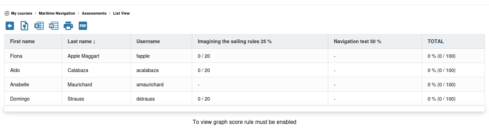
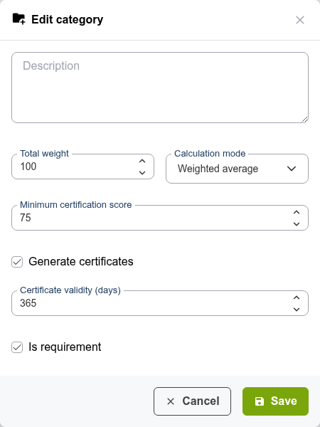

# Bewertungen

Die Bewertungen (früher *gradebook*) fassen Ergebnisse aus Übungen, Aufgaben und anderen benoteten Aktivitäten in einer einheitlichen Übersicht über die Leistung jeder lernenden Person zusammen. Sie steuern außerdem die Zertifikatserstellung.

## Funktionsweise der Bewertungen

Die Bewertungen sind gewichtete Bewertungssysteme. Sie legen fest:

1. **Welche Aktivitäten** in die Note einfließen (Übungen, Aufgaben, Anwesenheit usw.)
2. **Die Gewichtung** jeder Aktivität (wie stark sie zur Gesamtnote beiträgt)
3. **Die Mindestpunktzahl für die Zertifizierung** (der Schwellenwert für den Erwerb eines Zertifikats)
4. **Eine Mindestpunktzahl je Aktivität** — Jede Aktivität im Notenbuch kann eine eigene **Mindestpunktzahl** haben. Lernende, die bei einer zentralen Aktivität unter dieser Mindestpunktzahl liegen, können daran gehindert werden, die Ziele zu erreichen und das Zertifikat zu erwerben, auch wenn ihre gewichtete Gesamtpunktzahl ansonsten hoch genug wäre.

Aktivitäten können von zwei Arten sein:
* **Präsenzaktivität** (oder Aktivität vor Ort), bei der Noten aus einer anderen Quelle importiert werden müssen
* **Online-Aktivität**, die aus dem Kurs ausgewählt wird und deren Noten durch das Absolvieren der Aktivität im Kurs ermittelt werden

Chamilo berechnet die Gesamtnote jeder lernenden Person anhand dieser Gewichtungen.

## Einrichten der Bewertung

1. Öffnen Sie das Werkzeug **Bewertungen**  auf der Kursstartseite
2. Sie sehen die Bewertungsübersicht, die zunächst leer ist

### Aktivitäten hinzufügen

1. Klicken Sie auf **Online-Aktivität hinzufügen**
2. Wählen Sie den Typ:
   * **Test** — Verknüpfen Sie eine bestimmte Übung aus dem Kurs
   * **Aufgabe** — Verknüpfen Sie einen Ordner für studentische Veröffentlichungen
   * **Lernpfad** — Verknüpfen Sie den Abschluss eines Lernpfads
   * **Anwesenheit** — Verknüpfen Sie eine Anwesenheitsliste
   * **Forenthema** — Verknüpfen Sie ein Forenthema (das manuell benotet werden muss)
   * **Umfrage** — Verknüpfen Sie eine Umfrage
3. Wählen Sie die konkrete Aktivität innerhalb des gewählten Typs
4. Legen Sie die **Gewichtung** für diese Aktivität fest (z. B. 30 % für die Zwischenprüfung, 40 % für das Abschlussprojekt)
5. Legen Sie gegebenenfalls die **Mindestpunktzahl** fest
6. Speichern

Die Gesamtgewichtung aller Aktivitäten sollte 100 % ergeben.

### Unterkategorien

Für komplexe Benotungsschemata können Sie **Unterkategorien** erstellen, um zusammengehörige Aktivitäten zu gruppieren:

* **Beispiel**: Eine Unterkategorie „Hausaufgaben“ (Gewichtung: 30 %) mit fünf einzelnen Aufgaben, die jeweils 20 % der Unterkategorie ausmachen
* Unterkategorien ermöglichen eine hierarchische Organisation der Bewertung, während die Gesamtberechnung einfach bleibt

## Noten anzeigen

Die Bewertung zeigt eine Tabelle mit:

* dem Namen jeder lernenden Person
* den Ergebnissen jeder Aktivität
* dem gewichteten Gesamtwert
* der Angabe, ob die lernende Person für ein Zertifikat qualifiziert ist

Sie können nach jeder Spalte sortieren, um leistungsstarke oder unterstützungsbedürftige Lernende schnell zu erkennen.

### Diagramme zur Punkteverteilung

Unterhalb der Tabelle und auf der Seite **Grafische Ansicht** zeichnet die Bewertung ein Balkendiagramm
je Aktivität sowie eines für den Gesamtwert. Jedes Diagramm ist ein Säulendiagramm: Die
horizontale Achse listet Ihre Punktebereiche vom niedrigsten bis zum höchsten auf, und die
Höhe jedes Balkens entspricht der Anzahl der Lernenden in diesem Bereich.

Das Diagramm **Gesamt** markiert außerdem den Klassendurchschnitt. Ein roter Punkt liegt auf dem Bereich,
der den Durchschnitt enthält, und die Legende gibt den genauen Prozentsatz an.

Diese Diagramme erscheinen nur, wenn die Regeln für die Punkteanzeige festgelegt sind. Wenn Sie die
Meldung *To view graph score rule must be enabled* sehen, definieren Sie zuerst Ihre Bereiche
in den Bewertungseinstellungen der Bewertung.

## Zertifikate

So aktivieren Sie die Zertifikatserstellung:

1. Legen Sie in den Bewertungseinstellungen eine **Mindestpunktzahl für die Zertifizierung** fest (z. B. 70 %)
2. Wenn der gewichtete Gesamtwert einer lernenden Person diesen Schwellenwert erreicht oder überschreitet (und keine Mindestpunktzahl je Aktivität verfehlt wurde), kann das Zertifikat heruntergeladen werden
3. Das Zertifikat wird aus einer Vorlage erzeugt, die von der Plattformadministration konfiguriert wurde

Sobald **Zertifikate erzeugen** für die Stammkategorie aktiviert ist, erscheint das Feld **Gültigkeit des Zertifikats (Tage)**. Belassen Sie den Wert bei `0` für Zertifikate, die nie ablaufen, oder geben Sie eine Anzahl von Tagen an, nach der das Zertifikat abläuft — Chamilo kann die Lernenden dann an das nahende Ablaufdatum erinnern, entweder automatisch (Cron, von der Administration konfiguriert) oder manuell über die Zertifikatsliste.

Weitere Einzelheiten finden Sie unter [Zertifikate und Kompetenzen](../tracking-and-reporting/certificates-and-skills.md#certificate-validity-and-expiry).

## Verknüpfung mit Kompetenzen

Sie können der Bewertung **Kompetenzen** zuordnen. Wenn eine lernende Person die festgelegten Ziele zum Abschluss der Bewertung erreicht, kann sie ein Zertifikat, eine Kompetenz oder beides erhalten. Kompetenzen sind im Profil im Bereich des sozialen Netzwerks sichtbar. So entsteht im Laufe der Zeit ein Kompetenznachweis.

## Noten exportieren

Klicken Sie auf die Schaltfläche **Export** , um Noten als Tabellenkalkulation herunterzuladen. Dies ist nützlich für:

* das Teilen von Noten mit Verwaltungssystemen
* zusätzliche Analysen außerhalb von Chamilo
* das Aufbewahren von Offline-Aufzeichnungen

### Excel-Listenexport: numerische Ergebnisse

In der **Listenansicht** schreibt der Excel-Export (`.xls`) jede bewertete Aktivität und die Gesamtsumme in drei separate Spalten: **Prozentsatz**, **Punktzahl** und **Höchstpunktzahl**. Die Werte sind Zahlen, kein kombinierter Text wie `18 / 20 (90%)`, sodass Sie Summen, Durchschnitte und Diagramme in einer Tabellenkalkulation berechnen können.

Beispielsweise wird ein Aktivitätsergebnis von 18 von 20 als prozentformatierte numerische Zelle exportiert (angezeigt als **90.00%**), **18** in der Punktzahlspalte und **20** in der Spalte für die Höchstpunktzahl. Ein Lernender ohne erfasstes Ergebnis hat leere Punktzahlzellen, keine Nullen. Dies gilt speziell für den Excel-Export der Bewertungsliste; es bedeutet nicht dieselbe Spaltenstruktur für CSV, PDF oder andere Exportformate.

## Sicherheitstoken bei Aktionslinks

Einige Links, die früher Daten über ein einfaches GET änderten, tragen nun ein sitzungsbezogenes Sicherheitstoken. Ein von einer alten Seite kopierter Link, ein Lesezeichen oder ein von einer anderen Website geöffneter Link führt die Aktion daher nicht mehr aus: Dem Benutzer wird die Seite „nicht erlaubt“ angezeigt (oder bei Zertifikaten die Meldung „Sicherheitstoken abgelaufen, Seite neu laden“). Laden Sie die Seite neu und verwenden Sie die Schaltfläche erneut. Benutzer, die die Schaltflächen normal anklicken, bemerken keine Änderung.

* Notenbuch (Kursseiten und Seiten „Mein Notenbuch“): eine Kategorie, eine Bewertung oder einen Link löschen oder ein-/ausblenden; eine Kategorie oder Bewertung verschieben; die fehlenden Kategorien erstellen; das Ergebnis eines Lernenden oder einen Versuch davon löschen.
* Zertifikatsliste des Notenbuchs: **Zertifikate erzeugen**.
* Sitzung > Geplante Ankündigungen: **Ausstehende Ankündigungen manuell senden**. Der geplante Versand durch Cron (`app:send-scheduled-announcements` / `main/cron/scheduled_announcement.php`) bleibt unverändert.

## Namen der Lernenden in der flachen Ansicht sichtbar halten

In der **flachen Ansicht** der Bewertungen bleiben die Spalten für Vor- und Nachnamen der Lernenden fixiert, während die Bewertungsspalten horizontal scrollen. Dadurch lassen sich breite Punktetabellen leichter prüfen, ohne den der jeweiligen Zeile zugeordneten Lernenden aus den Augen zu verlieren. Die Änderung ist rein visuell; sie verändert weder Noten, Gewichtungen, Berechnungen noch Exporte. Siehe [PR #9429 zu fixierten Spalten der Lernenden](https://github.com/chamilo/chamilo-lms/pull/9429).

## Tipps

* **Gewichtungen früh planen** — Legen Sie das Bewertungsschema zu Beginn des Kurses fest, damit die Lernenden wissen, was sie erwartet
* **Unterkategorien für komplexe Kurse verwenden** — Gruppieren Sie Aufgaben, Übungen und Beteiligung in klaren Kategorien
* **Aussagekräftige Bestehensgrenzen festlegen** — Die Zertifizierungspunktzahl sollte die tatsächliche Kompetenz widerspiegeln, nicht nur die Beteiligung
* **Regelmäßig prüfen** — Überprüfen Sie das Notenbuch regelmäßig, um sicherzustellen, dass alle Aktivitäten ordnungsgemäß verknüpft sind und Punktzahlen erfasst werden