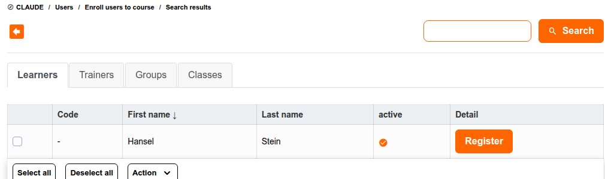
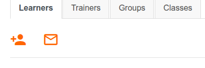
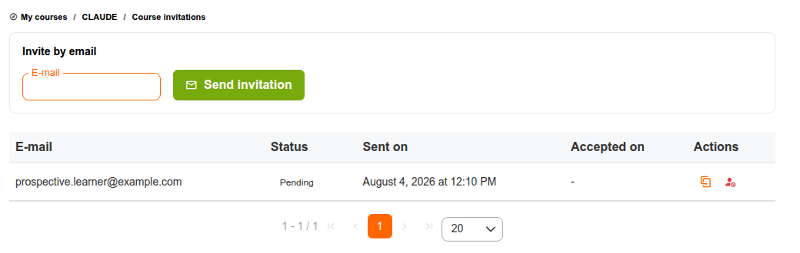

# Benutzer einschreiben

Bevor Sie einen Lernenden beurteilen können, muss dieser in Ihren Kurs eingeschrieben sein. Chamilo bietet vier Möglichkeiten, jemanden aufzunehmen, je nachdem, wer die Einschreibung vornimmt und ob die Person bereits ein Plattformkonto besitzt.

| Methode | Wer führt sie durch | Bestehendes Konto erforderlich? |
|--------|-------------|------------------------------|
| [Einschreibung durch die Administration](#administrator-enrollment) | Plattformadministrator | Ja |
| [Selbsteinschreibung über den Kurskatalog](#self-enrollment-via-the-course-catalog) | Die Lernenden selbst | Ja |
| [Manuelle Einschreibung über das Werkzeug „Benutzer“](#manual-enrollment-via-the-users-tool) | Lehrkraft (oder Kursadministrator) | Ja |
| [Benutzer per E-Mail einladen](#inviting-users-by-email) | Lehrkraft (oder Kursadministrator) | **Nein** |

## Einschreibung durch die Administration

Ein Plattformadministrator kann jeden vorhandenen Benutzer direkt über das Administrationspanel in einen beliebigen Kurs einschreiben — nützlich für die Masseneinschreibung (z. B. den Import einer Klassenliste) oder wenn eine Lehrkraft nicht über die Rechte verfügt, die Einschreibung selbst zu verwalten. Siehe den Abschnitt [Kurse](../../admin-guide/courses/README.md) im Administrationshandbuch.

## Selbsteinschreibung über den Kurskatalog

Wenn die [Sichtbarkeit](../creating-your-course/course-settings.md#course-visibility) Ihres Kurses dies zulässt, können sich Lernende mit einem Plattformkonto selbst einschreiben, indem sie Ihren Kurs unter **Weitere Kurse erkunden** finden und auf Beitreten klicken — von Ihrer Seite ist keine Aktion erforderlich. Ob dies verfügbar ist und ob ein Kennwort erforderlich ist, wird über die **Einschreibungseinstellungen** in den [Kurseinstellungen](../creating-your-course/course-settings.md#enrollment-settings) gesteuert.

## Manuelle Einschreibung über das Werkzeug „Benutzer“

Um eine Person einzuschreiben, die bereits ein Plattformkonto besitzt, dem Kurs aber noch nicht selbst beigetreten ist, öffnen Sie das Werkzeug **Benutzer** Ihres Kurses und klicken Sie auf das Symbol **Benutzer hinzufügen** .

1. Suchen Sie die Person nach Name, Benutzername, E-Mail oder offiziellem Code
2. Klicken Sie in ihrer Zeile auf **Registrieren**, oder wählen Sie mehrere Personen über die Kontrollkästchen aus und verwenden Sie das Menü **Aktion**, um sie alle auf einmal zu registrieren

In den Ergebnissen erscheinen nur Benutzer, die noch nicht in den Kurs eingeschrieben sind.

> Dieses Symbol steht Lehrkräften standardmäßig zur Verfügung. Ein Plattformadministrator kann es über die Einstellung **Allow User Course Subscription By Course Administrator** (`allow_user_course_subscription_by_course_admin`) auf Administratoren beschränken — wenn Sie das Symbol **Benutzer hinzufügen** nicht sehen, wenden Sie sich an Ihre Administration.

## Benutzer per E-Mail einladen

Die drei oben genannten Methoden setzen voraus, dass die Person bereits ein Plattformkonto besitzt. **Kurseinladungen** decken den Fall ab, in dem dies nicht zutrifft: Sie senden eine Einladung an eine E-Mail-Adresse, und Chamilo sendet dieser Person einen einmaligen Link. Durch Öffnen des Links kann sie ein Konto erstellen, und sobald die Registrierung abgeschlossen ist, wird sie automatisch in Ihren Kurs eingeschrieben — ein separater Einschreibungsschritt ist nicht erforderlich.

### Zugriff auf das Werkzeug

Öffnen Sie das Werkzeug **Benutzer** Ihres Kurses und klicken Sie dann in der Symbolleiste neben **Benutzer hinzufügen** auf das Symbol **Per E-Mail einladen** :

Dadurch wird die Seite **Kurseinladungen** geöffnet.

### Wer Einladungen senden kann

* Plattformadministratoren, immer.
* In einem einfachen Kurs (nicht in einer Sitzung geöffnet): Lehrkräfte und andere Benutzer mit Bearbeitungsrechten für den Kurs.
* In einer Sitzung: der allgemeine Coach der Sitzung oder ein Sitzungsadministrator — nicht die breitere Gruppe der Kurs-Coaches, da eine Einladung hier in die *gesamte Sitzung* einschreibt, nicht nur in diesen einen Kurs.

### Eine Einladung senden

1. Geben Sie die E-Mail-Adresse des Empfängers im Formular **Per E-Mail einladen** ein
2. Klicken Sie auf **Einladung senden**

Jede Einladung, die Sie für diesen Kurs gesendet haben, erscheint unter dem Formular mit ihrem Status:

| Status | Bedeutung |
|--------|---------|
| **Ausstehend** | Gesendet, noch nicht verwendet. Liegt noch innerhalb der Gültigkeitsdauer. |
| **Angenommen** | Der Empfänger hat sich registriert und wurde eingeschrieben. |
| **Widerrufen** | Sie haben sie storniert, bevor sie verwendet wurde. |

Bei einer noch ausstehenden Einladung bietet die Spalte **Aktionen** Folgendes:

* **Kopieren**  — kopiert den Einladungslink, falls Sie ihn lieber selbst weitergeben möchten (Chat, persönlich), anstatt sich auf die E-Mail zu verlassen.
* **Widerrufen**  — storniert die Einladung sofort; der Link funktioniert nicht mehr. Eine bereits angenommene Einladung kann nicht widerrufen werden.

> **Die eingeladene E-Mail-Adresse darf auf dieser Plattform noch kein Konto haben.** Falls doch, schlägt das Senden der Einladung mit einer Meldung fehl, die Sie auffordert, diesen bestehenden Benutzer stattdessen direkt einzuschreiben — über [Manuelle Einschreibung über das Werkzeug Benutzer](#manual-enrollment-via-the-users-tool) oben.

### Einladungen in einer Sitzung

Wenn Sie das Werkzeug Benutzer aus einem Kurs öffnen, der innerhalb einer Sitzung läuft, zeigt die Seite einen Hinweis, dass die Einladung für die gesamte Sitzung gilt, nicht nur für diesen Kurs:

> *Dieser Kurs ist in einer Sitzung geöffnet. Wenn Sie hier eine Einladung senden, wird der Empfänger für die gesamte Sitzung eingeschrieben, nicht nur für diesen Kurs.*

Dies entspricht der Funktionsweise der Einschreibung an anderer Stelle in Chamilo: Sie schreiben jemanden für eine Sitzung als Ganzes oder für einen eigenständigen Kurs ein, niemals jedoch für „diesen einen Kurs innerhalb dieser Sitzung“ als separate Aktion.

### Was die eingeladene Person sieht

Die E-Mail enthält einen Link zur Registrierungsseite. Beim Öffnen:

* wird das E-Mail-Feld mit der von Ihnen eingeladenen Adresse vorausgefüllt und gesperrt — mit diesem Link kann sich die Person nicht unter einer anderen Adresse registrieren.
* kann sie die Registrierung **auch dann abschließen, wenn die Selbstregistrierung plattformweit derzeit deaktiviert ist** — sofern Ihre Administration die Einstellung **Registrierung über Kurseinladungslinks zulassen** aktiviert hat (siehe unten). Ohne diese Einstellung hilft ein Einladungslink nur, wenn die Selbstregistrierung ansonsten geöffnet ist.
* wird sie sofort in Ihren Kurs (oder die Sitzung) eingeschrieben, sobald sie das Formular absendet, und angemeldet.

Der Link ist einmalig verwendbar und läuft nach 7 Tagen ab. Wenn er abläuft oder die zugehörige Einladung widerrufen wird, verhält sich das Öffnen so, als hätte der Link nie existiert.

> Die plattformweite Einstellung **Registrierung über Kurseinladungslinks zulassen** (`registration.allow_invitation_registration`) steuert, ob Ihr Einladungslink die Registrierung öffnen kann, wenn die allgemeine Selbstregistrierung deaktiviert ist. Fragen Sie Ihre Administration, wenn Einladungen auf einer ansonsten geschlossenen Plattform nicht zu funktionieren scheinen.

## Tipps

* **Wählen Sie die Methode passend zur Situation** — Administration oder Selbsteinschreibung für Personen, die die Plattform bereits nutzen, manuelle Einschreibung für einen bekannten bestehenden Benutzer, Einladungen für externe Gäste, Gutachter oder alle, die noch kein Konto haben.
* **Widerrufen Sie Einladungen, die Sie nicht mehr benötigen** — eine alte ausstehende Einladung ist weiterhin ein gültiger, ungenutzter Link; widerrufen Sie sie, wenn der vorgesehene Empfänger keinen Zugriff mehr benötigt oder wenn Sie unsicher sind, ob sie ihn erreicht hat.
* **Klären Sie mit Ihrer Administration, wenn eine Methode nicht verfügbar zu sein scheint** — mehrere dieser Abläufe (manuelle Einschreibung, Einladungen, Selbsteinschreibung) können plattformweit eingeschränkt oder deaktiviert sein.