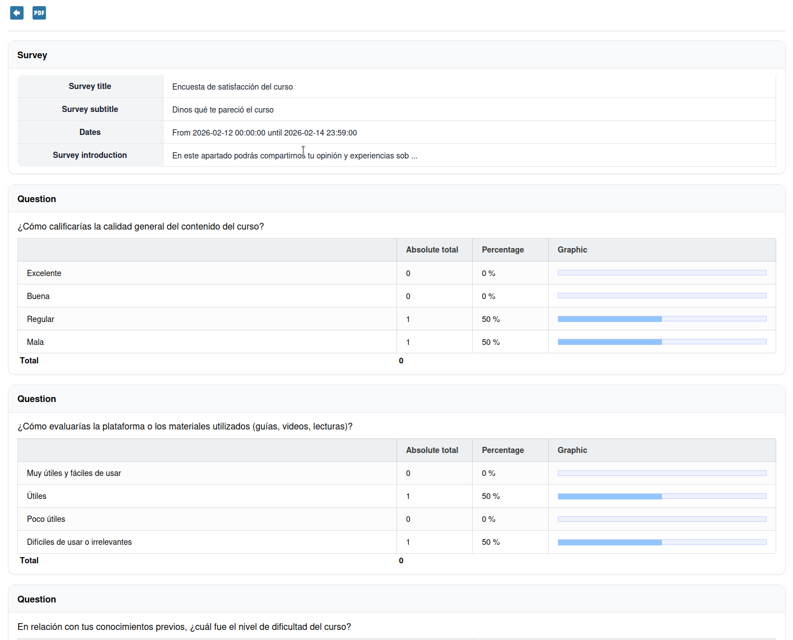

# Umfragen

Mit dem Umfrage-Tool können Sie Fragebögen erstellen, um Feedback von Ihren Lernenden einzuholen. Umfragen eignen sich für Kursevaluationen, Bedarfsanalysen und Meinungsumfragen.

## Eine Umfrage erstellen

1. Öffnen Sie das Tool **Umfragen**  auf der Kursstartseite
2. Klicken Sie auf **Umfrage erstellen**
3. Füllen Sie die Umfragedetails aus:
   * **Code** — Dies ist ein eindeutiger Code für die Umfrage. Er wird in E-Mails und Links verwendet.
   * **Titel** — Der Name der Umfrage
   * **Untertitel** — Eine optionale sekundäre Überschrift
   * **Startdatum** — Ab wann diese Umfrage für die Teilnahme geöffnet ist
   * **Enddatum** — Bis wann diese Umfrage für die Teilnahme geöffnet ist
   * **Anonym** — Ob die Antworten anonym sind oder einzelnen Lernenden zugeordnet werden
   * **Sichtbarkeit der Ergebnisse** — Wer die Ergebnisse sehen kann (nur Tutor, Tutor und Lernende, alle)
   * **Einleitung** — Eine Nachricht, die den Lernenden angezeigt wird, bevor sie die Umfrage beginnen
   * **Dankesnachricht** — Eine Nachricht, die nach dem Absenden angezeigt wird
4. Speichern

### Erweiterte Einstellungen

* **Note im Bewertungstool** — Ob der Antwortstatus dieser Umfrage in das Bewertungstool (Notenbuch) aufgenommen wird. Wer die Umfrage abgeschlossen hat, erhält 100 %, alle anderen erhalten 0 %
* **Übergeordnete Umfrage** — Wird derzeit nicht wirklich verwendet (Legacy-Funktion)
* **Eine Frage pro Seite** — Darstellungsstil für die Fragen
* **Mischmodus aktivieren** — Ob die Fragen gemischt werden
* **Fragennummer anzeigen** — Ob (automatisch generierte) Fragennummern angezeigt werden

### Von einem Administrator erstellte Vorlagen

Plattformadministratoren können wiederverwendbare **Umfragevorlagen** mit eigenen Fragen erstellen. Wenn der Administrator eine Vorlage als **Als Vorlage sichtbar** kennzeichnet, kann eine Lehrkraft sie beim Erstellen einer Umfrage in einem autorisierten Kurs oder einer autorisierten Sitzung auswählen. Die kopierte Umfrage kann anschließend überprüft und über den üblichen Einladungsworkflow veröffentlicht werden. Lehrkräfte können Vorlagen keinen anderen Kursen oder Sitzungen außerhalb ihres Lehrkontexts zuweisen.

Administratoren können eine Vorlage auch direkt einem ausgewählten Kurs oder einer Sitzung zuweisen, die diesen Kurs enthält. Siehe [Umfragevorlagen](../../admin-guide/survey-templates.md) für den Administrator-Workflow (PR #9208, Issue #8760).

### Ergebnisse vor Lehrkräften und Tutoren verborgen

Bei Umfragen, deren Antwortdaten gegenüber dem Lehrpersonal vertraulich bleiben müssen, kann ein Plattformadministrator in der Umfragekonfiguration **Ergebnisse vor Lehrkraft/Tutor verborgen** aktivieren. Lehrkräfte und Tutoren können weiterhin die Anzahl der Antworten sehen und Erinnerungen senden, **können die Ergebnisse jedoch nicht öffnen oder exportieren**. Diese Einschränkung gilt auch für Berichtsdownloads; nur ein Plattformadministrator darf auf die eingeschränkten Ergebnisse zugreifen. Sie ist unabhängig von der normalen Auswahl **Sichtbarkeit der Ergebnisse** und der globalen Einstellung für die Berichtsschaltfläche.

### Vorlage zur Schulungszufriedenheit

Wenn Sie einen standardisierten Fragebogen zum Ende einer Schulung wünschen, verwenden Sie die Aktion **Zufriedenheitsumfrage erstellen** in der Symbolleiste Umfragen. Chamilo erstellt eine anonyme **Umfrage zur Schulungszufriedenheit** aus der integrierten Vorlage mit sieben Fragen und öffnet sofort deren Frageneditor.

Die Umfrage wird im aktuellen Kurs- oder Kurssitzungskontext erstellt und nicht automatisch veröffentlicht. Überprüfen oder bearbeiten Sie zuerst die generierten Fragen, veröffentlichen Sie sie anschließend und wählen Sie die Empfänger auf die übliche Weise aus. Diese Aktion steht nur Benutzern zur Verfügung, die Umfragen erstellen können, und ist ausgeblendet, wenn die Erstellung von Umfragen durch die Plattformkonfiguration deaktiviert ist.

## Fragen hinzufügen

Sobald die Umfrage erstellt ist, fügen Sie Fragen hinzu:

1. Wählen Sie den Fragetyp:
   * **Ja/Nein** — Eine einfache binäre Auswahl
   * **Multiple Choice** — Eine Antwort aus mehreren Optionen auswählen
   * **Mehrfachantwort** — Eine oder mehrere Antworten aus mehreren Optionen auswählen
   * **Offene Frage** — Freitextantwort
   * **Dropdown** — Aus einer Dropdown-Liste auswählen
   * **Prozent** — Einen Prozentwert wählen
   * **Punktzahl** — Auf einer numerischen Skala bewerten
   * **Kommentar** — Ein Textblock (keine Frage), um Anweisungen zwischen Fragen einzufügen
   * **Multiple Choice mit Option „Sonstiges“** — Eine Antwort aus mehreren Optionen auswählen, mit einer alternativen Auswahl
   * **Selektive Anzeige** — Besonderer Typ, mit dem Sie den Fragenablauf anhand vorheriger Antworten anpassen können
   * **Seitenumbruch** — Seitenumbrüche im Fragenablauf hinzufügen. Nur sinnvoll, wenn im vorherigen Schritt „Eine Frage pro Seite“ **nicht** ausgewählt wurde
2. Konfigurieren Sie den Fragetext und die Antwortoptionen
3. Speichern

Jede Frage kann als verpflichtend gekennzeichnet werden. Wenn Sie dies nicht tun, ist das Überspringen einer Frage ein zulässiges Verhalten.

---
## Eine Umfrage veröffentlichen

Nachdem Sie alle Fragen hinzugefügt haben:

1. Klicken Sie auf **Veröffentlichen**
2. Wählen Sie die Empfänger — Wählen Sie bestimmte Lernende oder Gruppen aus (Sie wählen sie aus). Die Schaltfläche **Lernende hinzufügen** fügt alle Lernenden in einem einzigen Schritt hinzu und lässt die Lehrkräfte aus
3. Weitere Benutzer hinzufügen — Ermöglicht es Ihnen, Benutzer außerhalb von Chamilo zur Teilnahme an der Umfrage einzuladen. Sie erhalten eine E-Mail mit einem Link und erscheinen in den Umfragedetails unter ihrer E-Mail-Adresse
4. E-Mail-Betreff
5. E-Mail-Text — Erläutern Sie, worum es in der Umfrage geht und wann bzw. wie sie beantwortet werden soll
6. Es stehen verschiedene Optionen für wiederholte Einladungen zur Verfügung
7. Bestätigen

Die Lernenden erhalten eine Einladung (per E-Mail), die Umfrage auszufüllen.

Am unteren Rand der Veröffentlichungsseite steht ein Link zur Verfügung, um noch weitere externe Benutzer zur Teilnahme einzuladen. Teilnehmende, die diesen Link verwenden, werden nicht identifiziert und erscheinen in den Umfrageergebnissen als anonym.

## Ergebnisse anzeigen

Nachdem die Lernenden geantwortet haben:

1. Öffnen Sie die Umfrage
2. Klicken Sie auf **Ergebnisse** oder **Bericht**
3. Zeigen Sie die Antwortzusammenfassungen an:
   * Diagramme und Prozentsätze für geschlossene Fragen
   * Einzelne Textantworten für offene Fragen
   * Abschlussquote (wie viele Eingeladene geantwortet haben)

Sie können die Ergebnisse zur weiteren Analyse in eine Tabellenkalkulation exportieren.

## Tipps

* **Halten Sie sie kurz** — Lernende füllen kürzere Umfragen eher vollständig aus
* **Verwenden Sie den anonymen Modus** — Aktivieren Sie anonyme Antworten, um ehrliches Feedback zu erhalten
* **Wählen Sie den richtigen Zeitpunkt** — Versenden Sie Umfragen während des Kurses, um Anpassungen vorzunehmen, und nicht nur Evaluationen am Kursende