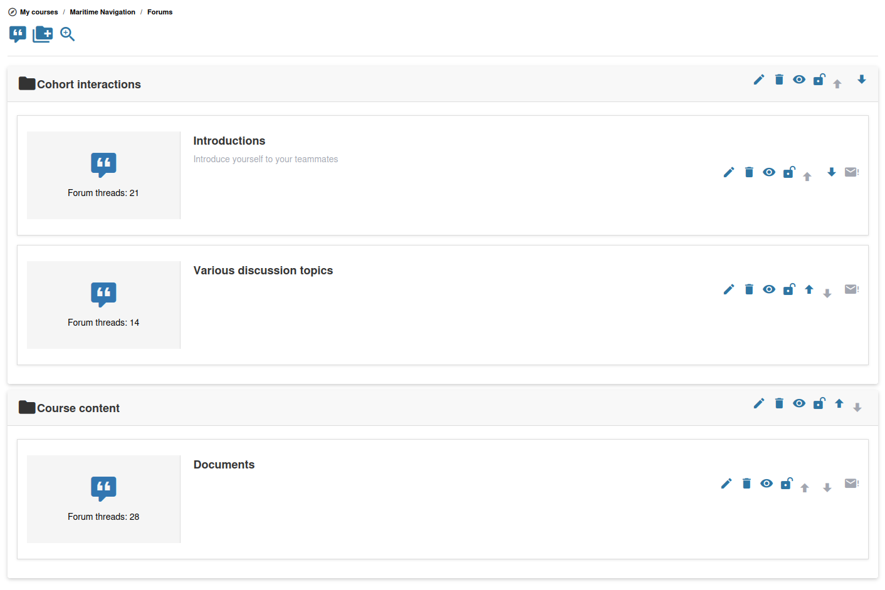

# Foren

Das Foren-Werkzeug ermöglicht es Ihnen, strukturierte Diskussionen in Ihrem Kurs zu führen. Lernende können Nachrichten veröffentlichen, einander antworten und sich an Diskussionen in Threads beteiligen.

## Forenstruktur

Foren in Chamilo sind in drei Ebenen organisiert:

1. **Forenkategorien** — Übergeordnete Gruppierungen (z. B. „Allgemeine Diskussionen“, „Fragen zu Modul 1“)
2. **Foren** — Einzelne Diskussionsbereiche innerhalb einer Kategorie
3. **Themen (Threads)** — Einzelne Diskussionsthemen innerhalb eines Forums, jeweils mit einer Kette von Antworten

## Eine Forenkategorie erstellen

1. Öffnen Sie das Werkzeug **Foren**  auf der Startseite Ihres Kurses
2. Klicken Sie auf **Forenkategorie hinzufügen**
3. Geben Sie einen **Kategorienamen** und optional eine Beschreibung ein
4. Speichern

## Ein Forum erstellen

Sie können ein Forum erst hinzufügen, wenn mindestens eine Kategorie vorhanden ist.

1. Klicken Sie innerhalb einer Kategorie auf **Forum hinzufügen**
2. Füllen Sie die grundlegenden Angaben aus:
   * **Titel** — Der Name dieses Diskussionsbereichs
   * **Beschreibung** — Eine optionale Beschreibung des Zwecks des Forums
   * **In Kategorie erstellen** — Die Kategorie, zu der dieses Forum gehört
   * **Veröffentlichungsdatum** / **Schließungsdatum** — Optionaler Zeitraum, in dem das Forum geöffnet ist
   * **Moderiertes Forum** — Neue Beiträge müssen von einer Lehrkraft genehmigt werden, bevor sie sichtbar werden
   * **Können Lernende ihre eigenen Beiträge bearbeiten?** — Lernenden erlauben oder verbieten, Beiträge nach dem Absenden zu bearbeiten
   * **Benutzern erlauben, neue Threads zu starten** — Wenn auf Nein gesetzt, können Lernende nur auf bestehende Threads antworten
   * **Standardansicht** — Wählen Sie, wie Beiträge angezeigt werden: **Flach**, **Als Thread** oder **Verschachtelt**
   * **Für Gruppe** — Dieses Forum einer Kursgruppe zuordnen
   * **Öffentlicher Zugriff / Privater Zugriff** — Legen Sie bei Gruppenforen fest, ob jedes Kursmitglied es lesen kann oder nur Gruppenmitglieder
4. Speichern

Wenn die Kurssichtbarkeit auf „Für die Welt geöffnet“ gesetzt ist, zeigt das Formular außerdem die Option **Anonyme Beiträge erlauben?**. Diese Option ist in Kursen mit eingeschränkter Sichtbarkeit ausgeblendet.

## Themen verwalten

Lernende (und Sie) können innerhalb eines Forums neue Themen erstellen. Als Lehrkraft können Sie:

* **Ein Thema anheften (Sticky-Nachricht)** — Markieren Sie einen Thread beim Erstellen oder Bearbeiten als angeheftet, damit er immer oben angezeigt wird
* **Ein Thema sperren** — Weitere Antworten verhindern
* **Beiträge bearbeiten oder löschen** — Die Diskussion moderieren
* **Ein Thema verschieben** — Ein Thema in ein anderes Forum übertragen
* **Die Beiträge vom neuesten an auflisten** — Ein Thread listet seine Beiträge vom ältesten an. Die Pfeilschaltfläche in der Symbolleiste des Threads (**Neueste zuerst**) listet sie vom neuesten an, um die jüngste Aktivität eines langen Threads zu verfolgen; klicken Sie erneut darauf (**Älteste zuerst**), um zurückzukehren. In der Thread- und der verschachtelten Ansicht werden die Antworten auf jeden Beitrag vom neuesten an aufgelistet. Lernende lesen den Thread stets vom ältesten Beitrag an, und innerhalb eines Lernpfads sehen alle die neuesten Beiträge zuerst.

Bei sehr langen Threads zeigt Ihre Plattform möglicherweise nur einen Teil der Beiträge jedes Threads für alle außer Plattformadministratoren — Sie eingeschlossen — an, wenn der Administrator **Maximale Anzahl der in einem Forenthread angezeigten Beiträge** (`thread_max_posts_for_non_admins`, siehe [Foreneinstellungen](../../admin-guide/platform-settings/forum-settings.md)) festlegt. In der Thread- und der verschachtelten Ansicht gilt die Begrenzung für die Antworten auf jeden Beitrag: Im Foren-Werkzeug sehen Sie die ersten Antworten, und innerhalb eines Lernpfads die neuesten, wobei die Begrenzung dort auch für Administratoren gilt. Das Auflisten der Beiträge vom neuesten an zeigt Ihnen stattdessen die neuesten. Bitten Sie einen Administrator, wenn Sie die übrigen Beiträge eines solchen Threads lesen müssen.

## Forenbewertung

Wenn Sie als Lehrkraft einen neuen Thread erstellen, können Sie unter den erweiterten Einstellungen **Diesen Thread bewerten** aktivieren. Anschließend legen Sie eine Höchstpunktzahl, eine Spaltenüberschrift für das Notenbuch und eine Gewichtung im Bericht fest. Sie können außerdem **Thread von Peers bewertet** aktivieren; dabei muss jede lernende Person mindestens zwei andere Lernende bewerten, bevor die eigene Punktzahl zählt.

Zum Bewerten klicken Sie in der Thread-Liste des Forums auf **Thread bewerten**. Das Fenster listet die Lernenden auf, die im Thread Beiträge veröffentlicht haben, jeweils mit einem Punktzahlfeld. Klicken Sie auf den Namen einer lernenden Person, um deren Beteiligung vor der Bewertung zu öffnen: die Anzahl der Kursbenutzer, die Anzahl der Beiträge im Thread, wie viele davon von der lernenden Person stammen und ihr Anteil am Thread, anschließend jeder von der lernenden Person verfasste Beitrag mit seinen Anhängen. Sie können die Punktzahl der lernenden Person auch in diesem Fenster speichern. Ein roter Papierkorb neben jedem Beitrag löscht ihn nach Bestätigung, beispielsweise um eine themenfremde oder doppelte Nachricht vor der Bewertung zu entfernen; die Zählungen werden aktualisiert, und eine lernende Person ohne verbleibenden Beitrag verschwindet aus der Liste. Der Papierkorb wird nicht mehr angezeigt, sobald das Notenbuch die Punktzahl des Threads gesperrt hat.

## Teilnahmevoraussetzungen und Kategorieinformationen

Administratoren können optional drei forenweite Verhaltensweisen unter **Administration > Konfigurationseinstellungen > Foren** aktivieren:

* **Themenantworten erst nach Teilnahme anzeigen** (`show_thread_replies_after_participation`) — Lernende sehen die Eröffnungsnachricht des Themas, jedoch keine Antworten anderer Personen, bis sie selbst einen Beitrag verfasst haben. Lehrkräfte, Administratoren, Sitzungsbetreuer und Gruppentutoren unterliegen dieser Einschränkung nicht. Ein Beitrag eines Lernenden, der auf Moderation wartet, zählt dennoch als Teilnahme, auch wenn die üblichen Moderationsregeln weiterhin gelten.
* **Beschreibung der Forenkategorie in Themen anzeigen** (`show_category_description_in_thread`) — Der Kategorietitel und ein Auszug aus der Beschreibung erscheinen oberhalb der Diskussion. **Mehr lesen** klappt lange Beschreibungen auf.
* **Erforderliche Beiträge zum Abschluss eines Forenthemas** (`thread_participation_progress_posts`) — Ist der Wert größer als `0`, zeigt ein Fortschrittsbalken die Beitragszahl eines Lernenden im Verhältnis zum konfigurierten Ziel an. Beiträge, die auf Moderation warten, werden mitgezählt. Der Wert `0` blendet den Balken aus.

Das Fortschrittsziel ist ein informativer Indikator, **nicht** der Schwellenwert zum Freischalten von Antworten: Wenn teilnahmeabhängige Antworten aktiviert sind, genügt ein einzelner Beitrag, um diese Einschränkung aufzuheben. Diese Einstellungen sind standardmäßig deaktiviert. Siehe [Foreneinstellungen](../../admin-guide/platform-settings/forum-settings.md).

Diese drei Einstellungen gelten für jeden Kurs der Plattform, sofern der Administrator nicht zusätzlich **Forenteilnahmeeinstellungen können im Kurs geändert werden** (`forum_participation_can_be_modified_in_course`) aktiviert. Jeder Kurs wählt dann eigene Werte im Abschnitt **Foreneinstellungen** seiner [Kurseinstellungen](../creating-your-course/course-settings.md#forum-settings) — beispielsweise, um Antworten nur in bestimmten Kursen bis zum ersten Beitrag der Lernenden auszublenden, während die Plattformeinstellungen deaktiviert bleiben. Ein Kurs, der **Plattformeinstellung verwenden** beibehält, folgt dem Plattformwert.

## Forendiskussionen innerhalb eines Lernpfads

Wenn Lernende eine Forendiskussion **aus einem Lernpfadschritt** öffnen, werden die Antworten **neueste zuerst** angezeigt. In der Thread- und der verschachtelten Ansicht bleibt der Eröffnungsbeitrag oben, und die neuesten Antworten erscheinen unmittelbar darunter, wobei auf jede Antwort ihre eigenen Antworten folgen, ebenfalls neueste zuerst — so sehen Lernende ihre Antwort direkt nach dem Veröffentlichen. Ein Beitrag ohne übergeordneten Beitrag im Thema wird als Antwort auf den Eröffnungsbeitrag angezeigt. Die gewöhnliche Forennavigation außerhalb des Lernpfads behält ihre normale Reihenfolge bei. Die Forenseite blendet in diesem eingebetteten Kontext die redundanten Aktionen **Zurück zu den Themen** und **Zurück zum Lernpfad** aus; Lernende sollten die Navigation des Lernpfad-Players verwenden, um zu einem anderen Schritt zu wechseln.

Wenn Lernende dieselbe Diskussion über das reguläre Werkzeug **Foren** öffnen, verwenden sie die normale Forennavigation und die chronologische Beitragsreihenfolge. Dieses kontextabhängige Verhalten wurde in [PR #9163](https://github.com/chamilo/chamilo-lms/pull/9163) korrigiert.

## Benachrichtigungen

Jedes Forum und jedes Thema verfügt über einen Schalter **Mich benachrichtigen**, mit dem Sie und Ihre Lernenden E-Mail-Benachrichtigungen über neue Beiträge abonnieren können. Benachrichtigungen sind ein benutzerspezifisches Abonnement und werden beim Erstellen des Forums nicht konfiguriert.