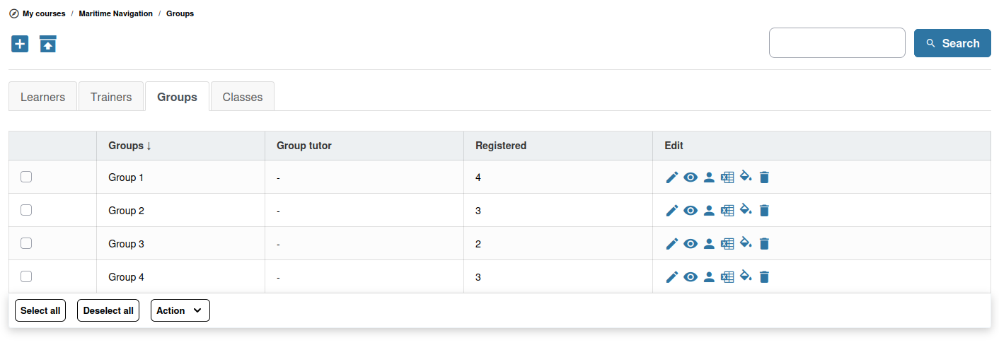

# Gruppen

Gruppen ermöglichen es Ihnen, Ihre Lernenden in kleinere Teams für die Zusammenarbeit aufzuteilen. Jede Gruppe kann über eigene gemeinsame Werkzeuge verfügen, beispielsweise Dokumente, Foren und ein Wiki.

## Gruppen erstellen

1. Öffnen Sie das Werkzeug **Gruppen** auf der Kursstartseite
2. Klicken Sie auf **Gruppen erstellen**
3. Konfigurieren Sie die Gruppeneinstellungen:
   * **Anzahl der Gruppen** — Wie viele Gruppen erstellt werden sollen
   * **Maximale Mitgliederzahl pro Gruppe** — Die Größenbeschränkung für jede Gruppe (0 für unbegrenzt)
   * **Selbstregistrierung** — Ob Lernende Gruppen selbstständig beitreten können
   * **Selbstabmeldung** — Ob Lernende eine Gruppe selbstständig verlassen können

## Gruppenwerkzeuge

Jede Gruppe kann auf eine Teilmenge der Kurswerkzeuge zugreifen, die nur unter den Gruppenmitgliedern geteilt werden:

* **Dokumente** — Ein gemeinsamer Dateibereich für die Gruppe
* **Forum** — Ein gruppenspezifisches Diskussionsforum
* **Wiki** — Ein kollaboratives Wiki für die Gruppe
* **Chat** — Ein Chatbereich für die Gruppe
* **Agenda** — Kalenderereignisse im Gruppenbereich
* **Ankündigungen** — Ankündigungen nur an Gruppenmitglieder senden
* **Aufgaben** — Arbeiten der Gruppe einsammeln

Für jedes Werkzeug können Sie die Zugriffsstufe wählen: **Nicht verfügbar**, **Öffentlich** (jedes Kursmitglied) oder **Privat** (nur Gruppenmitglieder). Diese Einstellungen können auf Ebene der Gruppenkategorie angewendet werden, sodass mehrere Gruppen derselben Kategorie dieselbe Werkzeugkonfiguration teilen.

## Gruppenmitglieder verwalten

Sie können die Gruppenmitgliedschaft auf verschiedene Weise verwalten:

* **Manuelle Zuweisung** — Bestimmte Lernende jeder Gruppe hinzufügen
* **Ausgewählte Gruppen füllen** — Noch keiner Gruppe zugeordnete Lernende automatisch auf die ausgewählten Gruppen verteilen, unter Berücksichtigung der Kapazität jeder Gruppe und der Gruppenbegrenzung pro Benutzer
* **Selbstregistrierung** — Lernenden erlauben, ihre eigene Gruppe zu wählen
* **Aus Klassen importieren** — Gruppen automatisch aus den bereits im Kurs eingeschriebenen Klassen erstellen

Um Mitglieder manuell zu verwalten, klicken Sie auf einen Gruppennamen und verwenden Sie anschließend den Bereich **Mitglieder**, um Lernende hinzuzufügen oder zu entfernen.

## Gruppentutoren

Sie können Gruppen **Tutoren** zuweisen. Ein Tutor ist in der Regel ein Lernender oder eine Assistenzkraft, der bzw. die bei der Verwaltung der Gruppenarbeit hilft. Tutoren können innerhalb der Gruppe zusätzliche Berechtigungen haben, beispielsweise die Moderation des Gruppenforums.

## Gruppenarbeit überwachen

Als Kurslehrkraft können Sie auf alle Gruppen und deren gemeinsame Werkzeuge zugreifen, unabhängig von der Mitgliedschaft. Dadurch können Sie:

* Von jeder Gruppe hochgeladene Dokumente prüfen
* Diskussionen im Gruppenforum lesen
* Wiki-Beiträge überprüfen
* Die Zusammenarbeit in der Gruppe bewerten