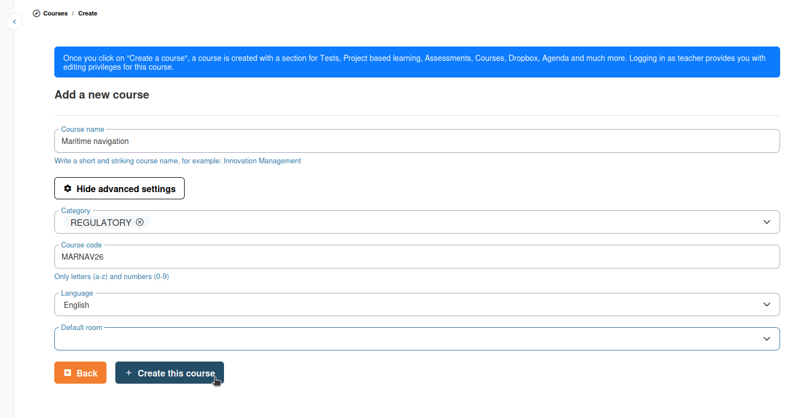

# Ihren Kurs erstellen

In diesem Abschnitt wird erläutert, wie Sie in Chamilo einen neuen Kurs erstellen und ihn an Ihre Anforderungen anpassen.

## Einen neuen Kurs erstellen

So erstellen Sie einen Kurs:

1. Klicken Sie in der Seitenleiste auf **Meine Kurse**
2. Klicken Sie auf die Schaltfläche **Kurs erstellen** (in der Regel ein grünes Buchsymbol  mit einem Pluszeichen)
3. Füllen Sie das Formular zur Kurserstellung aus:

| Feld | Erforderlich | Beschreibung |
|-------|----------|-------------|
| **Kursname** | Ja | Ein kurzer, aussagekräftiger Titel für Ihren Kurs (z. B. „Innovationsmanagement“) |
| **Kurskategorie** | Nein | Wählen Sie eine Kategorie, um Kurse auf der Plattform zu organisieren |
| **Kurscode** | Nein | Ein kurzer Code, der nur Buchstaben und Zahlen enthält (maximal 40 Zeichen). Bleibt das Feld leer, wird automatisch ein Code aus dem Kursnamen erzeugt |
| **Sprache** | Nein | Die Hauptsprache des Kurses. Standardmäßig wird Ihre aktuelle Sprache verwendet |

Falls aktiviert, finden Sie möglicherweise auch eine Einstellung für den **Standardraum** sowie die Möglichkeit, eine **Kursvorlage** zu verwenden, um den Kurs nicht vollständig von Grund auf neu erstellen zu müssen.

4. Klicken Sie auf **Diesen Kurs erstellen**

Sie werden zur Startseite Ihres neuen Kurses weitergeleitet. Es erscheint eine Bestätigungsmeldung: „Kurs erfolgreich erstellt.“

## Die Kursstartseite

Nach der Erstellung Ihres Kurses gelangen Sie auf dessen Startseite. Sie ist die zentrale Anlaufstelle Ihres Kurses, über die Sie und Ihre Lernenden auf alle Werkzeuge und Inhalte zugreifen.

Die Startseite zeigt Folgendes an:

* **Kurstitel** — Der Name Ihres Kurses, oben angezeigt.
* **Kurseinführung** — Eine optionale Beschreibung oder Begrüßungsnachricht. Klicken Sie auf die Schaltfläche **+ Kurseinführung**, um eine hinzuzufügen, oder auf die Schaltfläche **Einführung bearbeiten**  oben, um sie zu ändern. Dabei wird Rich Text mit Bildern, Links und Formatierungen unterstützt.
* **Werkzeugraster** — Ein Raster aller verfügbaren Kurswerkzeuge, jeweils als Karte mit Symbol und Name dargestellt.

### Sichtbarkeit von Werkzeugen verwalten

Als Lehrkraft können Sie steuern, welche Werkzeuge Ihre Lernenden sehen können:

* Klicken Sie auf das **Augensymbol**  neben einem Werkzeug, um es für Lernende auszublenden. Ausgeblendete Werkzeuge zeigen ein **durchgestrichenes Auge**  und bleiben für Sie weiterhin zugänglich.
* Verwenden Sie die Schaltflächen **Alle anzeigen** und **Alle ausblenden**, um alle Werkzeuge gleichzeitig zu ändern
* Klicken Sie auf **Sortieren**, um die Neuanordnung des Werkzeugrasters per Drag-and-drop zu aktivieren

### Studierendenansicht

Klicken Sie auf die Schaltfläche **Studierendenansicht**, um die Kursstartseite genau so zu sehen, wie ein Lernender sie sehen würde. Dies ist nützlich, um zu prüfen, dass ausgeblendete Werkzeuge und unveröffentlichte Inhalte nicht sichtbar sind. Klicken Sie erneut auf die Schaltfläche, um zur Lehrkraftansicht zurückzukehren.

## Nächste Schritte

* [Kurseinstellungen](course-settings.md) — Zugriff, Einschreibung und weitere Optionen auf Kursebene konfigurieren
* [Kursstartseite](course-homepage.md) — Ausführliche Anleitung zur Anpassung Ihrer Kursstartseite
* [Kursbeschreibung](course-description.md) — Eine strukturierte Beschreibung Ihres Kurses für den Kurskatalog verfassen