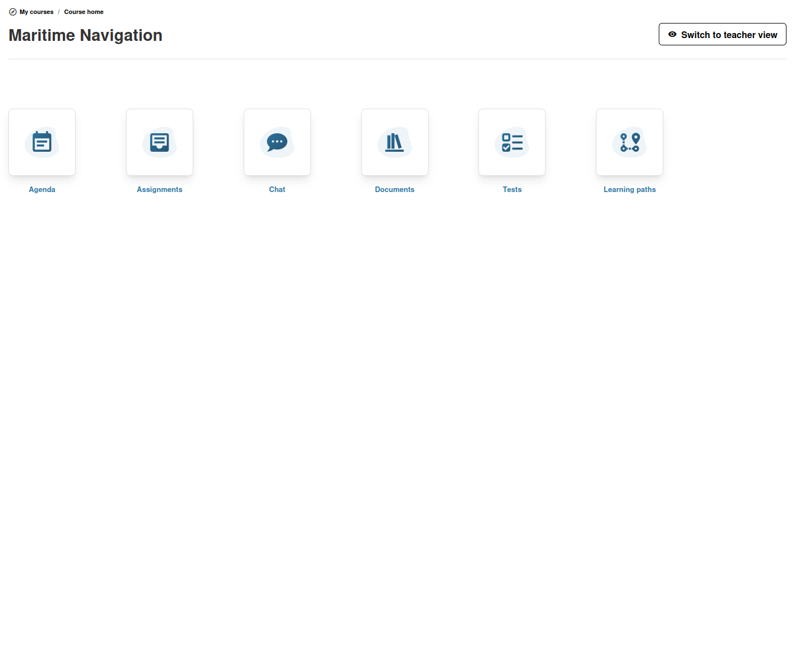

# Kursstartseite

Die Kursstartseite ist die erste Seite, die Ihre Lernenden sehen, wenn sie einen Kurs betreten. Auf dieser Seite wird beschrieben, wie Sie sie anpassen, um einen ansprechenden Einstiegspunkt zu schaffen.

## Kurseinführung

Die Kurseinführung ist ein Rich-Text-Bereich, der oben auf der Startseite über dem Werkzeugraster angezeigt wird. Verwenden Sie ihn, um:

* Ihre Lernenden willkommen zu heißen
* die Kursziele zu beschreiben
* Anleitungen für den Einstieg bereitzustellen
* Bilder, Videos oder Links einzubetten

So bearbeiten Sie die Einführung:

1. Klicken Sie auf die Schaltfläche **Einführung bearbeiten** 
2. Verwenden Sie den Rich-Text-Editor, um Ihre Inhalte zu verfassen
3. Speichern Sie Ihre Änderungen

Wenn noch keine Einführung erstellt wurde, sehen Sie eine Schaltfläche **Einführung erstellen**.

## Werkzeugraster

Unterhalb der Einführung werden die Kurswerkzeuge in einem Rasterlayout angezeigt. Jedes Werkzeug erscheint als Karte mit:

* einem Symbol, das das Werkzeug darstellt
* dem Namen des Werkzeugs

Die in Ihrem Kurs verfügbaren Werkzeuge können Folgendes umfassen:

| Werkzeug | Symbol | Zweck |
|------|------|---------|
| Agenda |  | Termine und Fristen planen |
| Ankündigungen |  | Nachrichten an eingeschriebene Lernende senden |
| Aufgaben |  | Studierendenarbeiten sammeln und bewerten |
| Dokumente |  | Dateien und Inhalte hochladen und organisieren |
| Tests |  | Quiz und Tests erstellen |
| Forum |  | Diskussionen führen |
| Glossar |  | Schlüsselbegriffe definieren |
| Bewertungen |  | Noten und Zertifikate verwalten |
| Lernpfade |  | Strukturierte Lernsequenzen erstellen |
| Links |  | Nützliche URLs teilen |
| Benutzer |  | Eingeschriebene Benutzer anzeigen und verwalten |
| Umfragen |  | Umfragen erstellen und verteilen |

> Einige Werkzeuge werden möglicherweise nicht angezeigt, wenn Ihre Administration sie auf Plattformebene deaktiviert hat oder wenn Sie sie ausgeblendet haben.

Eine bemerkenswerte Änderung gegenüber Chamilo 1.* besteht darin, dass die Werkzeuge nicht mehr in 3 verschiedene Bereiche aufgeteilt werden. Dadurch erhalten Lehrkräfte die volle Kontrolle darüber, welche Werkzeuge in welcher Reihenfolge angezeigt werden.

Außerdem wurden die Werkzeuge **Tracking** und **Wartung** an den oberen Seitenrand unter die Statistik- und Zahnradsymbole verschoben, um Werkzeuge, die den Lernenden nie angezeigt werden, aus der Liste zu entfernen.

## Werkzeuge organisieren

### Neu anordnen

1. Klicken Sie auf die Schaltfläche **Sortieren** oben im Werkzeugraster
2. Ziehen Sie die Werkzeuge per Drag-and-drop, um ihre Reihenfolge zu ändern
3. Die neue Reihenfolge wird automatisch gespeichert

### Ein- und Ausblenden

* Klicken Sie auf das **Sichtbarkeitssymbol** eines Werkzeugs, um es für Lernende zwischen sichtbar und ausgeblendet umzuschalten
* Verwenden Sie **Alle anzeigen** oder **Alle ausblenden** für Massenänderungen
* Ausgeblendete Werkzeuge bleiben für Sie als Lehrkraft zugänglich — sie sind nur für Lernende ausgeblendet

## Funktionen zum automatischen Start

Sie können bestimmte Werkzeuge so konfigurieren, dass sie automatisch gestartet werden, wenn ein Lernender den Kurs betritt. Wenn diese Funktion aktiviert ist, erscheint oben auf der Kursstartseite ein Hinweis, der anzeigt, welcher automatische Start aktiv ist:

* Automatischer Start von Dokumenten — Öffnet automatisch ein bestimmtes Dokument
* Automatischer Start von Übungen — Startet sofort einen Test
* Automatischer Start von Lernpfaden — Startet einen Lernpfad beim Betreten des Kurses
* Automatischer Start des Forums — Öffnet das Forum direkt