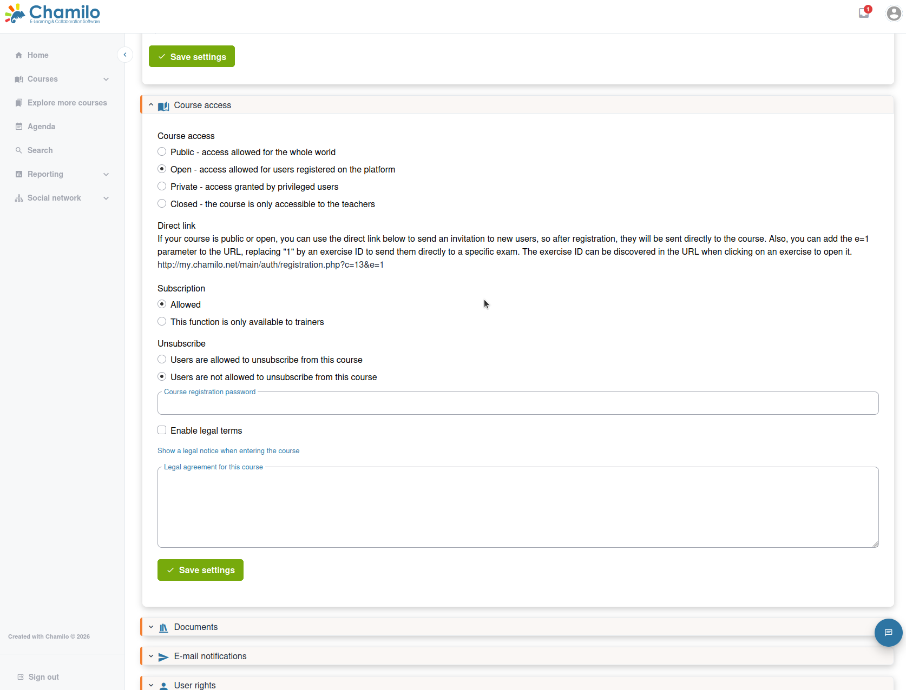

# Kurseinstellungen

Mit den Kurseinstellungen steuern Sie, wie sich Ihr Kurs verhält — wer darauf zugreifen kann, wie er angezeigt wird und welche Funktionen aktiviert sind.

Um die Kurseinstellungen zu öffnen, betreten Sie Ihren Kurs und klicken Sie auf das Symbol **Einstellungen**  neben der Schaltfläche **Zur Lernendenansicht wechseln**.

## Allgemeine Einstellungen

### Kursinformationen

* **Kurstitel** — Der Anzeigename Ihres Kurses
* **Kurssprache** — Die Hauptsprache der Kursoberfläche
* **Kurskategorie** — Die Kategorie, unter der der Kurs im Katalog erscheint
* **Kursbild** — Laden Sie eine Miniaturansicht hoch, die Ihren Kurs in Kurslisten repräsentiert (wird je nach Kontext in der Größe angepasst)

Der Kurscode (die kurze eindeutige Kennung) wird bei der Erstellung des Kurses festgelegt und kann auf dieser Seite nicht bearbeitet werden.

Standardmäßig sehen alle Benutzer, die Ihren Kurs betreten, die gesamte Chamilo-Oberfläche in der Sprache Ihres Kurses. Dies ist eine immersive Funktion. Administratoren können dieses Verhalten ändern, Sie können es jedoch auch mit einer der ersten Optionen ändern: **Kurs in der Sprache des Benutzers anzeigen** (standardmäßig auf Nein gesetzt), wenn Sie der Meinung sind, dass dies für Ihre Benutzer zu schwierig ist.

Die Felder Abteilung und Abteilungs-URL sind veraltet. Sie werden nur aus Gründen der Abwärtskompatibilität beibehalten.

Wenn die Option aktiviert ist, können Sie den Stil innerhalb Ihres Kurses mit der Option **Stylesheets** wechseln und dabei vorhandene Stylesheets Ihres Portals verwenden. Diese Option wird von Administratoren häufig deaktiviert, um ein einheitlicheres Gesamtdesign zu gewährleisten.

### Speicherplatzkontingent

Jeder Kurs hat ein Speicherlimit (Speicherplatzkontingent) für hochgeladene Dateien. Das Kontingent wird vom Plattformadministrator festgelegt. Ihr aktuelles Limit sehen Sie in den Kurseinstellungen, die aktuelle Nutzung im Werkzeug **Dokumente**.

> Wenn Ihnen der Speicherplatz ausgeht, wenden Sie sich an Ihren Plattformadministrator, um eine Erhöhung des Kontingents zu beantragen, oder entfernen Sie ungenutzte Dateien aus dem Werkzeug Dokumente.

### Kurssichtbarkeit

Legen Sie fest, wer auf Ihren Kurs zugreifen kann:

| Einstellung | Beschreibung |
|---------|-------------|
| **Öffentlich** | Jeder, einschließlich anonymer Besucher, kann auf den Kurs zugreifen |
| **Offen für die Plattform** | Alle auf der Plattform registrierten Benutzer können auf den Kurs zugreifen |
| **Privat — Zugriff durch privilegierte Benutzer gewährt** | Nur Benutzer, die ausdrücklich in den Kurs eingeschrieben sind, können darauf zugreifen |
| **Geschlossen** | Der Kurs ist gesperrt; niemand außer der Lehrkraft kann darauf zugreifen |

#### Einschreibungseinstellungen

Je nach Konfiguration Ihrer Plattform können Sie Folgendes steuern:

* **Selbsteinschreibung zulassen** — Ob Lernende sich selbst über den Kurskatalog einschreiben können
* **Selbstabmeldung zulassen** — Ob Lernende den Kurs selbstständig verlassen können
* **Einschreibungspasswort** — Ein Passwort für die Selbsteinschreibung verlangen (nützlich, um den Zugriff auf eine bestimmte Gruppe zu beschränken); das Sicherheitsniveau ist jedoch gering, da dasselbe Kurszugriffspasswort von allen Benutzern gemeinsam verwendet wird.

Diese Einstellungen betreffen nur die Selbsteinschreibung. Für das Gesamtbild — einschließlich der eigenen Einschreibung eines bestehenden Benutzers oder der Einladung einer Person, die noch kein Plattformkonto hat — siehe [Benutzer einschreiben](../assessing-learners/subscribing-users.md).

### Dokumenteinstellungen

Legen Sie fest, ob die Systemordner im Werkzeug **Dokumente** angezeigt oder ausgeblendet werden (standardmäßig ausgeblendet; in den meisten Fällen benötigen Sie sie nicht wirklich, und ihre Anzeige kann Probleme mit verborgenen Inhalten und Lernenden verursachen).

* **Standardsichtbarkeit für neue Dokumente** — Legen Sie fest, ob die Dokumente, Ordner und Dateien, die Sie erstellen oder hochladen, für Lernende sofort sichtbar sind oder unsichtbar bleiben, bis Sie sie veröffentlichen. Diese Option erscheint nur, wenn der Plattformadministrator jedem Kurs die Wahl erlaubt; andernfalls gilt die Plattformvorgabe (sichtbar, sofern nicht geändert).

### E-Mail-Benachrichtigungseinstellungen

Konfigurieren Sie, wie Kursaktivitäten Benachrichtigungen auslösen:

* **E-Mail-Benachrichtigungen für neue Inhalte** — Eingeschriebene Benutzer benachrichtigen, wenn Sie neue Dokumente, Ankündigungen oder andere Inhalte hinzufügen

### Chat-Einstellungen

Steuern Sie, wie das Werkzeug **Chat** angezeigt wird.

### Einstellungen für Lernpfade

* **Kursthemen aktivieren** — Lernpfaden erlauben, das Erscheinungsbild zu ändern (nicht empfohlen für ein integriertes Benutzererlebnis)
* **Rückkehrlink des Lernpfads** — Legen Sie fest, wohin Benutzer gelangen, wenn sie im Lernpfad auf das Symbol **Startseite** klicken: die Liste der Lernpfade, die Kursstartseite, *Meine Kurse*, *Meine Sitzungen* oder die Portalstartseite
* **Standardsichtbarkeit für neue Lernpfade** — Legen Sie fest, ob ein von Ihnen erstellter Lernpfad (oder ein aus einem SCORM-Paket importierter Lernpfad) für Lernende sofort sichtbar ist oder unsichtbar bleibt, bis Sie ihn veröffentlichen. Diese Option erscheint nur, wenn der Plattformadministrator jedem Kurs die Wahl erlaubt; andernfalls gilt die Plattformvorgabe (unsichtbar, sofern nicht geändert).

---
### Testeinstellungen

* **Standard-Sichtbarkeit für neue Tests** — Legen Sie fest, ob ein von Ihnen erstellter (oder importierter) Test für Lernende sofort sichtbar ist oder unsichtbar bleibt, bis Sie ihn veröffentlichen. Dieser Abschnitt erscheint nur, wenn der Plattformadministrator jedem Kurs die Wahl erlaubt; andernfalls gilt die Plattformvorgabe (sichtbar, sofern nicht geändert).

### Einstellungen für den thematischen Fortschritt

Konfigurieren Sie, wie die Meldungen zum thematischen Fortschritt auf der Kursstartseite angezeigt werden.

### Foreneinstellungen

Steuern Sie das Verhalten im Forum-Werkzeug dieses Kurses.

Wenn der Plattformadministrator jedem Kurs die Wahl erlaubt (`forum_participation_can_be_modified_in_course`), zeigt dieser Abschnitt auch die Optionen zur Forenbeteiligung. Andernfalls gelten die Plattformeinstellungen für jeden Kurs, wie unter [Foren](../collaboration-and-communication/forums.md#participation-requirements-and-category-information) beschrieben.

* **Themenantworten erst nach Beteiligung anzeigen** — **Ja**, um Lernenden nur den Eröffnungsbeitrag eines Themas anzuzeigen, bis sie darin geschrieben haben, **Nein**, um stets alle Antworten anzuzeigen, oder **Plattformeinstellung verwenden**
* **Beschreibung der Forenkategorie in Themen anzeigen** — **Ja**, um Titel und eine gekürzte Beschreibung der Forenkategorie oben in jedem Thema anzuzeigen, **Nein**, um sie auszublenden, oder **Plattformeinstellung verwenden**
* **Erforderliche Beiträge zum Abschließen eines Forenthemas** — Die Anzahl der Beiträge, die ein Lernender in einem Thema schreiben muss, damit der Fortschrittsbalken der Beteiligung 100 % erreicht. Setzen Sie `0`, um den Balken auszublenden, oder lassen Sie das Feld leer, um die Plattformeinstellung zu verwenden

### Aufgabeneinstellungen

* **Standardeinstellung für die Sichtbarkeit neu veröffentlichter Dateien** — Legen Sie fest, ob neue Dokumente, die Lernende im Werkzeug **Aufgaben** hochladen, mit allen anderen Lernenden geteilt werden (standardmäßig Nein)
* **Lernenden das Löschen ihrer eigenen Veröffentlichungen erlauben** — Erlauben Sie Lernenden, die bereits hochgeladenen Aufgaben zu löschen (falls sie eine Korrektur hochladen möchten).

### Im Kurs verbrachte Zeit

Wenn der Plattformadministrator jedem Kurs die Wahl erlaubt (`show_clock_time_spent_can_be_modified_in_course`), können Sie in diesem Abschnitt festlegen, ob Lernende auf jeder Seite des Kurses einschließlich der Lernpfade eine Uhr mit der insgesamt im Kurs verbrachten Zeit sehen. Andernfalls gilt die Plattformeinstellung (`show_clock_time_spent_on_all_course_page_for_learner`) für jeden Kurs.

* **Lernenden die im Kurs verbrachte Zeit anzeigen** — **Ja**, um den Lernenden dieses Kurses die Uhr anzuzeigen, **Nein**, um sie auszublenden, oder **Plattformeinstellung verwenden**

Die Uhr erscheint unten links auf der Seite. Sie zeigt die vom Kurs-Tracking erfasste Zeit an, dieselbe wie in den Kursberichten, und hört auf zu zählen, wenn der Lernende länger inaktiv war, als die Plattform zulässt. Lehrkräfte sehen sie nie, auch nicht in der Lernendenansicht.

### Autostart-Einstellungen

Ein Kurs kann so eingestellt werden, dass er ein Autostart-Verhalten aufweist, das den Weg der Lernenden zu den wichtigen Teilen Ihres Kurses verkürzt. Wenn dies aktiviert ist, werden Lernende, die Ihren Kurs betreten, direkt zum ausgewählten Werkzeug geleitet und sehen die Kursstartseite nicht als Zwischenschritt. Sie können sogar bestimmte Lernpfade oder Übungen auswählen, die beim Betreten des Kurses gestartet werden. In diesem Fall müssen Sie die Option hier auswählen, dann zur Liste der Lernpfade oder Übungen gehen und auf das Raketen-Symbol  beim ausgewählten Element klicken.

### Einstellungen für KI-Helfer

Dieser Abschnitt erscheint nur, wenn Ihr Administrator KI-Werkzeuge auf der Plattform aktiviert hat. Er ermöglicht es Ihnen, die Auswahl der KI-Helferdienste zu verfeinern, die über verschiedene Werkzeuge Ihrer Chamilo-Plattform verfügbar sind. Deaktivieren Sie sie, wenn Sie sie nicht verwenden möchten; das wäre jedoch wahrscheinlich keine gute Idee, da sie sehr leistungsfähig sind.

Diese Funktionen werden im Abschnitt **KI-Werkzeuge** dieses Leitfadens erläutert.

### Externe Werkzeuge (LTI)

Wenn dies auf Ihrer Plattform aktiviert ist, ermöglicht Learning Tools Integration, externe, kompatible Aktivitäten in diesen Kurs zu integrieren, als einzelne Symbole auf der Kursstartseite. Die Erörterung von LTI liegt außerhalb des Umfangs dieses Leitfadens, es handelt sich jedoch um ein leistungsfähiges Integrationssystem für Lehrkräfte.

### Sonstiges

Je nach Optionen und Versionen von Chamilo können auf dieser Seite weitere Abschnitte oder Optionen erscheinen.