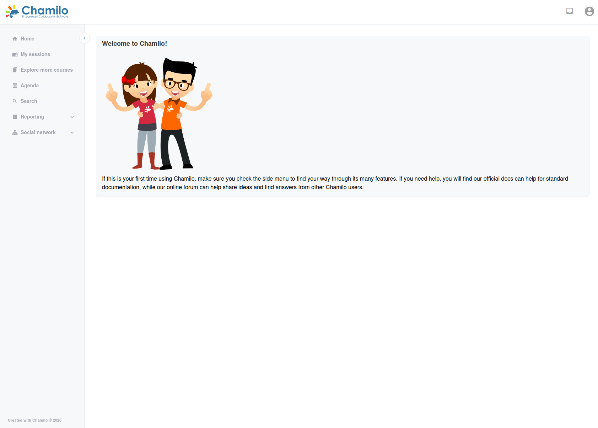
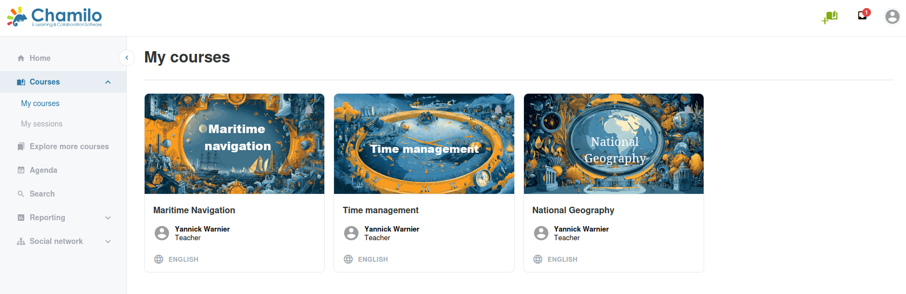

# Erste Schritte

Dieser Abschnitt hilft Ihnen, sich in Chamilo 3.0 zurechtzufinden. Sie erfahren, wie Sie sich anmelden, die Hauptoberfläche navigieren und Ihr Profil konfigurieren.

## Anmeldung

Um auf Chamilo zuzugreifen, öffnen Sie Ihren Browser und rufen Sie die von Ihrer Einrichtung bereitgestellte URL auf (zum Beispiel `https://chamilo.yourschool.edu`). Geben Sie auf der Anmeldeseite Ihren Benutzernamen und Ihr Passwort ein und klicken Sie auf **Anmelden**.

Wenn Ihre Einrichtung eine externe Authentifizierung verwendet (etwa Azure, Keycloak oder ein universitäres Single-Sign-on-System), sehen Sie unter dem Standardanmeldeformular möglicherweise zusätzliche Anmeldeschaltflächen. Klicken Sie auf die entsprechende Schaltfläche, um sich über den Identitätsanbieter Ihrer Einrichtung zu authentifizieren.

> Wenn Sie Ihr Passwort vergessen haben, klicken Sie auf der Anmeldeseite auf den Link **Passwort vergessen?**. Sie erhalten eine E-Mail mit Anweisungen zum Zurücksetzen.

## Erster Überblick

Nach der Anmeldung sehen Sie die Startseite von Chamilo. Die Oberfläche ist in drei Hauptbereiche gegliedert:

* **Obere Leiste** — Zeigt das Plattformlogo, Ihren Nachrichteneingang (mit einem Badge für ungelesene Nachrichten) und Ihren Benutzeravatar. Klicken Sie auf Ihren Avatar, um auf Ihr Profil und Ihre Kontoeinstellungen zuzugreifen.
* **Seitenleiste** — Das linke Navigationsfeld bietet schnellen Zugriff auf Ihre Kurse, Sitzungen, den Terminkalender, das soziale Netzwerk und mehr. Sie können es über den Schalter an seinem Rand einklappen.
* **Hauptinhaltsbereich** — Hier wird der Inhalt der aktuellen Seite angezeigt. Auf der Startseite sehen Sie Systemankündigungen und Ihre hervorgehobenen Kurse.

## Ihre Kurse

Klicken Sie in der Seitenleiste auf **Meine Kurse**, um alle Kurse zu sehen, in denen Sie als Lehrkraft oder Lernende bzw. Lernender eingeschrieben sind. Jeder Kurs erscheint als Karte mit folgenden Angaben:

* Das Kursbild oder Vorschaubild
* Der Kurstitel
* Schnellzugriffsaktionen

Wenn Ihre Einrichtung **Sitzungen** (zeitlich begrenzte Ausbildungszeiträume) verwendet, sehen Sie in der Seitenleiste außerdem einen Link **Meine Sitzungen**, gegliedert in aktuelle, vergangene und bevorstehende Sitzungen.

Sitzungen in Chamilo sind eine Möglichkeit, denselben Kurs verschiedenen Lerngruppen zu unterschiedlichen Zeiten anzubieten, ohne die Kursinhalte zu duplizieren. Stellen Sie sich eine Sitzung als eine geplante Ausgabe oder Kohorte eines Kurses vor. Mehr zu diesem Thema folgt später.

## Nächste Schritte

* [Die Oberfläche verstehen](understanding-the-interface.md) — Ein detaillierter Blick auf jeden Bereich der Chamilo-Oberfläche
* [Ihr Profil](your-profile.md) — So verwalten Sie Ihre persönlichen Angaben und Einstellungen
* [Demokurse](demo-courses.md) — Die beiden vorgefertigten Kurse (AI Act und Using Chamilo), die in jeder neuen Installation enthalten sind