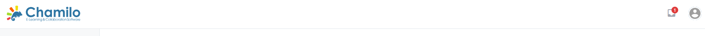
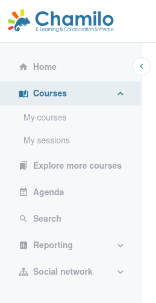

# Die Benutzeroberfläche verstehen

Chamilo 3.0 verfügt über eine klare, moderne Benutzeroberfläche, die die Navigation einfach halten soll. Auf dieser Seite wird jeder Teil der Benutzeroberfläche im Detail erläutert.

## Die obere Leiste

Die obere Leiste ist oben auf jeder Seite stets sichtbar. Sie enthält:

* **Plattformlogo** — Klicken Sie darauf, um jederzeit zur Startseite zurückzukehren.
* **Posteingangssymbol**  — Zeigt Ihre Nachrichten an. Ein rotes Kennzeichen weist auf ungelesene Nachrichten hin. Klicken Sie darauf, um Ihren Posteingang zu öffnen.
* **Support-Ticket-Symbol**  — Wenn Ihr Administrator diese Funktion aktiviert hat, erhalten Sie darüber Zugang zum Support-Ticket-System.
* **Ihr Avatar** — Ein kreisförmiges Bild in der oberen rechten Ecke. Klicken Sie darauf, um ein Dropdown-Menü mit Links zu Ihrem Profil, den Kontoeinstellungen und der Abmeldung zu öffnen.

## Die Seitenleiste

Die Seitenleiste links ist Ihre Hauptnavigation. Sie kann eingeklappt werden, um dem Inhaltsbereich mehr Platz zu geben. Klicken Sie auf den Umschaltpfeil an ihrem rechten Rand, um sie ein- oder auszuklappen. Chamilo merkt sich Ihre Einstellung.

Die Seitenleiste enthält die folgenden Links (einige können je nach Konfiguration Ihrer Plattform ausgeblendet sein):

| Menüeintrag | Symbol | Beschreibung |
|-----------|------|-------------|
| **Startseite** |  | Kehrt zum Haupt-Dashboard zurück |
| **Meine Kurse** |  | Listet alle Kurse auf, in denen Sie eingeschrieben sind |
| **Meine Sitzungen** |  | Listet Ihre Schulungssitzungen auf (aktuell, vergangen, bevorstehend) |
| **Weitere Kurse entdecken** |  | Durchsuchen Sie den Kurskatalog, um neue Kurse zu finden |
| **Agenda** |  | Ihr persönlicher und kursbezogener Kalender |
| **Berichte** |  | Zugriff auf die Lernendenverfolgung und Kursberichte |
| **Soziales Netzwerk** |  | Mit anderen Benutzern in Kontakt treten, Nachrichten senden, Gruppen beitreten |
| **Videokonferenz** |  | Zugriff auf Live-Videositzungen (sofern konfiguriert) |
| **Administration** |  | Plattformadministration (nur für Administratoren sichtbar) |

Ganz unten in der Seitenleiste finden Sie die Option **Abmelden**, mit der Sie sich schnell abmelden können, wenn Sie fertig sind. Diese Option ist auch über das Dropdown-Menü Ihres Avatarsymbols in der oberen rechten Ecke verfügbar.
Wenn die Plattform über externe Authentifizierungsmethoden verwaltet wird, sind diese Abmeldeoptionen möglicherweise nicht verfügbar.

## Der Hauptinhaltsbereich

Der zentrale Bereich des Bildschirms zeigt den Inhalt der aktuellen Seite an. Oben sehen Sie häufig eine **Brotkrümelnavigation**, die Ihren aktuellen Standort auf der Plattform anzeigt (zum Beispiel: Startseite > Rockmusik > Dokumente). Verwenden Sie die Brotkrumen, um zu einer übergeordneten Seite zurückzukehren.

## Die Kursstartseite

Wenn Sie einen Kurs betreten, sehen Sie die **Kursstartseite**. Diese wird im Abschnitt [Ihren Kurs erstellen](../creating-your-course/) ausführlich behandelt; hier folgt ein kurzer Überblick:

* **Kurstitel** — Oben deutlich sichtbar angezeigt
* **Kurseinführung** — Eine optionale Beschreibung im Rich-Text-Format, die Sie bearbeiten können
* **Werkzeugraster** — Ein Raster aus Symbolen, die die Kurswerkzeuge darstellen (Dokumente, Übungen, Foren usw.)

Als Lehrkraft sehen Sie zusätzliche Steuerelemente:

* **Studierendenansicht**  — Schalten Sie diese um, um den Kurs so zu sehen, wie ihn Studierende sehen würden
* **Einführung bearbeiten**  — Den Text der Kurseinführung bearbeiten
* **Alle anzeigen / Alle ausblenden** — Die Sichtbarkeit aller Werkzeuge für Studierende schnell ändern
* **Sortieren** — Drag-and-drop aktivieren, um die Werkzeuge auf der Startseite neu anzuordnen

## Symbolfarben

Dies ist noch experimentell und in Chamilo 3.0 nicht vollständig umgesetzt, aber wir versuchen, die folgenden Regeln für alle Schaltflächen und Aktionssymbole in der Benutzeroberfläche anzuwenden:

* **Grün** für Erstellungsaktionen. Dazu gehören das Hinzufügen, Erstellen, Importieren, Bewerten, Speichern und Kopieren von Inhalten.
* **Blau** für Ansichtsaktionen. Dazu gehören das Exportieren, Anzeigen, die Vorschau in Listen oder Detailansichten, das Suchen und Herunterladen.
* **Orange** für Bearbeitungsaktionen. Dazu gehören das Bearbeiten, Verschieben, Konfigurieren, Aktivieren/Deaktivieren, Ausblenden und Einblenden.
* **Rot** für Lösch-/Entfernungsaktionen. Dazu gehören das Löschen, Entfernen und Abmelden.
* **Grau** für Abbruchaktionen. Dabei bleibt der bisherige Zustand unverändert.

## Responsives Design

Chamilo 3.0 passt sich an unterschiedliche Bildschirmgrößen an. Auf einem Mobilgerät oder in einem schmalen Browserfenster:

* Die Seitenleiste ist standardmäßig ausgeblendet und kann durch Tippen auf das Menüsymbol geöffnet werden
* Kurskarten werden in einer einzelnen Spalte statt in einem Raster angezeigt
* Tabellen werden horizontal scrollbar

Das bedeutet, dass Sie und Ihre Lernenden von einem Telefon, Tablet oder Computer auf die Plattform zugreifen können, die Benutzeroberfläche jedoch möglicherweise leicht unterschiedlich erleben.