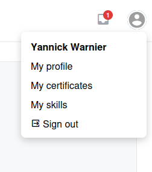

# Ihr Profil

Ihr Profil in Chamilo enthält Ihre persönlichen Informationen und Einstellungen. Andere Benutzer der Plattform können je nach Ihren Sichtbarkeitseinstellungen Teile Ihres Profils sehen.

## Zugriff auf Ihr Profil

Klicken Sie auf Ihren **Avatar** in der oberen rechten Ecke der oberen Leiste und wählen Sie anschließend **Profil** aus dem Dropdown-Menü. Sie können auch über den Bereich **Soziales Netzwerk** in der Seitenleiste darauf zugreifen.

## Profilinformationen

Auf Ihrer Profilseite werden möglicherweise folgende Angaben angezeigt (abhängig von der Konfiguration):

* **Avatar** — Ihr Profilbild. Klicken Sie auf **Profil bearbeiten**, um es zu ändern.
* **Vollständiger Name** — Ihr Vor- und Nachname, wie er auf der Plattform registriert ist.
* **E-Mail** — Ihre E-Mail-Adresse. Andere Benutzer können darauf klicken, um Ihnen eine Nachricht innerhalb von Chamilo zu senden.
* **Sprache** — Ihre bevorzugte Sprache.
* **Zusätzliche Felder** — Je nach Konfiguration Ihrer Plattform werden möglicherweise Felder wie Telefonnummer, Skype-Name, LinkedIn-Profillink oder von Ihrer Administration definierte benutzerdefinierte Felder angezeigt.

## Bearbeiten Ihres Profils

Um Ihre Profilinformationen zu aktualisieren, klicken Sie auf **Profil bearbeiten**. Hier können Sie:

* Ihren Namen, Ihre E-Mail-Adresse und Ihr Passwort ändern
* Ihren Avatar bzw. Ihr Bild hochladen oder ändern
* Ihre bevorzugte Sprache aktualisieren
* Zusätzliche Profilfelder ausfüllen (Skype, LinkedIn usw.)
* Benachrichtigungseinstellungen konfigurieren

Um Ihr Passwort zu ändern, klicken Sie auf **Passwort ändern**. Aus Sicherheitsgründen müssen Sie Ihr aktuelles Passwort sowie Ihr neues Passwort zweimal eingeben.

Wenn Ihre Administration die Option **Zwei-Faktor-Authentifizierung** (`2fa_enable`) für die Plattform aktiviert hat, können Sie in Ihrem Profil die 2FA für Ihr eigenes Konto mit einer TOTP-Authenticator-App (Google Authenticator, Authy, 1Password usw.) einschalten. Nach der Aktivierung wird im Anmeldevorgang zusätzlich zu Ihrem Passwort der zeitbasierte 6-stellige Code abgefragt.

## Personenbezogene Daten

Unter **Soziales Netzwerk** > **Personenbezogene Daten** können Sie alle Informationen einsehen, die Chamilo über Sie speichert. Dieser Bereich umfasst:

* Eine Zusammenfassung aller erfassten Daten, geordnet nach Kategorie
* Falls von Ihrer Organisation aktiviert, Ihren Annahmestatus für die **Nutzungsbedingungen** der Plattform
* Falls von Ihrer Organisation aktiviert, eine Option zum **Widerruf Ihrer Einwilligung** oder zum **Konto löschen**, wodurch eine Anfrage zur Kontolöschung ausgelöst wird, die Ihre Administration bearbeitet

> Diese Funktion wird bereitgestellt, um Datenschutzvorschriften einzuhalten. Wenden Sie sich an Ihre Administration, wenn Sie Fragen zur Verarbeitung Ihrer Daten haben.