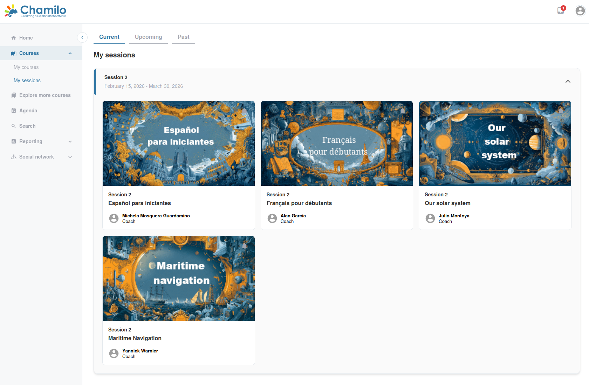

# Sitzungen

Sitzungen in Chamilo sind eine Möglichkeit, denselben Kurs verschiedenen Lerngruppen zu unterschiedlichen Zeiten anzubieten, ohne die Kursinhalte zu duplizieren. Stellen Sie sich eine Sitzung als eine geplante Ausgabe oder Kohorte eines Kurses vor.

## Funktionsweise von Sitzungen

Ein **Kurs** ist ein Container für Inhalte und Werkzeuge. Eine **Sitzung** weist diesen Kurs einer bestimmten Lerngruppe für einen bestimmten Zeitraum zu. Das bedeutet:

* Derselbe Kurs kann in mehreren Sitzungen wiederverwendet werden
* Jede Sitzung hat eigene eingeschriebene Lernende sowie eigene Start- und Enddaten
* Jede Sitzung hat eigene Ergebnisse — Noten, Fortschritt und Tracking-Daten werden pro Sitzung getrennt geführt
* Die Basisinhalte des Kurses werden gemeinsam genutzt, Lehrkräfte können jedoch bestimmte Elemente pro Sitzung anpassen

## Ihre Sitzungen

Klicken Sie in der Seitenleiste auf **Meine Sitzungen**, um Ihre Sitzungen anzuzeigen. Sie sind in drei Ansichten gegliedert:

* **Aktuelle Sitzungen** — Sitzungen, die derzeit aktiv sind
* **Vergangene Sitzungen** — Sitzungen, die beendet sind
* **Bevorstehende Sitzungen** — Sitzungen, die noch nicht begonnen haben

Jede Sitzung zeigt die enthaltenen Kurse an. Klicken Sie auf einen Kurs innerhalb einer Sitzung, um darauf zuzugreifen.

## Unterrichten in einer Sitzung

Wenn Sie einen Kurs über eine Sitzung öffnen, ähnelt die Erfahrung einem regulären Kurs, mit einigen Unterschieden:

* Der **Sitzungsname** erscheint neben dem Kurstitel, sodass Sie stets wissen, in welcher Sitzung Sie arbeiten
* Lerndaten (Fortschritt, Noten, Abgaben) gelten speziell für diese Sitzung
* Einige Einstellungen (etwa die Möglichkeit, die Sichtbarkeit von Werkzeugen zu ändern) können von der Sitzungsverwaltung gesperrt sein

## Sitzungsrollen

Sitzungen führen zusätzliche Rollen ein:

| Rolle | Beschreibung |
|------|-------------|
| **Sitzungsverwaltung** | Verwaltet die Erstellung und Konfiguration von Sitzungen |
| **Sitzungstutor** | Betreut alle Kurse innerhalb einer Sitzung (kann das Tracking kursübergreifend einsehen) |
| **Kurstutor** | Unterrichtet einen bestimmten Kurs innerhalb einer Sitzung |

Wenn Sie in einer Sitzung als **Kurstutor** zugewiesen sind, können Sie die Inhalte dieses Kurses verwalten und den Lernfortschritt der Lernenden dieser Sitzung verfolgen.

> Sitzungen werden in der Regel von Administratoren verwaltet. Wenn Sie eine Sitzung erstellen oder ändern müssen, wenden Sie sich an Ihre Plattformadministration oder Sitzungsverwaltung.