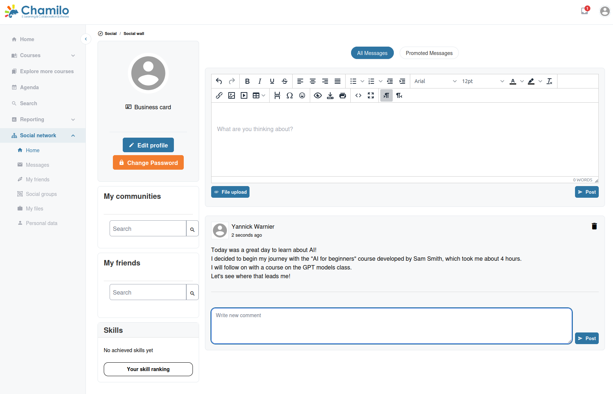

# Soziales Netzwerk

Chamilo enthält ein integriertes soziales Netzwerk, mit dem Sie sich mit anderen Benutzerinnen und Benutzern auf der Plattform vernetzen können. Diese Funktion kann von Ihrer Plattformadministration aktiviert oder deaktiviert werden.

## Zugriff auf das soziale Netzwerk

Klicken Sie in der Seitenleiste auf **Soziales Netzwerk**, um auf die sozialen Funktionen zuzugreifen. Wenn Sie diese Option nicht sehen, hat Ihre Administration sie möglicherweise deaktiviert.

## Ihre soziale Pinnwand

Die soziale Pinnwand zeigt einen Feed mit Aktivitäten von Ihnen und Ihren Kontakten. Sie können:

* **Aktualisierungen veröffentlichen** — Text und Links mit Ihren Kontakten teilen
* **Gefällt mir und kommentieren** — Mit Beiträgen anderer Benutzerinnen und Benutzer interagieren
* **Aktivitäten anzeigen** — Aktuelle Beiträge von Personen sehen, mit denen Sie verbunden sind

## Kontakte

Sie können sich mit anderen Benutzerinnen und Benutzern auf der Plattform vernetzen:

* **Benutzerinnen und Benutzer suchen** — Kolleginnen, Kollegen und Lernende nach Namen finden
* **Kontaktanfragen senden** — Andere Benutzerinnen und Benutzer zum Vernetzen einladen
* **Kontakte verwalten** — Kontakte annehmen, ablehnen oder entfernen

> **Hinweis:** Lernende können nur nach anderen Lernenden suchen und diese als Freundinnen oder Freunde hinzufügen — sie können keine Freundschaftsanfragen an Lehrkräfte senden. Als Lehrkraft können Sie jedoch nach Lernenden suchen und anfragen, sie als Freundinnen oder Freunde hinzuzufügen.

## Nachrichten

Das soziale Netzwerk ist in das Nachrichtensystem der Plattform integriert:

* **Nachrichten senden**  — Direkte Nachrichten an andere Benutzerinnen und Benutzer schreiben
* **Posteingang**  — Empfangene Nachrichten lesen und beantworten
* **Gesendete Nachrichten**  — Von Ihnen gesendete Nachrichten überprüfen

### Verfassen und Antworten

Beim Verfassen einer neuen Nachricht können Sie sie gleichzeitig an mehrere Empfängerinnen und Empfänger richten. Ebenso können Sie beim Antworten auf eine Nachricht mehrere Benutzerinnen und Benutzer in Ihre Antwort einbeziehen — nützlich für die Koordination in der Gruppe ohne eine formale soziale Gruppe.

### E-Mail-Antworten und Öffnungsstatus

Wenn eingehende E-Mail-Antworten von der Administration aktiviert sind, können Empfängerinnen und Empfänger von Benachrichtigungen über direkte Nachrichten aus ihrem E-Mail-Programm antworten, und die Antwort wird der Konversation in Chamilo hinzugefügt. Die Antwort muss von der E-Mail-Adresse stammen, die im Chamilo-Konto der Empfängerin oder des Empfängers registriert ist.

Wenn die Nachverfolgung des Öffnens von E-Mails aktiviert ist, können Ihre **Gesendeten Nachrichten** auch einen Zeitstempel **E-Mail-Benachrichtigungen** anzeigen. Dieser bedeutet nur, dass das Tracking-Bild der Benachrichtigung angefordert wurde, und beweist nicht, dass die Nachricht gelesen wurde.

### Schwebender Chat und Einzelvideoanrufe

Das schwebende Chat-Panel ist sowohl vom Posteingang als auch vom Kurswerkzeug **Chat** getrennt. Wählen Sie einen Online-Kontakt aus, um direkte Nachrichten in Echtzeit auszutauschen. Wenn die Administration den Videochat aktiviert hat und Ihr Browser WebRTC unterstützt, zeigt ein Online-Kontakt außerdem **Videoanruf starten** an.

Anrufe erfolgen eins zu eins. Die Empfängerin oder der Empfänger kann einen eingehenden Anruf **Annehmen** oder **Ablehnen**. Während eines verbundenen Anrufs kann jede teilnehmende Person das Mikrofon stummschalten oder die Stummschaltung aufheben, die Kamera ein- oder ausschalten und auflegen. Der Browser kann beim ersten Mal um die Berechtigung für Kamera und Mikrofon bitten.

### Nachrichten-Tags

Wenn Ihre Plattformkonfiguration Nachrichten-Tags verwendet (in der Regel auf Plattformebene verwaltet), zeigt Ihr Posteingang eine Tag-Liste an, auf die Sie klicken können, um Nachrichten nach diesem Tag zu filtern. So lassen sich zugehörige Unterhaltungen schneller finden, wenn Ihr Posteingang wächst.

## Soziale Gruppen

Soziale Gruppen ermöglichen es Benutzerinnen und Benutzern, sich um gemeinsame Interessen oder Projekte zu versammeln:

* **Gruppen beitreten** — Vorhandene Gruppen durchsuchen und ihnen beitreten
* **Gruppen erstellen** — Eine neue soziale Gruppe starten (sofern zulässig)
* **Gruppendiskussionen** — Beiträge im Kontext einer Gruppe teilen

> Soziale Gruppen unterscheiden sich von **Kursgruppen** (behandelt im Abschnitt [Gruppen](collaboration-and-communication/groups.md)). Kursgruppen sind an einen bestimmten Kurs gebunden, während soziale Gruppen plattformweit gelten.