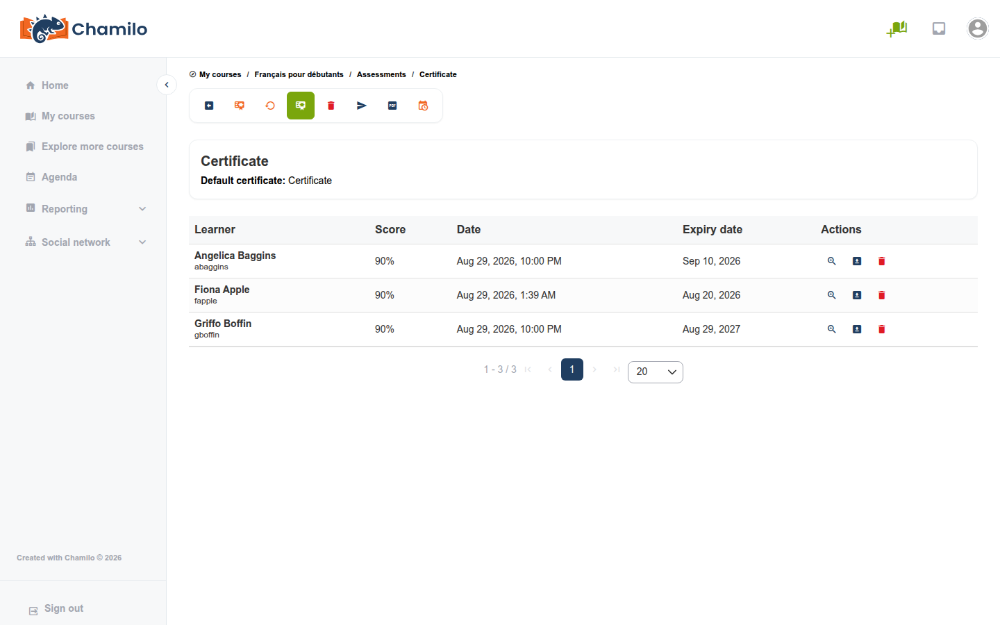
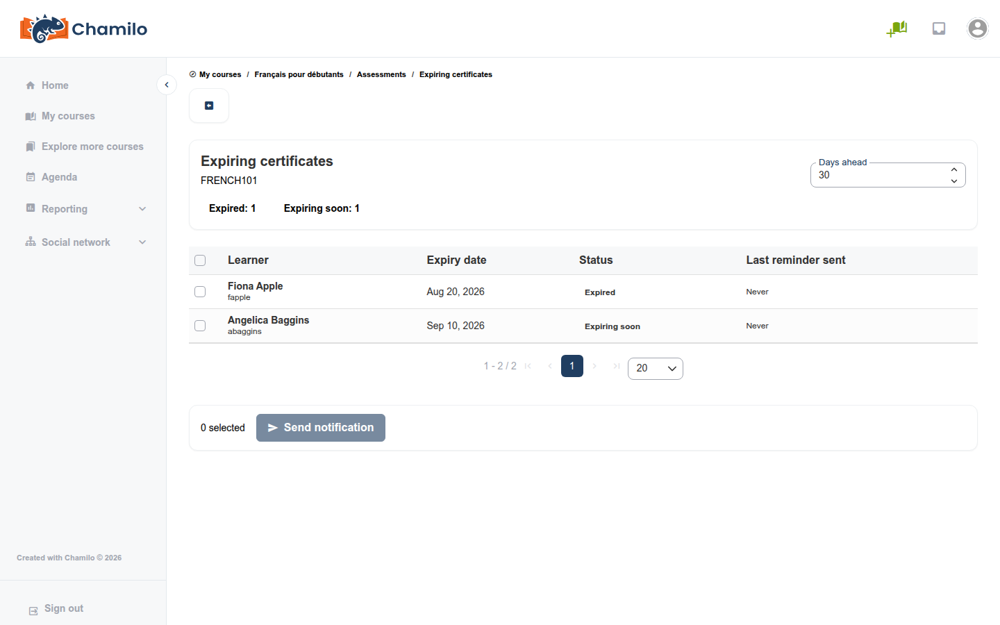
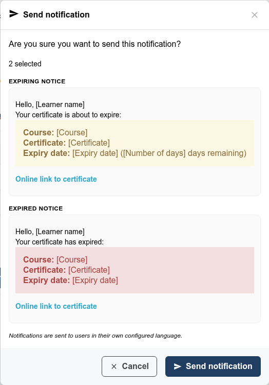

# Zertifikate und Kompetenzen

Chamilo ermöglicht es Ihnen, Lernenden Zertifikate zu verleihen, die bestimmte Leistungskriterien erfüllen, und die mit diesen Leistungen verbundenen Kompetenzen zu validieren.

## Funktionsweise von Zertifikaten

Zertifikate sind mit den **Bewertungen** (auch Notenbuch genannt) verknüpft. Wenn die Note eines Lernenden den von Ihnen festgelegten Mindestschwellenwert erreicht oder überschreitet, steht ein Zertifikat zum Herunterladen zur Verfügung.

Der Ablauf ist:

1. Richten Sie die [Bewertungen](../assessing-learners/gradebook.md) mit Ihren Übungen, Aufgaben und anderen bewerteten Aktivitäten ein
2. Legen Sie eine **Mindestpunktzahl für die Zertifizierung** fest (z. B. 70 %)
3. Wenn ein Lernender diese Punktzahl erreicht, kann er sein Zertifikat herunterladen (entweder direkt im Bewertungswerkzeug oder aus einem Lernpfad, wenn Sie den letzten Schritt entsprechend konfiguriert haben). Als Lehrkraft können Sie außerdem die Aktion **Zertifikate erzeugen** im Notenbuch verwenden, um die PDFs stapelweise für alle berechtigten Lernenden zu erstellen.

## Zertifikatsvorlagen

Zertifikate verwenden Vorlagen, die vom Plattformadministrator festgelegt werden. Die Vorlage enthält in der Regel:

* Den Namen des Lernenden
* Den Kursnamen
* Das Abschlussdatum
* Die erreichte Punktzahl
* Einen QR-Code oder eine URL zur Online-Überprüfung

Wenn Sie den Zertifikatsvorlagen-Manager für die Bewertungen eines Kurses zum ersten Mal öffnen (das Symbol **Zertifikat anhängen** im Notenbuch), dupliziert Chamilo automatisch die Standardzertifikatsvorlage der Plattform in den Kurs. So landen Sie nie auf einer leeren Seite — die Kopie können Sie von dort aus frei anpassen. Wenn Sie sie später lösen (**Stattdessen das System-Standardzertifikat verwenden**), wird sie beim erneuten Öffnen des Managers nicht ein zweites Mal neu erstellt; nur ein Kurs, dem tatsächlich noch nie ein Zertifikatsdokument zugeordnet war, erhält automatisch eines.

### Platzhalter zur Kursverfolgung in Vorlagen

Zertifikatsvorlagen können zusätzlich zu den Feldern für Lernende, Kurs und Note Platzhalter zur Kursverfolgung enthalten. Die folgenden Platzhalter werden ausgefüllt, wenn Chamilo ein Zertifikat erzeugt:

| Platzhalter | Wert |
|-------------|-------|
| `((time_in_course))` | Zeit, die der Lernende im Kurs im aktuellen Kurs-/Sitzungskontext verbracht hat, formatiert als verstrichene Zeit. |
| `((time_in_course_in_all_sessions))` | Summe der erfassten Zeit des Lernenden für diesen Kurs **über alle Sitzungen hinweg**. Es handelt sich um eine Sitzungsaggregation, die nicht unbedingt mit der Zeit des aktuellen Kontexts übereinstimmt. |
| `((start_date_and_end_date))` | Erstes und letztes Verbindungsdatum zum Kurs im aktuellen Kontext. Fallen beide auf denselben Tag, lautet die Bezeichnung das lokalisierte Äquivalent von **Am [Datum]**; andernfalls **Von [erstem Datum] bis [letztem Datum]**. |

Diese Werte stammen aus der Lernendenverfolgung und stellen **erfasste Aktivität** dar, nicht die geplante Kursdauer oder akademische Kreditstunden. Die Tags für die verstrichene Zeit verwenden nun die normale Zeitformatierung von Chamilo, ohne die frühere abgekürzte Formatierung. Sehen Sie sich das erzeugte Zertifikat mit repräsentativen Verfolgungsdaten in der Vorschau an, insbesondere wenn ein Kurs in mehreren Sitzungen wiederverwendet wird.

## Gültigkeit und Ablauf von Zertifikaten

Zertifikate können so eingestellt werden, dass sie nach einer bestimmten Anzahl von Tagen ablaufen. In den Einstellungen der [Bewertungen](../assessing-learners/gradebook.md) für die Stammkategorie erscheint, sobald **Zertifikate erzeugen** aktiviert ist, ein Feld **Gültigkeit des Zertifikats (Tage)**. Belassen Sie es bei `0` (dem Standardwert) für Zertifikate, die nie ablaufen, oder legen Sie eine Anzahl von Tagen fest, nach der ein Zertifikat ab dem Ausstellungsdatum abläuft.

Das eigene Ablaufdatum jedes Zertifikats wird beim Erzeugen (oder erneuten Erzeugen) automatisch aus dieser Einstellung berechnet — Sie legen es nicht Zertifikat für Zertifikat fest. Die Liste **Zertifikate** zeigt für jeden Lernenden eine Spalte **Ablaufdatum** an und gibt **Läuft nie ab** an, wenn kein Gültigkeitszeitraum gilt.

Wenn für die Kategorie kein Gültigkeitszeitraum konfiguriert ist, können Sie das Ablaufdatum eines einzelnen Lernenden weiterhin manuell festlegen (oder ändern): Klicken Sie neben dem Eintrag auf die Schaltfläche mit dem Stift **Ablaufdatum bearbeiten** und wählen Sie ein Datum. Diese Schaltfläche ist nur verfügbar, wenn die Kategorie selbst keinen Gültigkeitszeitraum hat — sobald ein Gültigkeitszeitraum festgelegt ist, werden Ablaufdaten automatisch verwaltet und können nicht mehr Zertifikat für Zertifikat bearbeitet werden.

### Lernende an ein bevorstehendes oder vergangenes Ablaufdatum erinnern

Öffnen Sie die Liste **Zertifikate** für Ihre Bewertung und klicken Sie auf die Schaltfläche **Ablaufende Zertifikate** , um zu sehen, welche Zertifikate der Lernenden abgelaufen sind oder demnächst ablaufen. Die Seite zeigt pro Lernendem: das **Ablaufdatum** des Zertifikats, seinen **Status** (**Abgelaufen** oder **Läuft bald ab**) und wann eine Erinnerung dazu **Zuletzt gesendete Erinnerung** war (oder **Nie**). Verwenden Sie **Tage im Voraus**, um zu erweitern oder einzugrenzen, wie weit in die Zukunft „läuft bald ab“ reicht.

So benachrichtigen Sie Lernende selbst:

1. Wählen Sie die Lernenden aus, die Sie erinnern möchten (oder wählen Sie alle aus)
2. Klicken Sie auf **Benachrichtigung senden**
3. Prüfen Sie die Vorschau der E-Mail, die gesendet wird — je nachdem, in welchen Fall die ausgewählten Lernenden fallen, werden separate Vorschauen für die Formulierungen „läuft bald ab“ und „abgelaufen“ angezeigt
4. Bestätigen Sie, indem Sie im Dialog erneut auf **Benachrichtigung senden** klicken

Jede lernende Person wird in ihrer eigenen konfigurierten Sprache benachrichtigt, sowohl per E-Mail als auch über eine interne Chamilo-Nachricht. Ein erneutes Senden für dasselbe Zertifikat und dasselbe Ablaufdatum ist unbedenklich — Chamilo protokolliert, was bereits pro Zertifikat gesendet wurde, und überschüttet Lernende nicht mit doppelten Erinnerungen, es sei denn, Sie senden ausdrücklich erneut.

Administratoren können dieselben Erinnerungen auch automatisch und wiederkehrend planen, ohne dass eine Lehrkraft sie manuell auslösen muss — siehe [Einstellungen für Cron-Jobs](../../admin-guide/platform-settings/crons-settings.md#certificate-expiry-reminders).

## Signierte Zertifikatsnachweise (optional)

Wenn der Administrator die Überprüfung signierter Zertifikate aktiviert, können Lernende unter **Meine Zertifikate** die Veröffentlichung eines überprüfbaren Nachweises genehmigen oder zurückziehen. Nach der Genehmigung kann ein Administrator den signierten Nachweis ausstellen und optional seinen Fingerabdruck im Sepolia-Testnetz verankern. Ein öffentlicher Überprüfungslink prüft die Signatur des Nachweises, die aktuelle Einwilligung, den Widerruf und den zugrunde liegenden Zertifikatsstatus; die Verankerung in Sepolia ist optional und verwendet ein Testnetzwerk.

Siehe [Überprüfung signierter Zertifikate](../../admin-guide/maintenance/signed-certificate-verification.md) für den Administrator-Workflow und wichtige Grenzen der Einwilligung.

## Zertifikatsvorlagen aus ZIP-Dateien importieren

Sie können ein ZIP-Paket hochladen, das eine HTML-Zertifikatsvorlage und deren Bilder enthält, wenn Sie ein Zertifikat an eine Kursbewertung anhängen. Wählen Sie in der Ansicht zum Hochladen der Zertifikatsvorlage eine `.html`-Datei oder ein `.zip`-Archiv. Chamilo importiert die HTML-Vorlage und bettet unterstützte Bildressourcen ein, sodass das Zertifikat in der Vorschau angezeigt und erzeugt werden kann, ohne die extrahierten Bilder als öffentliche Dateien offenzulegen.

Das ZIP muss mindestens eine `.html`- oder `.htm`-Datei enthalten. HTML-Vorlagen dürfen sich in Unterverzeichnissen befinden; unterstützte Bildformate sind PNG, JPEG, GIF und WebP. Andere Dateitypen, unsichere Archivpfade, symbolische Links und übergroße Archive werden abgelehnt. Wenn ein Paket mehrere Vorlagen enthält, prüfen Sie die importierten Dokumente und wählen Sie die vorgesehene Zertifikatsvorlage aus, bevor Sie Zertifikate für Lernende erzeugen.

Zeigen Sie ein Zertifikat mit einem Testlernenden in der Vorschau an, bevor Sie es in großer Zahl erzeugen, insbesondere wenn das Layout relative Bildpfade oder Platzhalter zur Kursverfolgung referenziert. Siehe [PR zum ZIP-Import von Zertifikaten #9371](https://github.com/chamilo/chamilo-lms/pull/9371).

## Plattformbericht für abgelaufene Zertifikate

Portaladministratoren verfügen in der globalen Berichterstattung über einen Bericht **Abgelaufene Zertifikate**. Er unterstützt die Filterung nach Stichwort, Sitzung, Kurs, Monat und Jahr und listet das Ablaufdatum jedes passenden Zertifikats auf. Dies unterscheidet sich von der oben beschriebenen Erinnerungsansicht **Ablaufende Zertifikate** der Lehrkraft. Siehe [PR zum globalen Bericht über abgelaufene Zertifikate #9372](https://github.com/chamilo/chamilo-lms/pull/9372) und den [Leitfaden zu globalen Statistiken](../../admin-guide/analytics/global-statistics.md).

## Kompetenzen

Kompetenzen stehen für Fähigkeiten, die Lernende erwerben. In Chamilo:

* Kompetenzen können mit Leistungen im Notenbuch verknüpft werden
* Wenn ein Lernender ein Zertifikat erwirbt, werden alle zugehörigen Kompetenzen automatisch validiert
* Kompetenzen sammeln sich im Profil des Lernenden und bilden so eine Kompetenzakte
* Kompetenzen können hierarchisch organisiert werden (z. B. „Datenanalyse“ unter „Forschungsmethoden“)
* Kompetenzen können zusätzlich durch Peers bewertet werden (360°-Evaluation)

## Zertifikats- und Kompetenzstatus anzeigen

Als Lehrkraft können Sie Folgendes einsehen:

* Welche Lernenden in Ihrem Kurs Zertifikate erworben haben
* Welche Kompetenzen validiert wurden
* Den Fortschritt der Lernenden in Richtung der Zertifizierungsschwelle
* Welche Zertifikate abgelaufen sind oder bald ablaufen und ob bereits eine Erinnerung dafür versendet wurde

Lernende können ihre eigenen Zertifikate und validierten Kompetenzen in ihrem Profil einsehen und über das Kompetenzrad (Skills Wheel) prüfen, welche Kompetenzen in ihrer Organisation gefragt sind.

Wenn Ihre Plattform akademische Leistungsnachweise verwendet, wird jedes von einem Lernenden erworbene Zertifikat auch zu einer Zeile seines Leistungsnachweises, mit der Punktzahl und dem Buchstaben der Notenskala — siehe [Akademische Leistungsnachweise](../../admin-guide/users/academic-transcripts.md).

## Tipps

* **Klare Erwartungen setzen** — Teilen Sie den Lernenden zu Beginn des Kurses mit, was sie erreichen müssen, um ein Zertifikat zu erhalten
* **Aussagekräftige Kompetenzbezeichnungen verwenden** — Kompetenzen sollten beschreiben, was die Lernenden können, und nicht nur den Kursnamen wiedergeben
* **Mit Portfolios kombinieren** — Ermutigen Sie die Lernenden, ihre Zertifikate ihrem Portfolio hinzuzufügen
* **Zertifikate erweitern** — Bitten Sie Ihre Administration, das Plugin [Custom Certificate](../plugins/custom-certificate.md) zu aktivieren, um noch mehr Möglichkeiten bei der Zertifikatsvorlagengestaltung freizuschalten
* **Gültigkeitsdauer für compliancebezogene Zertifizierungen festlegen** — Wenn eine Zertifizierung regelmäßig erneuert werden muss (z. B. Sicherheitsschulung), legen Sie **Zertifikatsgültigkeit (Tage)** fest, damit die Lernenden erinnert werden, bevor sie abläuft