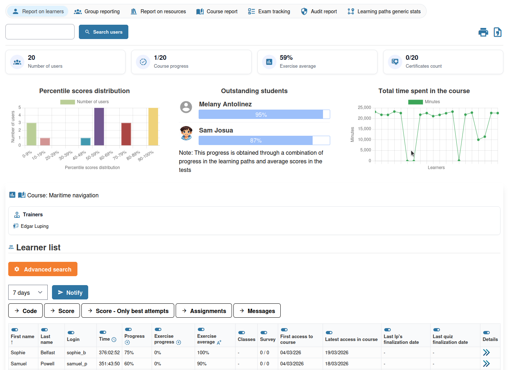

# Kursberichte

Kursberichte bieten Ihnen eine Gesamtübersicht über Aktivität und Leistung aller Lernenden in Ihrem Kurs.

## Zugriff auf Kursberichte

Öffnen Sie das Werkzeug **Nachverfolgung**  auf der Kursstartseite und wählen Sie die Berichtsansicht auf Kursebene.

## Verfügbare Berichte

### Aktivitätsübersicht

Eine Zusammenfassung der gesamten Kursbeteiligung, einschließlich der eingeschriebenen Lernenden, der im Kurs verbrachten Zeit, des Kursfortschritts, des Übungsfortschritts und der durchschnittlichen Punktzahl sowie der Aufgabenaktivität.

Separate Detailansichten sind im Bereich Nachverfolgung verfügbar für **Ressourcen** (Zugriffsanzahlen je Ressource), **Werkzeuge** (Nutzung je Werkzeug) und **Ereignisse** (unbearbeitetes Ereignisprotokoll).

### Übungsberichte

Für jede Übung im Kurs:

* Anzahl der Lernenden, die sie bearbeitet haben
* Durchschnittliche Punktzahl
* Punkteverteilung
* Anzahl der Lernenden, die bestanden haben (basierend auf der von Ihnen festgelegten Bestehensschwelle)

### Lernpfadberichte

Für jeden Lernpfad:

* Abschlussquoten aller Lernenden
* Durchschnittlicher Fortschritt in Prozent
* Aufgewendete Zeit je Element
* Lernende, die den Pfad abgeschlossen haben, gegenüber jenen, die sich noch in Bearbeitung befinden

### Aufgabenberichte

Für jede Aufgabe:

* Anzahl der eingegangenen Abgaben
* Anzahl der ausstehenden Überprüfungen

## Daten exportieren

Sie können Nachverfolgungs- und Berichtsdaten zur weiteren Analyse exportieren. Suchen Sie die Option **Exportieren** , um die Daten in einem tabellenkalkulationskompatiblen Format herunterzuladen.

## Sitzungsberichte

Wenn Sie innerhalb einer Sitzung unterrichten, sind die Berichte auf die Lernenden der Sitzung beschränkt. Sitzungstutorinnen und Sitzungstutoren haben Zugriff auf Berichte aller Kurse in ihrer Sitzung. Eine globale Konfigurationseinstellung kann Lehrkräften außerdem ermöglichen, Aufgaben über alle Sitzungen hinweg einzusehen, die ihren Kurs verwenden (wenden Sie sich an Ihre Administration).