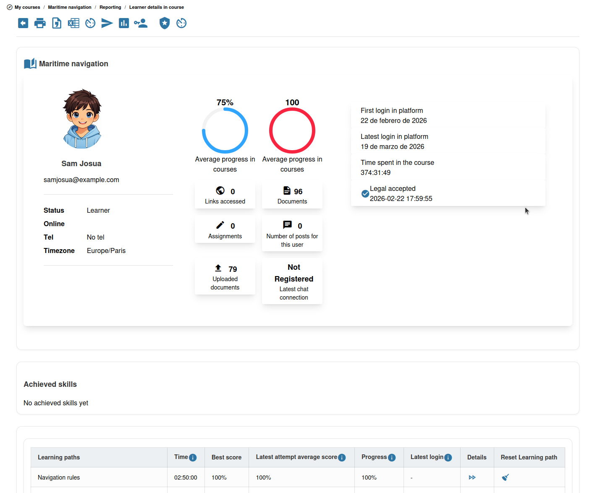

# Tracking der Lernenden

Chamilo verfolgt die Aktivitäten der Lernenden auf der gesamten Plattform und gibt Ihnen detaillierte Einblicke, wie sich jede lernende Person mit Ihrem Kurs auseinandersetzt.

## Zugriff auf das Tracking der Lernenden

Öffnen Sie das Werkzeug **Tracking**  auf der Kursstartseite oder klicken Sie in der Seitenleiste auf **Berichte**.

## Was erfasst wird

Für jede lernende Person erfasst Chamilo (in der zentralen Tracking-Ansicht je Lernende):

* **Anmeldeaktivität** — Wann sich die lernende Person zuletzt angemeldet hat und ihre gesamte Anmeldezeit
* **Im Kurs verbrachte Zeit** — Die Gesamtzeit, die die lernende Person in Ihrem Kurs verbracht hat
* **Erster und letzter Zugriff** — Wann die lernende Person den Kurs erstmals betreten und zuletzt besucht hat
* **Kursfortschritt** — Aggregierter Fortschrittsprozentsatz über den gesamten Kurs
* **Übungsergebnisse** — Punktzahlen und Versuche für jede Übung
* **Lernpfadfortschritt** — Abschlussprozentsatz und aufgewendete Zeit für jeden Lernpfad
* **Aufgabenabgaben** — Welche Aufgaben eingereicht und bewertet wurden

Zugriffsdetails je Ressource (welche konkreten Dokumente oder Seiten eine lernende Person geöffnet hat) sowie Aktivitäten auf Werkzeugebene sind über die eigenen Ansichten **Ressourcen**, **Werkzeuge** und **Ereignisse** im Tracking-Bereich verfügbar, nicht in der zentralen Zeile der lernenden Person.

## Individuelle Daten der Lernenden anzeigen

Klicken Sie auf den Namen einer lernenden Person, um ihren detaillierten Aktivitätsbericht anzuzeigen. Dieser zeigt:

* Eine Zusammenfassung ihres gesamten Engagements
* Den Fortschritt in jedem Lernpfad
* Übungspunktzahlen und die Versuchshistorie
* Den Status der Aufgabenabgaben

## Bericht der lernenden Person über alle Kurse

**Berichte** > **Lernende** und anschließend die Details einer lernenden Person öffnen den Bericht der lernenden Person (`/reporting/learners/{id}`), der jeden Kurs umfasst, dem die lernende Person folgt. Unter dem Profil der lernenden Person und den erworbenen Kompetenzen werden angezeigt:

* **Klassen** — Die Klassen, denen die lernende Person angehört, sofern vorhanden
* **Kurse** — Die Kurse, für die die lernende Person direkt eingeschrieben ist
* **Eine Tabelle je Sitzung** — Titel und Zugriffsdaten der Sitzung, anschließend die Kurse der lernenden Person in dieser Sitzung

Administratoren, Personalverantwortliche, Vorgesetzte und Sitzungsadministratoren sehen alle Einschreibungen der lernenden Person. Lehrkräfte, Tutoren und Coaches sehen nur die Kurse, die sie unterrichten oder betreuen, die Sitzungen, die sie als allgemeiner Coach betreuen, sowie die Kurse, die sie in einer Sitzung coachen; eine Kurslehrkraft sieht diesen Kurs außerdem in den Sitzungen der lernenden Person.

Daten werden in der Zeitzone der Benutzerin bzw. des Benutzers angezeigt, wenn diese eine wählen dürfen, andernfalls in der Zeitzone der Plattform.

Jede Kurstabelle listet für jeden Kurs die verbrachte Zeit, den Fortschritt, die Punktzahl, die Abwesenheiten (versäumte Anwesenheitslisten von der Gesamtzahl) und die Notenbuchpunktzahl auf, gefolgt von einer Zeile **Gesamt**. Der Kurstitel öffnet den Kurs, und die Schaltfläche für Details öffnet den Bericht der lernenden Person in diesem Kurs. Ein Kurs, dem sowohl direkt als auch in einer Sitzung gefolgt wird, erscheint in beiden Tabellen, jeweils mit den Zahlen der betreffenden Einschreibung.

Jede Tabelle kann einzeln nach CSV oder Excel exportiert werden. Sitzungstabellen bieten zusätzlich einen PDF-Export der Anwesenheit der Sitzung und ein **Leistungszertifikat**. Die Exportschaltflächen oben auf der Seite exportieren alle Tabellen auf einmal.

### Erworbene Kompetenzen

Der Block **Erworbene Kompetenzen** zeigt die Kompetenzen, die die lernende Person erworben hat. Ein Klick auf eine Kompetenz öffnet ihr Abzeichen. Wie die Kompetenzen angeordnet werden, hängt von zwei Einstellungen der Kategorie **Kompetenzen** in den Plattformeinstellungen ab:

* Wenn **Bezeichnungen der Kompetenzstufen** (`skill.skill_levels_names`) leer ist, werden die erworbenen Kompetenzen nacheinander aufgelistet.
* Andernfalls werden die Kompetenzen im Kompetenzbaum angeordnet: Jede erworbene Kompetenz erscheint unter ihren übergeordneten Kompetenzen bis zur Spitze des Baums. Die übergeordneten Kompetenzen, die die lernende Person nicht erworben hat, werden abgeblendet dargestellt, und es werden nur die Zweige gezeichnet, die mindestens eine erworbene Kompetenz enthalten.
  * Ist **Kompetenzen als hierarchische Tabelle anzeigen** (`skill.skills_hierarchical_view_in_user_tracking`) aktiviert, ist jeder Zweig der obersten Ebene eine Spalte, unter der die zugehörigen Kompetenzen verschachtelt sind.
  * Ist die Einstellung deaktiviert, ist jeder Zweig der obersten Ebene eine Überschrift, gefolgt von den zugehörigen Kompetenzen nebeneinander: Die erste Ebene unter der Überschrift hat größere Abzeichen, und die tieferen Ebenen zeigen ihr Abzeichen ohne Titel.

Eine Kompetenz zeigt ihren Kurzcode anstelle ihres Titels an, sofern sie einen besitzt. Eine Kompetenz ohne übergeordnete Kompetenz erscheint an der Spitze des Baums.

Der Bericht der lernenden Person in einem einzelnen Kurs ordnet die in diesem Kurs erworbenen Kompetenzen auf dieselbe Weise an.

### Nachrichten über die lernende Person

Wenn in den Plattformeinstellungen **Private Nachrichten zwischen Lehrkräften über eine lernende Person zulassen** (`message.private_messages_about_user`) aktiviert ist, listet ein Block **Nachrichten** am unteren Rand des Berichts die Nachverfolgungsnachrichten auf, die über die lernende Person verfasst wurden. Klicken Sie auf eine Nachricht, um sie zu lesen. **Neue Nachricht** erstellt eine neue Nachricht mit einem Betreff und einem Text. Wird eine Nachricht gesendet, erhalten die Vorgesetzten der lernenden Person eine Benachrichtigung mit einem Link zum Bericht. Sie können nur die Nachrichten löschen, die Sie selbst verfasst haben; jede Löschung wird im Ereignisprotokoll der Plattform aufgezeichnet.

Der Bericht der lernenden Person in einem Kurs, der über die Schaltfläche „Details“ geöffnet wird, zeigt ebenfalls die Klassen der lernenden Person und denselben Block **Nachrichten**.

## Lernpfadpunktzahlen: Der beste Versuch zählt

> **Verhaltensänderung.** Die Lernpfadstatistiken verwenden nun je Element den **besten Versuch** jeder lernenden Person anstelle des Durchschnitts aller Versuche.

Wenn eine lernende Person ein Lernpfadelement (SCORM-Element oder Test) mehrmals öffnet, entspricht die in den Lernpfadstatistiken angezeigte Punktzahl der Punktzahl des besten Versuchs dieser Person für dieses Element. Zuvor wurde jeder Versuch zur Gesamtsumme addiert und als zusätzliches Element gezählt, sodass die angezeigte Punktzahl der Durchschnitt aller Versuche war: Eine lernende Person, die bei demselben Element 9/10 und anschließend 4/10 erzielte, wurde mit 65 % angezeigt; nun werden 90 % angezeigt.

* Es gibt einen Wert je Element und je lernender Person: den Versuch mit dem höchsten Verhältnis von Punktzahl zu Maximum. Haben zwei Versuche dasselbe Verhältnis, wird der neueste verwendet. Ein Testversuch wird mit seinem eigenen Maximum verglichen (zufällige Fragen können es verändern), sodass 8/10 besser ist als 9/20.
* Die Spalten „letzter Versuch“ der Nachverfolgungsseite für Lernende bleiben unverändert (sie zeigen weiterhin den letzten Versuch); die Spalten „beste Punktzahl“ stimmen nun mit der Standardpunktzahl überein.
* Dies gilt überall, wo die Lernpfadpunktzahl angezeigt oder exportiert wird: Kurs- und Sitzungsberichte, die Nachverfolgungsseite für Lernende („Meine Lernenden“), der Lernpfadbericht, das Benutzerportal, die Übersicht des Reporting-Dashboards sowie die zugehörigen CSV-/Excel-Exporte.
* Vorhandene Tracking-Daten werden nicht verändert; es ändert sich nur die Art der Zusammenfassung, sodass die Werte vergangener Versuche bei der Anzeige neu berechnet werden.

## Tracking-Ansichten

Sie können Tracking-Daten aus verschiedenen Perspektiven anzeigen:

* **Nach lernender Person** — Wählen Sie eine lernende Person aus, um ihre gesamte Aktivität zu sehen
* **Nach Ressource** — Wählen Sie ein Dokument, eine Übung oder einen Lernpfad aus, um zu sehen, wie alle Lernenden damit interagiert haben
* **Nach Werkzeug** — Sehen Sie die aggregierte Nutzung für jedes Kurswerkzeug

## Tipps

* **Lernende mit Schwierigkeiten erkennen** — Achten Sie auf Lernende mit geringer Beteiligung, mehreren fehlgeschlagenen Übungsversuchen oder unvollständigen Lernpfaden
* **Fortschritt regelmäßig überwachen** — Prüfen Sie die Tracking-Daten wöchentlich, um Probleme frühzeitig zu erkennen
* **Daten für Feedback nutzen** — Teilen Sie relevante Tracking-Daten mit den Lernenden, damit sie ihren eigenen Fortschritt besser verstehen