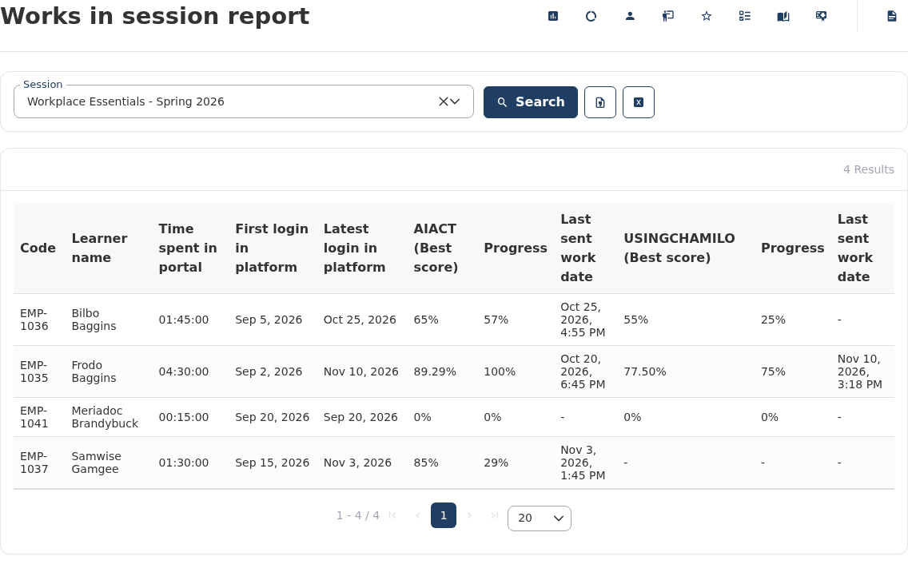

# Learning Analytics

Learning Analytics is Chamilo's classic tracking dashboard (historically known as "MySpace" or "Reporting"). It's the main drill-down tool for following learner, course, and session performance.

## Accessing Learning Analytics

From the administration panel, click **Analytics > Learning analytics**.

## What It Shows

* **Overview counts** — Number of students, teachers, and Human Resources users; courses and sessions assigned
* **Drill-downs** — Separate views for users, courses, and sessions, each showing average time spent, average score, and progress
* **CSV export** — Export the current view for offline analysis

Unlike Global Statistics, this view's scope adapts to the viewer's role: a Global Administrator sees platform-wide data, while a teacher or session tutor opening the equivalent view in their own course only sees their own courses and sessions. As an administrator using this dashboard entry, you get the platform-wide view.

## Works in Session Report

The **Works in session report** follows the learners of one session across all of its courses. It shows each learner's progress, best score and latest assignment submission in every course, side by side.

You can open it from:

* **Reporting > Admin view > Works in session report** (administrators)
* The **Assignments report** button in the toolbar of **Reporting > Course sessions** (administrators and Human Resources managers)
* The **Assignments report** icon on each row of **Reporting > Course sessions**, which opens the report for that session directly

Select a session in the **Session** field, then click **Search**. Until you select a session, the report stays empty. The list of sessions depends on your role:

* **Administrators** see every session of the current portal.
* **Human Resources managers** see the sessions they follow.
* **Session administrators** see the sessions they manage.
* **Coaches** see the sessions they coach. A course coach only gets the columns of the courses they coach, and the learners of those courses. A general coach of the session sees every course.

The report has one row per learner of the session, with these columns:

* **Code** — The learner's official code
* **Learner name**
* **Time spent in portal** — Total time connected to the platform, not only to this session
* **First login in platform** and **Latest login in platform**
* Then, for each course of the session, three columns:
  * **\<course code\> (Best score)** — The average score of the learner in the tests of the course's learning paths, counting the best attempt of each test
  * **Progress** — The average progress of the learner in the course's learning paths
  * **Last sent work date** — The date of the learner's most recent submission in the course's assignments of this session

A learner who belongs to the session but is not subscribed to one of its courses shows a dash (**-**) in that course's columns. A learner who is subscribed but has not started yet shows **0%**.

Use the export buttons next to **Search** to download the report as a CSV or Excel file. The export contains every learner of the session, not only the current page.

## Related

For workload-focused reporting instead of learner performance, see [Corporate Reports](corporate-reports.md), which includes the Teachers Time Report.
