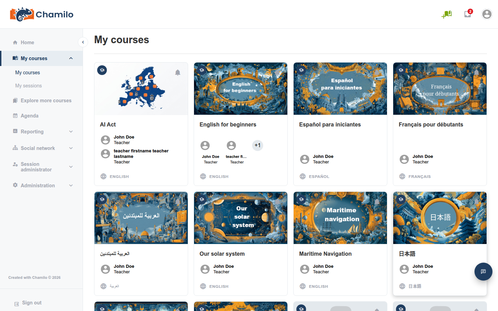

# Demo Courses

Starting with Chamilo 3.0.0, two demonstration courses are installed on every new platform. They show what can be done with Chamilo, and they are useful in their own right.

| Course | Code | Useful for |
|--------|------|------------|
| **AI Act** | `AIACT` | Any organization linked to the European AI Act. Provides an *AI Act Awareness for European Organizations* learning path. |
| **Using Chamilo** | `USINGCHAMILO` | Any organization starting to use Chamilo. Provides a *Getting Started with Chamilo 3.0* learning path. |

## What You Get

* **Both courses are multilingual.** Each one contains **26 language versions** of its content, mostly the languages of the countries affected by the AI Act. Learners see the version matching their own profile language, thanks to the [multi-language content](../../teacher-guide/adding-content/multi-language-content.md) feature (the `translate_html` setting, enabled by default since 3.0.0; see [Editor Settings](../platform-settings/editor-settings.md)). If you turned that setting off, learners will see all language versions at once instead of only theirs, so keep it enabled if you want to use these courses.
* **They are installed with the platform.** They are created during installation, owned by the administrator account, and appear in the course list like any other course.
* **They are open to logged-in users.** Their visibility is set to *Open*, and only the **Course description** and **Learning paths** tools are visible on the course homepage.

## Using Them

* Make sure the course is visible, then subscribe the relevant users, or add it to the course catalogue, so people can find it. See [Managing Courses](managing-courses.md).
* Use the *AI Act* course to train your staff on AI awareness, and the *Using Chamilo* course to onboard new teachers and learners.
* Copy a course (see [Course Import and Export](course-import-export.md)) before changing it, so you can keep the original as a reference.

## Hiding or Deleting Them

If you do not need them, they can be removed without any side effect on the rest of the platform:

* **Hide them**: edit the course and set its visibility to **Hidden** (or **Closed**), or remove it from the course catalogue. It stays on the platform and can be brought back later.
* **Delete them**: use **Delete** in the course list. As with any course, this is permanent, so consider exporting the course first if you may want it later.


Deleting the demo courses is safe, but they cannot be reinstalled from the interface afterwards. Hiding them is the reversible option.


## Why Keep Them?

Even if your organization does not need the training itself, they are the quickest way to show new teachers what a finished, multilingual course with a learning path looks like. Many administrators keep them hidden from learners and visible only to teachers for that purpose.
