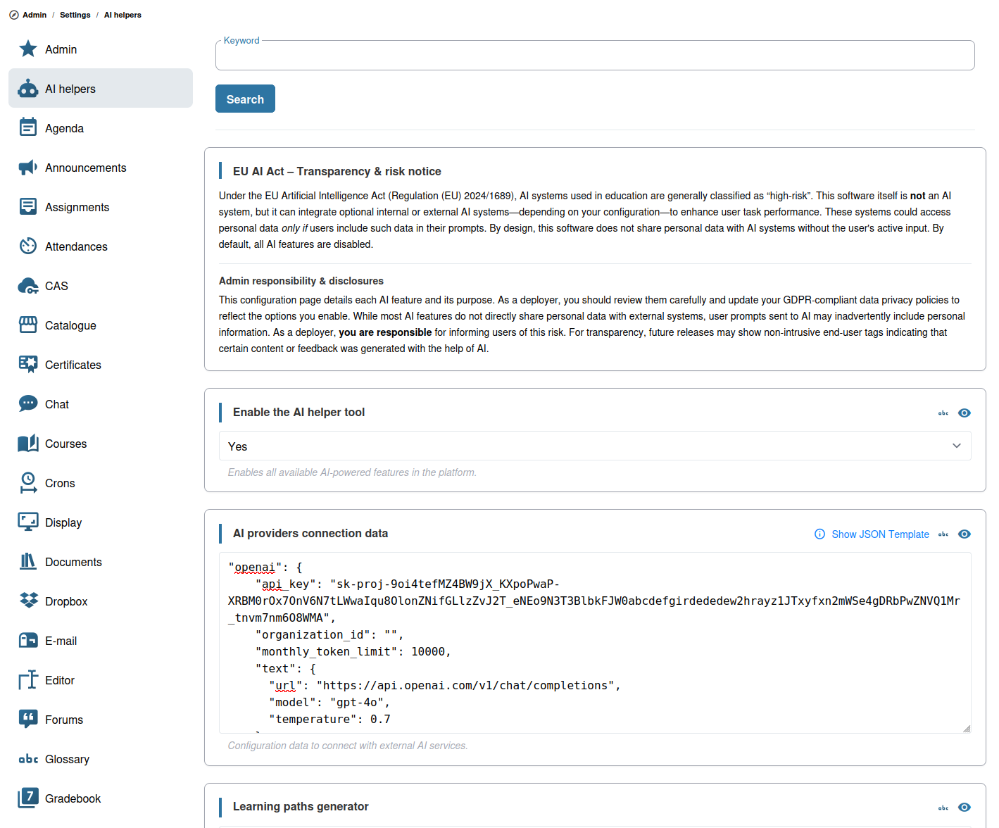

# AI Configuration

Chamilo 3.0 includes AI-powered features that require configuration before they become available to teachers and learners.

## Supported AI Providers

Chamilo supports multiple AI providers:

| Provider | Capabilities |
|----------|-------------|
| **Claude (Anthropic)** | Text generation, document analysis |
| **DeepSeek** | Text generation |
| **Google Gemini** | Text, image, video generation |
| **Grok** | Text, image, video generation |
| **Mistral** | Text generation |
| **OpenAI** | Text, image, video generation |

Each provider can be configured for different types of AI tasks:

* **Text** — Used for exercise generation, learning path generation, AI grading, and the AI tutor
* **Image** — Used for AI image generation
* **Video** — Used for AI video generation (where supported)
* **Document** — Used for AI document analysis

## Configuration Steps

### 1. Obtain API Keys

Register for an account with your chosen AI provider and obtain an API key:

* **Claude (Anthropic)**: [console.anthropic.com](https://console.anthropic.com/)
* **DeepSeek**: [platform.deepseek.com](https://platform.deepseek.com/)
* **Google Gemini**: Google AI Studio or Google Cloud
* **Grok**: [console.x.ai](https://console.x.ai/)
* **Mistral**: [console.mistral.ai](https://console.mistral.ai/)
* **OpenAI**: [platform.openai.com](https://platform.openai.com/)

### 2. Configure Providers in Chamilo



In the platform settings, navigate to the **AI Helpers** section:

1. **Enable AI helpers** — Turn on the AI features globally
2. **Configure AI providers** — Add one or more providers with:
   * **Provider name** (`claude`, `deepseek`, `gemini`, `grok`, `mistral`, `openai`). `anthropic` is accepted as an alias of `claude`
   * **API key** — Your API key for the provider
   * **Model** — The specific model to use (e.g., `gpt-4o`, `claude-sonnet-4-6`, `gemini-pro`, `mistral-large`)
   * **API URL** — The endpoint URL (pre-configured for standard providers)

You can configure multiple providers. The first provider in the configuration becomes the default.

### 3. Enable Features Per Course

AI features can be enabled or disabled at the course level. Teachers can toggle:

* **AI Tutor chatbot** — The AI assistant for learners
* **Assignment grader** — AI-generated grading recommendation
* **Exercise generator** — AI-generated quiz questions
* **Learning path generator** — AI-generated learning sequences
* **Image/Video generator** — AI-generated images and videos in documents

This allows different courses to use different AI configurations based on their needs.

## Using Any Compatible Model or Endpoint

**You are not limited to the providers listed above.** Chamilo talks to each provider through a standard API *interface*, and the endpoint URL is configurable. Any model or service that is compatible with one of these interfaces can be used simply by choosing the matching provider and changing the **API URL** (endpoint), the **API key** and the **model** name.

| If your model/service is compatible with... | Use this provider | Typical endpoint path |
|---|---|---|
| The **OpenAI API** (Chat Completions) | `openai` | `.../chat/completions` |
| The **Anthropic (Claude) Messages API** | `claude` | `.../v1/messages` |
| The **Gemini API** | `gemini` | provider-specific |
| The **Mistral**, **DeepSeek** or **Grok** APIs | `mistral`, `deepseek`, `grok` | provider-specific |

The OpenAI-compatible interface is by far the most widely implemented one. It is used, among others, by GLM (Z.ai / Zhipu), Qwen, Kimi, Together AI, Groq, OpenRouter, Perplexity, and by self-hosted servers such as Ollama, vLLM, LM Studio or LiteLLM. All of them can be plugged into Chamilo through the `openai` provider.

### Example: using GLM (Z.ai) through the OpenAI provider

GLM models from Z.ai expose an OpenAI-compatible endpoint, so no dedicated GLM provider is needed:

1. Get an API key from your Z.ai account.
2. In the **AI Helpers** settings, add (or edit) the `openai` provider.
3. Set the **API URL** of the text service to the GLM endpoint, set the **model** to a GLM model, and paste the Z.ai key as the **API key**.

```json
{
  "openai": {
    "api_key": "YOUR_ZAI_API_KEY",
    "text": {
      "url": "https://api.z.ai/api/paas/v4/chat/completions",
      "model": "glm-4.6",
      "temperature": 0.7,
      "max_tokens": 1000
    }
  }
}
```

The same approach works for a local model served by Ollama (`"url": "http://localhost:11434/v1/chat/completions"`, `"model": "llama3.1"`), or for any other service: check the vendor's documentation for its OpenAI-compatible base URL and exact model names.


The endpoint must implement the full request/response format of the interface you pick, and the model must support the capability being used (for example, image generation will only work if the endpoint also implements the OpenAI image API). Model names, endpoint URLs and availability are defined by the vendor and may change: always check their documentation. If a feature does not work, test with a text-only configuration first.


The same principle applies to the Claude provider: any Anthropic-compatible gateway or proxy can be used by changing the API URL.

## Cost Considerations

AI API calls have costs associated with them. Consider:

* **Setting usage limits** — Monitor and limit AI API usage to control costs
* **Choosing models wisely** — Smaller, less expensive models may be sufficient for many educational tasks
* **Tracking usage** — Chamilo logs AI requests to help you monitor consumption

## Tips

* **Start with one provider** — Configure and test one provider before adding more
* **Test with a course** — Enable AI features in a test course first to verify they work as expected
* **Communicate with teachers** — Let teachers know which AI features are available and how to use them
* **Monitor quality** — Regularly review AI-generated content to ensure it meets your educational standards
