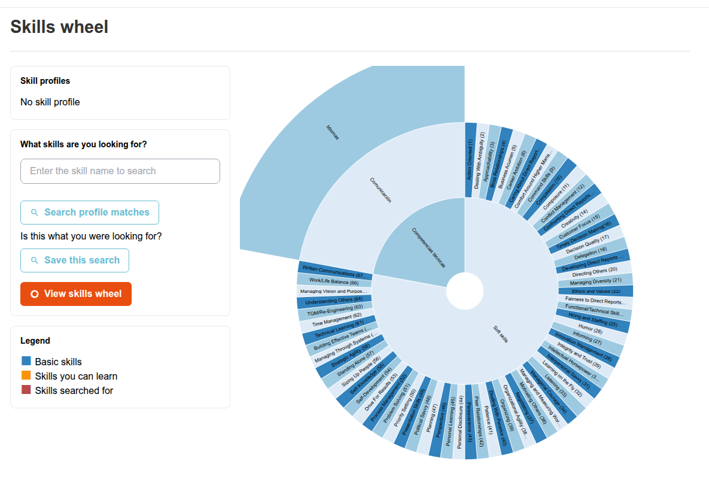
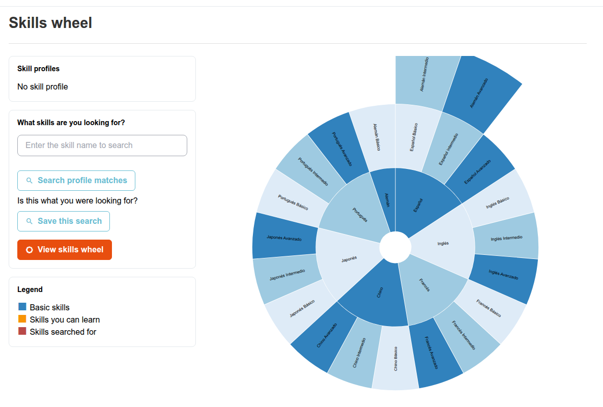
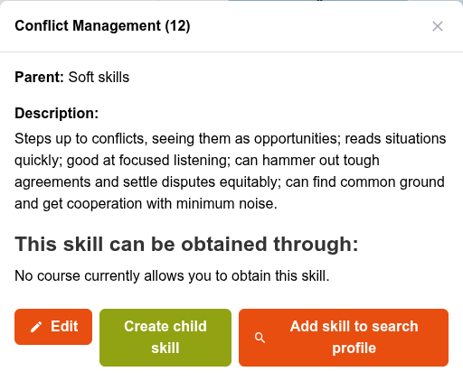

# Skills Wheel

The Skills Wheel is a zoomable, wheel-shaped diagram of the entire skill tree — a visual alternative to browsing the flat list in [Managing Skills](managing-skills.md).

## Accessing the Skills Wheel

From the administration panel, click **Skills > Skills wheel**.

## What It Shows

Each segment of the wheel is a skill, expandable into its child skills. A segment indicates whether the skill has a linked gradebook (see [Skills and Assessments](skills-assessments.md)) and, when viewing a specific user, whether that user has already achieved it.

Click a segment to zoom into it and reveal its child skills; click the center circle to zoom back out. The modern explorer also shows the current hierarchy as breadcrumbs so you can move back through its branches.

### Exploring and Finding Skills (3.1)

The updated wheel uses a responsive **3D-style explorer** with a depth effect when you move the pointer across the diagram. This is a visualization of the skill hierarchy, not a separate set of skills.

* Open **What skills are you looking for?** to search by skill name. You can select multiple skills, then use **View skills wheel** to locate a selected skill in the hierarchy.
* Press `/` or **Ctrl+K** (on macOS, **Cmd+K**) when you are not typing in a form field to open the search dialog.
* Use **Focus mode** for an expanded view of the wheel; **Esc** exits Focus mode. The **Help** control explains the navigation and legend.
* Select a skill to open its contextual inspector, with the skill code, description, parent hierarchy and courses or assessments through which it can be acquired, where available.

The skill detail inspector offers **Edit**, **Create child skill**, and **Add skill to search profile** to authorized administrators and HR managers. After creating or editing a skill from the wheel, the interface returns to the wheel context rather than dropping you into an unrelated list.

Right-click a segment to open its details: description, parent skill, and the courses (if any) that award it. From this dialog, administrators can also edit the skill, create a child skill under it, or add it to the profile search described below.

Administrators and Human Resources Manager users also get a profile search here: skills can be grouped into "profiles" (sets of skills expected for a given role or job description), and this page lets you search for users whose acquired skills match a given profile — useful for identifying who's ready for a role, or where the gaps are across a team.

### Using Skill Profiles

The **Skill profiles** control is available to administrators and HR managers. Open it to find saved profiles and search for users whose skills match them. You can also select multiple skills from the search dialog and choose **Search profile matches** or **Save this search**. These profile-management actions are role-restricted; not everyone browsing the wheel sees them.

This interface enhancement was implemented in [PR #9201](https://github.com/chamilo/chamilo-lms/pull/9201).
