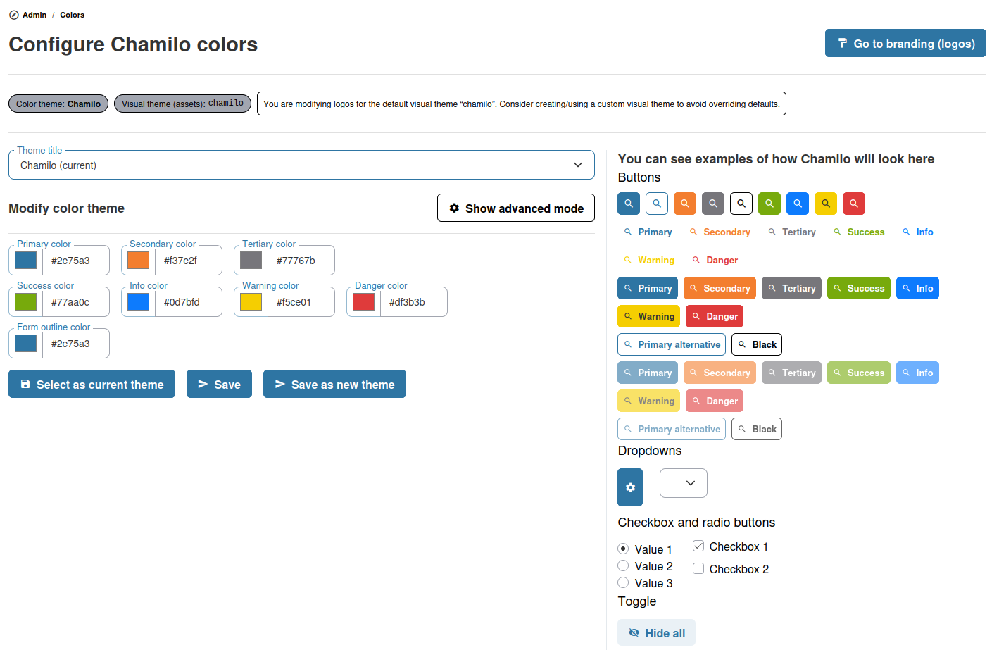

# Color Themes

Chamilo 2.0 introduces a color theme system that lets you customize the visual appearance of the platform.

## How Themes Work

Color themes define the palette used across the Chamilo interface — primary colors, accent colors, backgrounds, and text colors. A theme is associated to an access URL: in a single-URL portal it effectively becomes the global theme, and in a multi-URL setup each URL can have its own.

## Applying a Theme

1. From the administration panel, navigate to **Color themes**
2. Browse the available themes
3. Select a theme and click **Apply**
4. The theme is immediately applied to the platform

## Page Backgrounds

Some pages show a decorative image at their bottom, repeated horizontally: **My courses** and **My sessions** (a landscape), the **Administration** pages (a cityscape), the **Sessions management** pages (fields) and the **Social network** (a seascape). Each visual theme ships these images.

On the color themes page, the **Page backgrounds** section shows the image of each of these places in the active visual theme. For each one, you can:

* **Replace it** — Click **Choose file**, select a PNG, JPEG or WebP image of 2 MB at most, then click **Upload**. The image is displayed 180 pixels high and repeated across the page, so a wide band whose edges join gives the best result.
* **Hide it** — Click **Hide** to remove the image from those pages, and **Show** to bring it back. Hiding an uploaded image keeps it for later.
* **Restore the image of the theme** — Deletes the uploaded image, after confirmation, and shows the image the theme ships again.

Like the logos, these images belong to the active visual theme: in a multi-URL setup, each URL with its own theme has its own images. Avoid changing them in the default `chamilo` theme, whose images are the defaults of every other theme.

The uploaded images are stored in the theme directory (`var/themes/<theme>/images/bg-<place>-custom.<extension>`, or the remote storage of the themes), next to a `page-backgrounds.json` file that records the choices. To replace an image directly on the server instead, put a file named `images/bg-landscape.png` (or `bg-cityscape.png`, `bg-fieldscape.png`, `bg-seascape.png`) in the directory of the active theme: it is used whenever no image was uploaded from the page. Browsers keep these images for a day, so a file replaced on the server can take that long to show, while an uploaded image shows at once.

## Per-URL Themes

In a multi-URL setup, each access URL can have its own color theme. This allows different portals to have distinct visual identities while sharing the same Chamilo installation.

## Tips

* **Match your brand** — Choose or customize a theme that matches your organization's brand colors
* **Test readability** — After applying a theme, check that text is readable against background colors, especially in high-contrast situations
* **Consider accessibility** — Ensure sufficient color contrast for users with visual impairments
