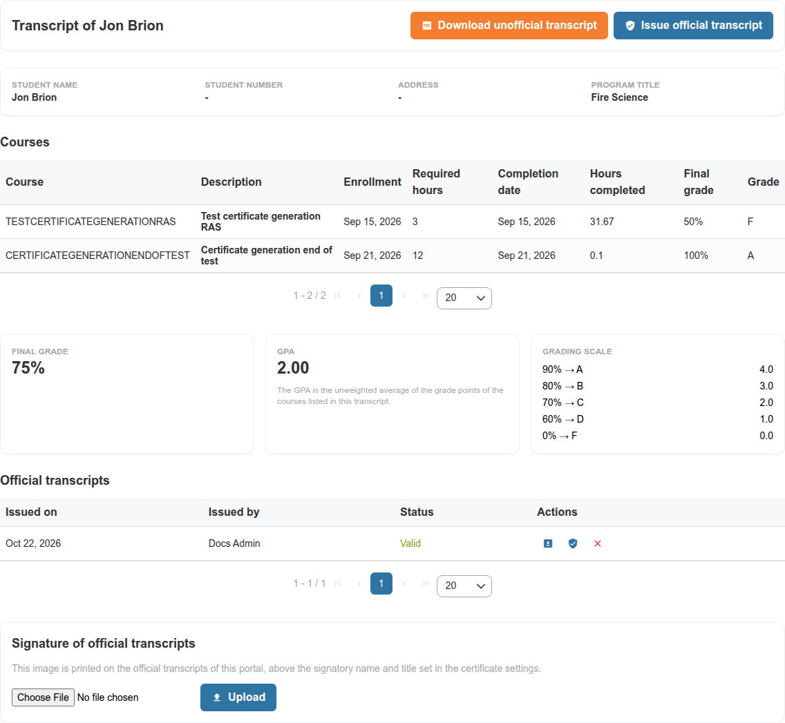
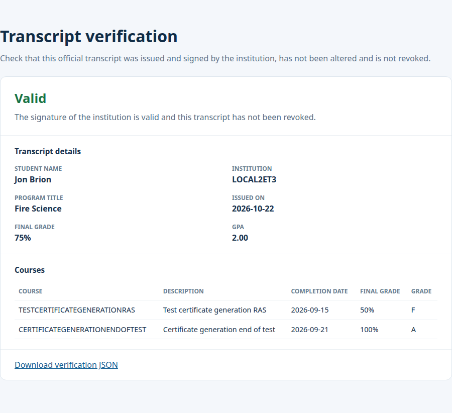

# Academic Transcripts

Chamilo can produce an **unofficial academic transcript** from a learner's completed, certified courses and allow authorized staff to issue an **official signed transcript**. This feature is distinct from an individual course certificate or its optional Sepolia testnet verification.

## Enable the Feature

In **Administration > Configuration settings > Certificates**, enable **Academic transcripts** (`certificate.transcript_enabled`). It is disabled by default. Review the additional program, grading scale, course-hours, student-number, address and signatory settings in [Certificates Settings](../platform-settings/certificate-settings.md#transcript_enabled).

The transcript uses certificates generated by the **root gradebook category** of eligible courses and sessions. It includes only courses within the current access URL to which the learner is still subscribed. A course without an eligible certificate does not contribute a row.

The displayed final grade is an average of the listed course percentage scores; GPA is the unweighted average of the mapped grade points. Both depend on the courses included at the time of viewing or issuance.

## Transcript Columns

| Column | Content |
|--------|---------|
| **Course** | The course code, or the department name of the course (`transcript_course_code_source`) |
| **Description** | The course title, and the session title for a course followed in a session |
| **Enrollment** | When the learner subscribed to the course or to the session |
| **Required hours** | The value of the course extra field set in `transcript_hours_extra_field`, or the course duration |
| **Completion date** | The date of the certificate |
| **Hours completed** | The time the learner spent in the course, or the required hours when `transcript_completed_hours_are_required_hours` is enabled |
| **Final grade** | The score of the certificate |
| **Grade** | The letter of `transcript_grading_scale` matching that score |

## Access a Learner's Transcript

1. Go to **Administration > Users > User list** and locate the learner. A **Transcript** action is available to authorized administrators and session administrators when the feature is enabled.
2. Alternatively, use the **Transcript** action from an eligible learner's global reporting detail page.
3. Review the learner's course list, grades, dates, hours, final grade and GPA.
4. Select **Download unofficial transcript** for a PDF built from the learner's current records.

The transcript page is also directly available at `/transcript?userId=<user-id>` for someone authorized to access that learner's records. Do not treat knowing the URL or user ID as permission: access is checked server-side.

A learner can view their **own** transcript, but cannot issue or revoke an official one. Authorized issuers are:

* Platform/portal administrators acting within their managed user/access-URL scope.
* HR managers for learners they follow.
* Session administrators for learners registered in a session they administer.

These permissions are evaluated per learner; having a staff role by itself does not grant access to every transcript.

## Issue and Verify an Official Transcript

1. On an authorized learner's transcript page, check the currently displayed courses, grades and personal information.
2. Select **Issue official transcript** and confirm. Chamilo saves a signed snapshot of the information at that moment.
3. The new entry appears under **Official transcripts** with its issue date and issuer.
4. Use **Download** for the official PDF or **Verify** to open the public verification page.
5. If needed, an authorized issuer can **Revoke** that official transcript. The verification page will then report that it is revoked.

Every issued transcript is separately stored: issuing a newer version does not silently rewrite an earlier signed record. Verification links follow `/transcripts/verify/<token>` and also expose a `.json` response. Someone with the verification link can check validity without signing in; keep these links appropriately controlled because a valid verification exposes signed transcript details. Invalid or revoked records are not presented as valid documents.

An official transcript is signed digitally by Chamilo using the institution's signing key. **It is not a blockchain transaction**; the Sepolia feature documents a separate process for gradebook certificate credentials.

## Signature Image and Signatory Details

A platform administrator may upload a **PNG or JPEG** signature image in the **Signature of official transcripts** section of a learner's transcript page. The image belongs to the current access URL and is used in official PDFs. The signatory name and title come from `certificate.transcript_signatory_name` and `certificate.transcript_signatory_title`.

Only platform administrators manage the signature image; other authorized transcript issuers do not obtain this permission automatically. Protect the institution's signing keys and private signature image storage as part of the portal's backup and access-control procedures. Both are kept outside the public web folder, in `var/certificate-issuer/`, with the key that also signs gradebook certificate credentials: include this folder in your [backups](../maintenance/backups.md), or every transcript and credential already issued can no longer be verified.

## Troubleshooting

* **Transcript link missing:** check `certificate.transcript_enabled` and the current user's scope.
* **No completed courses:** the learner needs a qualifying root-gradebook certificate and a matching current course/session enrollment on this access URL.
* **Incorrect student number, hours, grade letters or program title:** review the specific `certificate.transcript_*` settings before issuing an official transcript.
* **Verification reports a revoked or invalid result:** do not reuse the record as proof of a current official transcript; authorized staff can issue a new one when appropriate.

See also [Certificates and Skills](../../teacher-guide/tracking-and-reporting/certificates-and-skills.md) and [My Transcript](../../student-guide/account-and-security/my-transcript.md).
