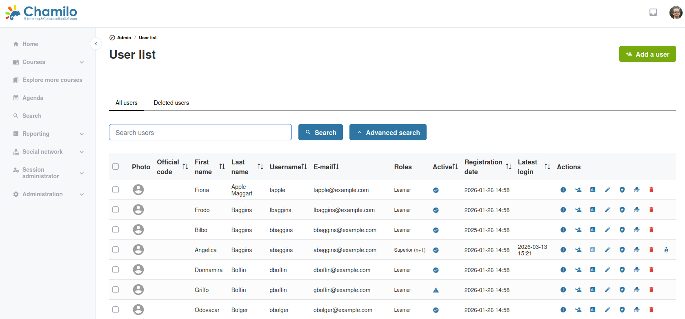
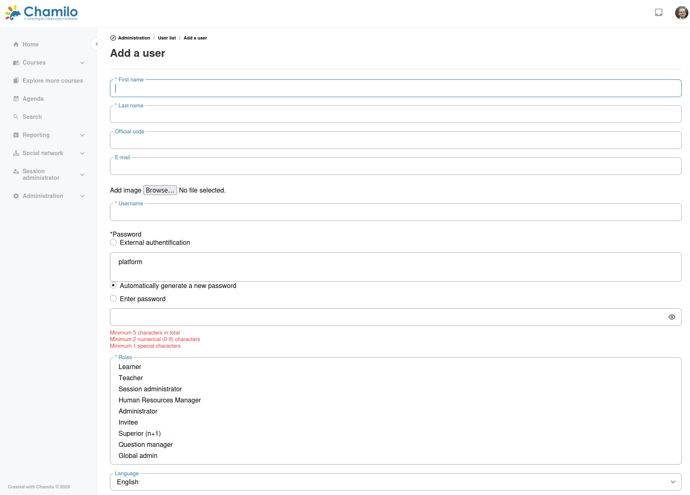
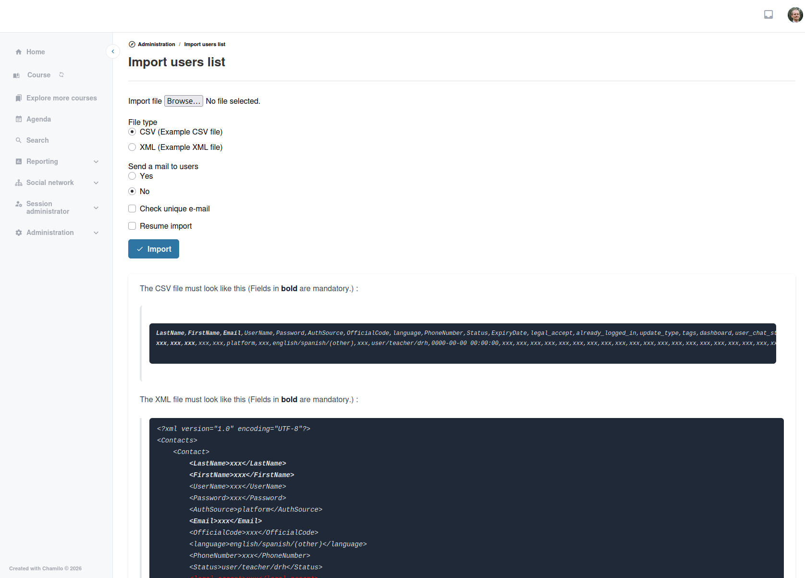

# Managing Users

This page covers the day-to-day tasks of creating, editing, and managing user accounts.

## User List

From the administration panel, click **User list** to see all users on the platform. The list shows:

* Avatar
* Name
* Username
* Email address
* Roles
* Active/inactive status
* Registration date
* Last login date

Use the **Advanced search** tool to find specific users by name, email, role, or other criteria.

## Creating a User

1. Click **Add a user** from the administration panel
2. Fill in the required fields:
   * **First name** and **Last name**
   * **Email** — Must be unique on the platform
   * **Username** — The login name (must be unique)
   * **Password** — Set an initial password
   * **Roles** — Select the user's platform role(s) (student, teacher, admin, etc.)
   * **Language** — The user's preferred interface language
3. Optionally fill in additional fields:
   * Official code (e.g. unique ID in the organization)
   * Phone number
   * Expiration date — Automatically deactivate the account after a date
   * Active/inactive status
   * Extra profile fields (if configured)
4. Save

## Importing Users

For bulk user creation, you can import users from a file:

1. Click **Import users** from the administration panel
2. Upload a **CSV** or **XML** file with user data
3. Map the file columns to Chamilo user fields
4. Choose how to handle existing users (update or skip)
5. Import

The import file should contain columns for at least: first name, last name, email, username, and password.

Note: The **Status** column is the legacy name for **Role** and only accepts a few values, like 1 for teacher, 5 for student. Further tuniing of the roles can only be done by hand later on, editing the user.

## Exporting Users

Click **Export users** to download the user list as a CSV or XML file. You can filter which users to export by role, registration date, or other criteria.

## Editing a User

Click on a user's name in the user list to edit their account. You can modify:

* Personal information (name, email, phone)
* Roles
* Password (reset)
* Active/inactive status
* Expiration date
* Extra profile fields

## Deleting a User

When deleting users (usually teachers) who have created content on the platform, the system might prevent you from deleting the users permanently, and will show a warning message explaining the user is still attached to some of the resources. If you confirm the deletion, the system will not delete the content itself but attach it to a neutral user (we call it the "Fallback user") for data consistency reasons.

To avoid this, check the user details, delete each of their courses one by one, then delete the user.

## User Actions

| Action | Description |
|--------|-------------|
| **Deactivate** | Disable a user's account without deleting it. The user cannot log in but their data is preserved. |
| **Activate** | Re-enable a previously deactivated account. |
| **Login as** | Log in to the platform as this user (impersonation). Useful for troubleshooting. |
| **Anonymize** | Erase all of the account's personal information, as defined by the EU's GDPR. |
| **Delete** | Soft delete the user account. Use the **Deleted users** tab to permanently delete the account and associated data. |

> **Login as** is a powerful feature. Use it responsibly and only for legitimate support purposes.

## Batch Operations

Select multiple users in the user list to perform batch actions:

* Activate or deactivate multiple users at once
* Delete multiple users
* Assign users to a course or session

## Merging User Accounts

The **Unify** action of the duplicate-users report (**Administration > Reports > Duplicate users**) merges the other accounts of a duplicate group into the account you keep. The merged accounts are soft-deleted and then permanently deleted.

### Who May Merge

* Only administrators (`ROLE_ADMIN` or `ROLE_GLOBAL_ADMIN`). Session administrators cannot merge accounts.
* Both the account you keep and every account merged into it must be inside the access URLs you manage: a global administrator restricted to a sub-portal tree can only merge users of that tree; a plain administrator only users of the URL(s) they are registered to. Duplicates outside your scope are ignored; if none is inside your scope the action is refused.
* You cannot merge your own account into another one.

### What Is Refused

The whole operation is cancelled (nothing is merged) with an explicit message when:

* the account to merge holds an administrative role (administrator, global administrator, session administrator) that the account to keep does not hold: the roles are never transferred, so the privilege would silently vanish;
* the account to merge is a **teacher** (teacher or HR manager role) and the account to keep is a **student** (none of the teacher, HR manager or administrator roles). The reverse direction (student into teacher) and same-role merges stay allowed.

### What Is Merged

Everything that belongs to the learner follows the kept account: course, session, class and URL subscriptions, learning path progress, exercise attempts and tracking, gradebook results and certificates, attendance, forum, blog, wiki, dropbox, assignments, surveys (invitations and the answers of non-anonymous surveys), tickets, messages, skills, certificates/transcripts, career, justification documents, shared resource links (`resource_link.user_id`), authorship (who created or last edited an item) and audit logs.

When both accounts have a row for the same item (same course, same learning path, same evaluation, same course vote...) the kept account's row wins and the merged account's row is dropped (or, when other data hangs from it, left on the merged account). Answers to a survey that both accounts answered are not combined: only the kept account's stay.

### What Is Never Merged

Credentials and private data are left on the (deleted) merged account, so one person's identity is never handed to another account: sign-in methods (`user_auth_source`), OAuth tokens and consents, password-reset requests, push subscriptions and API keys, AI-tutor and support-bot conversations, dashboard blocks, user templates, saved searches and notification-event subscriptions. Anonymous survey answers are never touched. The username, e-mail and password of the kept account are never changed.

## Tips

* **Use CSV import for large enrollments** — When onboarding many users at the start of a training program, prepare a CSV file and import in bulk
* **Set expiration dates** — For temporary users (workshop participants, trial users), set an expiration date to automatically deactivate their accounts
* **Deactivate rather than delete** — When a user leaves, deactivate their account first. This preserves their training records. Only delete if you are sure the data is no longer needed.
