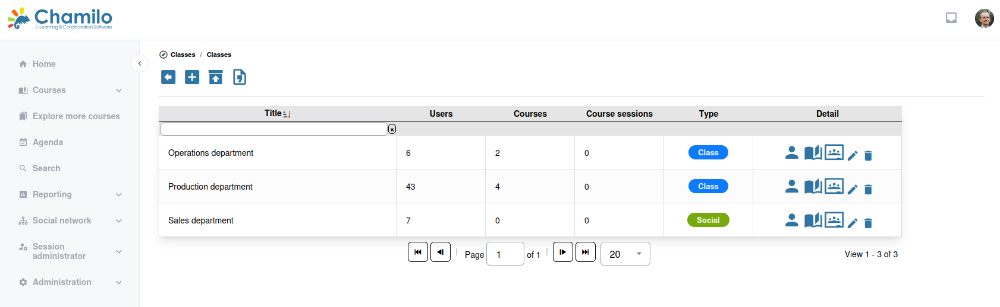

# Classes / User Groups

Classes in the administration panel are platform-wide groups used to organize users for management purposes. They are distinct from course-level groups (which are created by teachers within a course).

> User groups and [Classes](../../admin-guide/sessions/classes.md) share the same interface. The only difference is the **group type** setting: choose "Class" to create a class (used for bulk session enrollment), or "User group" for more social groups that can have their own space in the internal social network. See [Classes](../../admin-guide/sessions/classes.md) for details on session enrollment.

## Creating a Group

1. From the administration panel, navigate to **Classes**
2. Click **Add classes**
3. Enter a **title** and optional **description**
4. Check **Social group** if this will be a social group. Leave unchecked if it will be a class.
5. Add an optionali reference URL and picture/logo.
6. Choose the group **permissions**:
   * **Open** — Any user can join
   * **Closed** — Users must be added by an administrator
7. Check if you want members to be able to leave the class by themselves.
8. Save.

## Adding Members

1. Open the list of classes/user groups
2. Click the user icon **Subscribe users to class**
3. Search for users by name, username or email
4. Select the users to add, using the arrows to the right side
5. Click the confirmation button to save

## Use Cases

* **Department organization** — Group users by department or team
* **Bulk enrollment** — Add all members of a group to a course or session at once
* **Targeted communication** — Send announcements to specific groups
* **Reporting** — View training progress filtered by group

## Managing Groups

* **Edit** — Change the group name, description, or visibility
* **Manage members** — Add or remove members
* **Delete** — Remove the group (does not delete the member accounts)

## Sort Order of the Lists

The helper that sorted several lists applied the requested direction upside down: choosing "ascending" in a column header returned the highest value first, and "descending" the lowest first. It now follows the direction asked for. If you were used to clicking a header twice to get the order you wanted, the first click now gives it.

Lists affected (sorted by clicking a column header):

* **Administration > Classes / user groups** list (title, users, courses, sessions and type columns)
* The user groups list of the course **Classes** tab
* Three lists of the course home pages (served by `course_home.ajax.php`)

Unchanged: the agenda day cell, the next-exercise block of the user portal (explicitly ascending, as before) and the session **Exercises** grid, whose rows are then re-sorted by the grid itself (initial order: oldest first).
