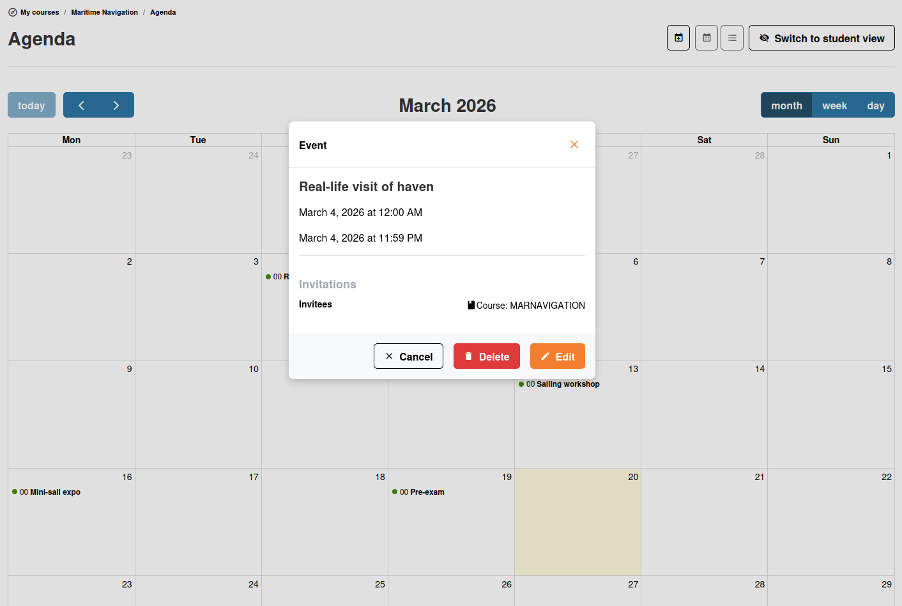
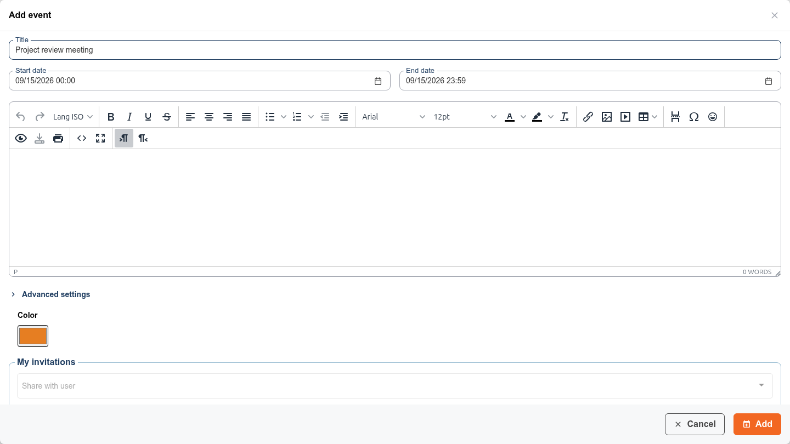
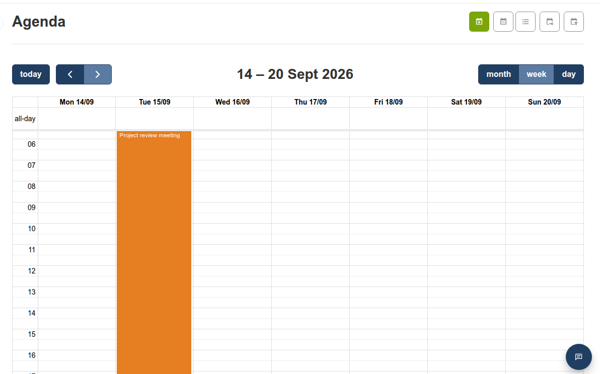

# Agenda

The agenda tool lets you schedule events and deadlines within your course. Events appear on a calendar that your learners can view.

## Viewing the Agenda

Open the **Agenda**  tool from the course homepage. You can view events in three modes:

* **Calendar view** — A visual monthly/weekly/daily calendar
* **List view** — Events shown as a chronological list
* **Personal events** — Filter to see only events relevant to you

## Creating an Event

1. Click **Add event** 
2. Fill in the event details:
   * **Title** — A short name for the event
   * **Start date and time**
   * **End date and time**
   * **Description** — Additional details (supports rich text)
   * **Attachments** — Click **Add attachment** to attach one or more files, and optionally describe them in **File comment**. Learners see the files in the event details and can download them, if the event is sent to them. To delete a file, edit the event and click the delete icon next to the file. Attachments are only available for course events
   * **Comment** — A short plain-text note, for example what learners must bring. It is only available for course events, and learners see it under the description, in the event details and in the list view
3. Choose the **audience** in the **Send to** field:
   * Leave it empty to send the event to **everyone** in the course (or in the course of the current session)
   * Select one or more **users** and/or **groups** of the course to send the event only to them. A learner then sees the event only if it was sent to them or to one of their groups; teachers always see every event of the course.

   You can change the recipients later by editing the event. The **Send to** field is only shown to teachers, in the agenda of a course; inside a group's agenda, new events always belong to that group.
4. Optionally set a **reminder**  to send email notifications before the event (*cron* setup for the portal required by an admin)
5. Optionally check **Add an announcement (Send mail)** to also publish the event as a course announcement, sent by email to the same recipients. The announcement takes the title and the description of the event. This option is only shown to teachers, when they create a course event
6. Pick a **color** for the event by clicking the color swatch. This color is used to highlight the event throughout the calendar (month, week and day views), making it easy to tell events apart at a glance — for example to distinguish deadlines from regular sessions, or events from different courses in your personal agenda.

   
7. Save

The chosen color is then reflected wherever the event appears in the calendar:

By default, new events get a color based on their context (course, session, personal or global), but you can override it with any color you like.

## Managing Events

* **Edit**  — Click on an event to modify its details
* **Delete**  — Remove an event from the calendar
* **Drag and drop** — In calendar view, drag events to reschedule them

## Repeating an Event

When you create a course event, check **Repeat event**, then choose:

* **Repeat type** — **Daily**, **Weekly**, **Monthly, by date** or **Yearly**
* **Repeat end date** — The last day on which a repetition can start

The agenda then creates a copy of the event at each repetition, with the same details and the same recipients. Each copy is a separate event: you can edit or delete it on its own. To delete the whole series at once, click any event of the series and click **Delete all items**.

The repeat options are only available when you create a course event; you cannot add a repetition to an existing event.

## Filtering by Recipient

As a teacher, use the **Filter** selector above the course agenda to list only the events sent to one user or to one group. Pick **All** (or clear the selector) to see every event again. The filter applies to both the calendar view and the list view, and it is kept when you switch between them.

## Personal Agenda

You also have a **personal agenda** accessible from the sidebar. The personal agenda aggregates events from all your courses into a single view. This is where learners see their combined schedule across all courses they are enrolled in.

## Tips

* **Set deadlines** — Create events for assignment due dates and exercise deadlines so learners can see them in their calendar
* **Use reminders** — Enable email reminders for important events to help learners stay on track
* **Coordinate with sessions** — If you teach in multiple sessions, each session has its own events, visible only to that session's learners. Teachers have a feature to see the events (homeworks, excursions, etc) of other courses in their sessions to avoid overloading students.
