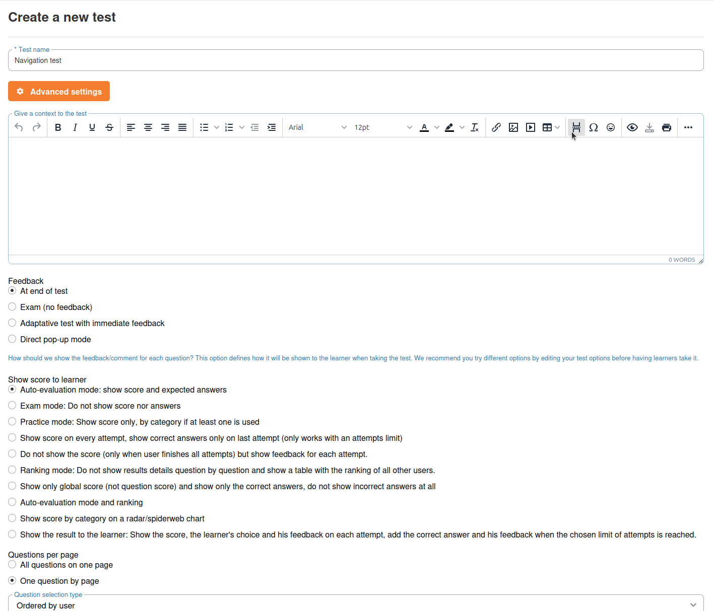
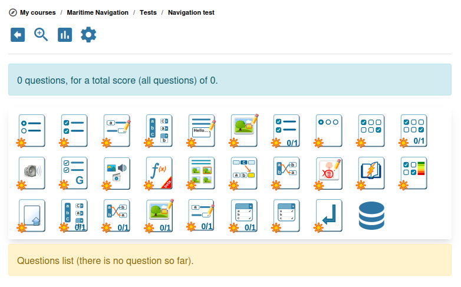

# Exercises

The exercises tool (also called "tests") lets you create quizzes and exams with automatic grading. Chamilo supports a wide variety of question types, from simple multiple choice to interactive hotspot questions.

## Creating an Exercise

1. Open the **Exercises**  tool from the course homepage
2. Click **New exercise**
3. Enter a **title** and optional **description**
4. Configure the exercise settings (see below)
5. Save, then add questions

## Exercise Settings

### Display and Navigation

| Setting | Options | Description |
|---------|---------|-------------|
| **Question layout** | All on one page / One per page | Show all questions at once or one at a time |
| **Hide question titles** | Yes / No | Whether to show question titles to learners |
| **Show previous button** | Yes / No | Allow learners to go back to previous questions |
| **Prevent backwards navigation** | Yes / No | Force learners to answer in order without going back |

### Time and Availability

| Setting | Description |
|---------|-------------|
| **Time limit** | Maximum time (in minutes) to complete the exercise. A countdown timer is shown to the learner |
| **Start date** | When the exercise becomes available to learners |
| **End date** | When the exercise stops being available |

### Access Conditions

When the administrator enables **Access conditions before a test** (`allow_final_exam_access_rule`), the **Attempts and timing** part of the advanced settings shows an **Access conditions** block. Use it to keep a test, typically a final exam, closed until the learner is ready:

| Setting | Description |
|---------|-------------|
| **Minimum time in the course before starting the test (in minutes)** | The learner can only start the test once they have spent this time in the course, as the course reports count it (the same time as the clock of the time spent in the course). 0 sets no minimum |
| **Profile field required before starting the test** | A field of the learner's profile, such as a student ID, that must be filled in first. Only the text fields learners can change on their own profile are offered |
| **The learner can choose not to fill in this field** | Asks the learner a question first (**Question asked before filling in the field**). If they answer No, the field is marked as declined and the test can start |

Until the conditions are met, the start page of the test hides the **Start test** button and tells the learner how much time they still have to spend in the course and what profile field to fill in. The learner fills in the field directly on that page: it only accepts digits (at least 3). Teachers are not concerned by the conditions.

Under the fields, **Access conditions in JSON** shows, read-only, the rule as it will be saved. Check **Edit the JSON** to write it yourself: the fields above are then frozen and the JSON is saved as written, including keys the fields do not edit (such as the `source` of rules imported from an older platform). The JSON must be an object with at least `minimum_minutes_before_exam` (a whole number of minutes) and `user_identifier_field_variable` (the profile field, or an empty string); `allow_user_identifier_opt_out` (true or false) and `user_identifier_opt_out_prompt` are optional. An empty JSON removes the conditions. Unchecking **Edit the JSON** fills the fields from a valid JSON.

### Attempts and Scoring

| Setting | Description |
|---------|-------------|
| **Maximum attempts** | How many times a learner can take the exercise (0 = unlimited) |
| **Pass percentage** | The minimum score to pass (e.g., 70%). Learners who do not reach this threshold see a failure message |
| **Propagate negative scoring** | Whether negative points on individual questions reduce the total score below zero |

### Feedback

| Setting | Options |
|---------|---------|
| **At the end** | Show results and correct answers after the learner submits |
| **Immediate** | Show feedback after each question (useful for learning exercises) |
| **Exam mode** | Do not show any feedback or results |

### Learner Question Issue Reports

Enable **Allow learners to report issues in questions** when you want learners to flag unclear, incorrect or broken questions during an active attempt. The report option is shown only to learners and only for normal question items.

A learner enters a comment in **Report a problem with this question**. The report is attached to that question and attempt; it does not change the learner's answer or score.

### Results Display

Control what learners see after completing the exercise:

* Show score and expected answers
* Show score only
* Show score with category breakdown
* Show ranking among other learners
* Show only on last attempt
* Show radar chart visualization

### Completion Messages

* **Success message** — Custom text shown when the learner passes
* **Failure message** — Custom text shown when the learner does not reach the pass percentage

### Question Randomization

| Setting | Description |
|---------|-------------|
| **Random question order** | Shuffle the order of questions for each attempt |
| **Random answers** | Shuffle answer options within each question |
| **Random by category** | Select random questions from each question category |

You can also configure advanced selection strategies that combine categories and randomization.

## Question Types

Chamilo offers a rich set of question types organized into several categories:

### Single Choice

* **Multiple choice (single answer)** — Learner selects one correct answer from a list of options
* **Single answer with images** — Same as above, but answer options are displayed as images

### Multiple Choice

* **Multiple answer** — Learner selects one or more correct answers
* **Multiple answer (dropdown)** — Answer options are presented as dropdown menus
* **True/False** — A series of statements that the learner marks as true or false
* **True/False with degree of certainty** — True/false with an additional confidence level, enabling more nuanced scoring

### Fill in the Blanks

* **Fill in the blanks** — Learner completes missing words in a text. You define the blanks and accepted answers when creating the question.

### Matching

* **Matching** — Learner connects items from two columns
* **Matching (draggable)** — Same concept, but with a drag-and-drop interface
* **Draggable** — Drag items into the correct positions

### Open-Ended

* **Free answer (essay)** — Learner writes a text response. Requires manual grading (or AI-assisted grading if configured)
* **Oral expression** — Learner records an audio response using their microphone
* **Upload answer** — Learner uploads a file as their answer

### Hotspot

* **Hotspot** — Learner clicks on specific areas of an image to answer
* **Hotspot delineation** — Learner draws boundaries around areas on an image

### Calculated

* **Calculated answer** — Numerical questions with a formula and tolerance range. Useful for math and science courses.

### Special

* **Reading comprehension** — Tests based on reading a passage
* **Annotation** — Teacher uploads an image and the learner annotates it
* **Answer in Office document** — When the OnlyOffice plugin is enabled, the learner answers the question by editing an embedded Office document (Word, Excel, PowerPoint). Their response is saved as a separate file under the exercise so it can be reviewed alongside the rest of their attempt.

## Adding Questions to an Exercise

1. Open the exercise and click **Add a question**
2. Select the question type
3. Enter the **question text** (supports rich text with images and formatting)
4. Define the **answers** and their scoring:
   * For each answer option, specify whether it is correct and how many points it is worth
   * You can assign negative points to wrong answers to discourage guessing
5. Optionally add **feedback** — explanations shown to the learner after answering
6. Set the **difficulty level** and **category** (useful for random selection and reporting)
7. Save

## Correcting Open Questions

Open-ended questions (open question, oral expression, file upload, annotation and Office document answers) are corrected by hand. Open the learner's attempt from the exercise's results in correction mode: below each of these answers, the **Teacher correction** box sets the score and a **Teacher comment**.

When **Audio feedback to submitted answers** (`exercise.allow_teacher_comment_audio`) is enabled in the platform settings, the box also offers an **Audio comment**: click **Start recording**, speak, then **Stop recording**, and listen to the result before saving. The recording is saved with the correction, by **Save as draft** or **Save correction**. A new recording replaces the previous one. The learner hears it next to the written comment when the exercise shows feedback.

## Reviewing Learner Reports

Open a question in the question editor and expand **Learner reports**. Each report shows the learner, the time, the exercise when available, and the submitted comment. When Chamilo can link the report to the attempt, use **View attempt** to inspect the surrounding answers before correcting the question.

## Answer Change History (Technical)

Chamilo 3.1 can record changes made to answers during an exercise attempt, including the modern Vue player and applicable legacy answer-saving flows. The log is stored separately in `track_e_attempt_log`, preserving earlier answer states without changing final answers or scores.

This is an internal audit record, **not** an additional question score and not a general-purpose answer-history viewer in the teacher interface. Deployment of this feature requires the associated Chamilo database migration. See [Exercise answer history #9277](https://github.com/chamilo/chamilo-lms/pull/9277).

## Question Categories

You can organize questions into categories (e.g., "Module 1", "Vocabulary", "Advanced"). Categories are useful for:

* Organizing large question banks
* Enabling random selection by category (e.g., "5 questions from Module 1, 3 from Module 2")
* Viewing scores broken down by category in reports

## Question Reuse

Questions can be reused across exercises within the same course. When adding a question, you can choose to create a new one or select an existing question from the question bank.

## Importing Exercises

Chamilo supports importing exercises from external formats:

* **IMS QTI / Common Cartridge** — The standard e-learning quiz format
* **Moodle format** — Import quizzes from Moodle exports

To import, look for the **Import** option in the exercises tool and upload your file.

### IMS QTI 2 interoperability

Chamilo 3.1 supports a defined subset of IMS QTI 2 question types. Recent improvements cover **Matching** (`matchInteraction`), including correct associations, and **Fill in the blanks**, including typed blanks (`textEntryInteraction`), dropdown blanks (`inlineChoiceInteraction`) and their per-blank scoring when represented by the imported package.

The QTI 2 exporter supports single-choice, multiple-choice, exact combination, free-answer, matching (including draggable matching), sequence ordering and fill-in-the-blanks questions. Multiple-answer questions use QTI `choiceInteraction` with `maxChoices="0"`, allowing learners to select more than one option. Exact combination questions award the full score only when exactly the correct choices are selected, and import back as exact combination questions.

**Unique answer with unknown (type 10)** uses a QTI 2.1 `choiceInteraction` with a single answer. Chamilo includes the fixed **Don't know** choice with zero points and an optional `assessmentItem` label `chamilo:unique-answer-unknown`. When a package produced by Chamilo is imported back into Chamilo, this label restores type 10 and its fixed answer. Unmarked single-choice questions import as ordinary Unique answer (type 1), even when one choice says "Don't know". Other QTI tools may ignore or remove the label, so verify the question type and scoring after transfers.

Matching and draggable matching both use QTI `matchInteraction`. For draggable matching, Chamilo adds the optional `assessmentItem` label `chamilo:matching-draggable`. **Chamilo-to-Chamilo QTI 2.1 round trips preserve draggable matching (type 19)** when this label is present; ordinary or unmarked matching items import as standard Matching (type 4). Other QTI tools may ignore or remove the optional label, so the draggable presentation is not guaranteed when transferring through another tool.

**Sequence ordering (type 18)** is exported and imported using QTI 2.1 `orderInteraction` with an ordered response. A Chamilo-to-Chamilo round trip preserves the correct order, horizontal or vertical orientation, and per-position partial-credit points. QTI tools may use different scoring rules or omit this positional scoring, so verify the imported weights and total score before using an assessment.

#### Additional QTI 2.1 question types (Chamilo 3.1)

Chamilo extends import and export to the following question types. The round trip refers to transferring an assessment definition between Chamilo installations, not to transferring learners' attempts or grades.

| Type | Question | What to check after import |
| --- | --- | --- |
| 6 | Hotspot | Image, zones, geometry and answer weights |
| 7 | Graphic ordering | Image, ordered zones and scoring |
| 11 | True/false with partial scoring | Statements, answer choices and signed scores |
| 12 | True/false with combination scoring | Statements and overall combination score |
| 13 | Oral expression | Question text and maximum score; response is manually graded |
| 17 | Single answer with images | Packaged answer images, choices and scores |
| 22 | True/false with degree of certainty | Statements, certainty options and scoring rules |
| 23 | Upload answer | Question text and maximum score; response is manually graded |
| 29 | Multiple answer (dropdown) | Choices, correct answers and weights |

Media required by supported questions is packaged in the QTI ZIP and restored on import. Some variants rely on optional Chamilo-specific item labels and scoring conventions; unmarked items may import as a more general question type. Interoperability with external QTI tools is therefore not guaranteed. In particular, type 7 supports QTI data interchange, but its modern Vue editor and player are not yet supported. Do not rely on that question type for a live modern exercise without separately confirming playback.

Unsupported question types may be skipped during export or import, so compare the question count and scoring after each transfer. See [PR #9529](https://github.com/chamilo/chamilo-lms/pull/9529).

For critical assessments, test the exported archive by importing it into a non-production course and checking the questions and answers before using it with learners. This is **not** a guarantee of full QTI 2 coverage for all question types or packages.

## Showing or hiding each question's maximum score

Open an exercise's configuration and locate **Show maximum score per question during the test**. Enable it when learners should see the maximum number of points available for each question while taking an exercise; disable it when this information should be hidden during the attempt.

This controls presentation in the exercise player, not how questions are graded. The configured value is preserved when the exercise is duplicated and applies to both the modern player and supported legacy exercise flow. See [question maximum score PR #9362](https://github.com/chamilo/chamilo-lms/pull/9362).

## Creating a linked copy of an exercise

In the exercise list, use **Create linked exercise** on an exercise where that action is available, then confirm. This creates another exercise linked to the original question set rather than a fully independent copy. Use a normal independent copy when the questions must be edited without affecting related exercises.

Before editing linked questions, verify which other exercises reuse them so a shared change does not unintentionally alter another assessment. The linked-copy action is only shown for eligible exercises. See [linked exercise copy PR #9350](https://github.com/chamilo/chamilo-lms/pull/9350).

## Tips

* **Mix question types** — Combine multiple choice, fill-in-the-blanks, and open-ended questions for a comprehensive assessment
* **Use categories** — Organize questions by topic to enable targeted random selection
* **Set a pass percentage** — Give learners a clear target and link it to certificate generation via the Gradebook
* **Use immediate feedback for practice** — Create ungraded practice exercises with immediate feedback to help learners learn from their mistakes
* **Randomize for integrity** — Enable random question order and random answers to reduce the chance of copying
