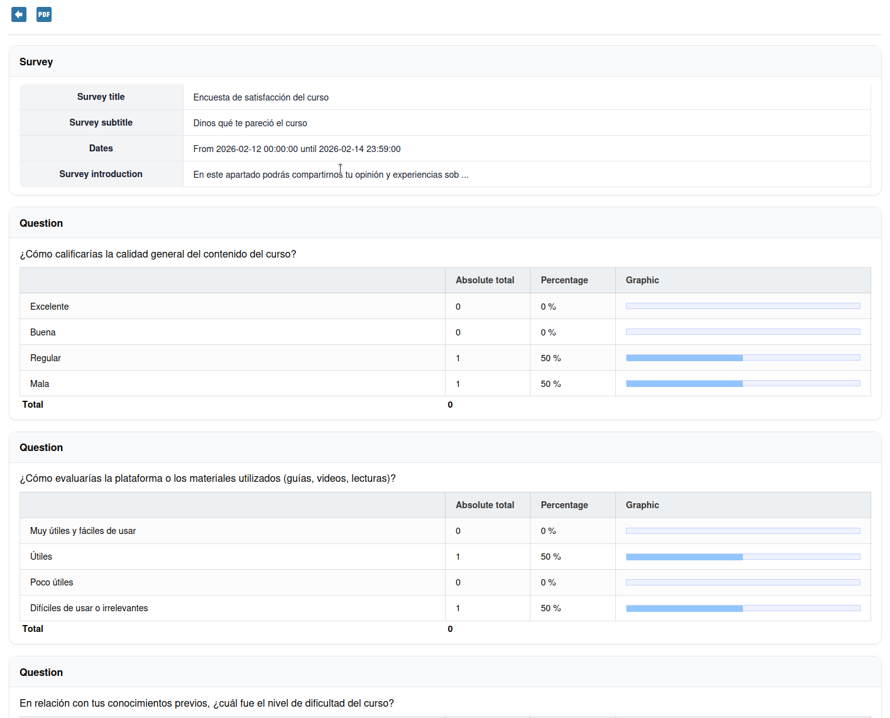

# Surveys

The survey tool lets you create questionnaires to collect feedback from your learners. Surveys are useful for course evaluations, needs assessments, and opinion polls.

## Creating a Survey

1. Open the **Surveys**  tool from the course homepage
2. Click **Create survey**
3. Fill in the survey details:
   * **Code** — This is a unique code for the survey. It will be used in mails and links.
   * **Title** — The name of the survey
   * **Subtitle** — An optional secondary heading
   * **Start date** — From when this survey will be open to participation
   * **End date** — Until when this survey will be open to participation
   * **Anonymous** — Whether responses are anonymous or linked to individual learners
   * **Results visibility** — Who can see the results (only tutor, tutor and students, everyone)
   * **Introduction** — A message shown to learners before they start the survey
   * **Thank you message** — A message shown after submission
4. Save

### Advanced settings

* **Grade in the assessment tool** — Whether to include this survey's answer state in the assessment tool (gradebook). Anyone having completed the survey gets 100%, anyone else get 0%
* **Parent survey** — Not really used at this point (legacy feature)
* **One question per page** — Presentation style for the questions
* **Enable shuffle mode** — Whether to shuffle questions
* **Show question number** — Whether to show (auto-generated) question numbers

### Templates created by an administrator

Platform administrators can create reusable **Survey templates** with their own questions. When the administrator makes a template **Visible as template**, a teacher can choose it while creating a survey in an authorised course or session. The copied survey can then be reviewed and published through the usual invitation workflow. Teachers cannot assign templates to other courses or sessions outside their teaching context.

Administrators can also assign a template directly to a chosen course or to a session containing that course. See [Survey Templates](../../admin-guide/survey-templates.md) for the administrator workflow (PR #9208, issue #8760).

### Results hidden from teachers and tutors

For surveys whose response data must remain confidential from teaching staff, a platform administrator can enable **Results hidden from teacher/tutor** in the survey configuration. Teachers and tutors can still see response counts and send reminders, but **cannot open or export the results**. This restriction also applies to reporting downloads; only a platform administrator may access the restricted results. It is independent of the normal **Results visibility** selection and the global reporting-button setting.

### Training satisfaction template

If you want a standard end-of-training questionnaire, use the **Create satisfaction survey** action in the Surveys toolbar. Chamilo creates an anonymous **Training satisfaction survey** from the built-in seven-question template and opens its question editor immediately.

The survey is created in the current course or course-session context and is not published automatically. Review or edit the generated questions first, then publish it and choose recipients in the usual way. This action is only available to users who can create surveys, and it is hidden when survey creation is disabled by platform configuration.

## Adding Questions

Once the survey is created, add questions:

1. Choose the question type:
   * **Yes/No** — A simple binary choice
   * **Multiple choice** — Select one answer from several options
   * **Multiple answer** — Select one or more answers from several options
   * **Open-ended** — Free text response
   * **Dropdown** — Select from a dropdown list
   * **Percentage** — Choose a percentage value
   * **Score** — Rate on a numeric scale
   * **Comment** — A text block (not a question) for adding instructions between questions
   * **Multiple choice with "other" option** — Select one answer from several options, with an alternative choice
   * **Selective display** — Special type allowing you to adapt the flow of questions based on previous answers
   * **Page break** — Add page breaks in the questions flow. Only useful if "One question per page" was **not** selected in the previous step
2. Configure the question text and answer options
3. Save

Each question can be marked as mandatory. If you don't, skipping any question will be acceptable behaviour.

## Publishing a Survey

After adding all questions:

1. Click **Publish**
2. Choose the recipients — Select specific learners or groups (you select them). The **Add learners** button adds all the learners in one single push and leaves the teachers behind
3. Add additional users — Lets you invite users from outside Chamilo to participate in the survey. They will receive an e-mail with a link and will appear by their e-mail address in the survey details
4. Mail subject
5. Mail text — Explain what the survey is about and when/how to answer
6. Different options for repeat invitations are available
7. Confirm

Learners receive an invitation (as an email) to complete the survey.

A link is available at the bottom of the publication page to invite even more external users to participate. Participants using this link will not be identified and appear as anonymous in the survey results.

## Viewing Results

After learners have responded:

1. Open the survey
2. Click **Results** or **Report**
3. View response summaries:
   * Charts and percentages for closed questions
   * Individual text responses for open-ended questions
   * Completion rate (how many invitees responded)

You can export results to a spreadsheet for further analysis.

### Average scores for score-type questions

The **Overview** and **Detailed report by question** display the average for score-type survey questions. The report shows the overall question average and individual criterion averages, using the question's scoring scale. For example, on a 20-point scale, criterion averages of 12/20 and 2/20 can produce an overall average of 7/20 when the two criteria have equal numbers of valid scores. Unanswered or invalid scores are excluded rather than treated as zero; existing distribution and response reporting remain available.

These are descriptive survey statistics, not a new Gradebook score. Access to the results remains subject to the survey's confidentiality and results visibility configuration. See [PR #9550](https://github.com/chamilo/chamilo-lms/pull/9550).

### Answer timestamps (technical)

New and updated survey answer rows record creation and modification timestamps in `c_survey_answer.created_at` and `c_survey_answer.updated_at`. Creation time is set on insert; modification time is maintained when answers change. The Doctrine lifecycle uses UTC. Historical answers with unknown dates remain nullable rather than receiving invented historical timestamps. This is database-level metadata, not a new teacher-facing timeline or guaranteed export column. Apply the corresponding schema migration as part of a normal Chamilo upgrade. See [PR #9549](https://github.com/chamilo/chamilo-lms/pull/9549).

## Tips

* **Keep it short** — Learners are more likely to complete shorter surveys
* **Use anonymous mode** — For honest feedback, enable anonymous responses
* **Time it right** — Send mid-course surveys to make adjustments, not just end-of-course evaluations
