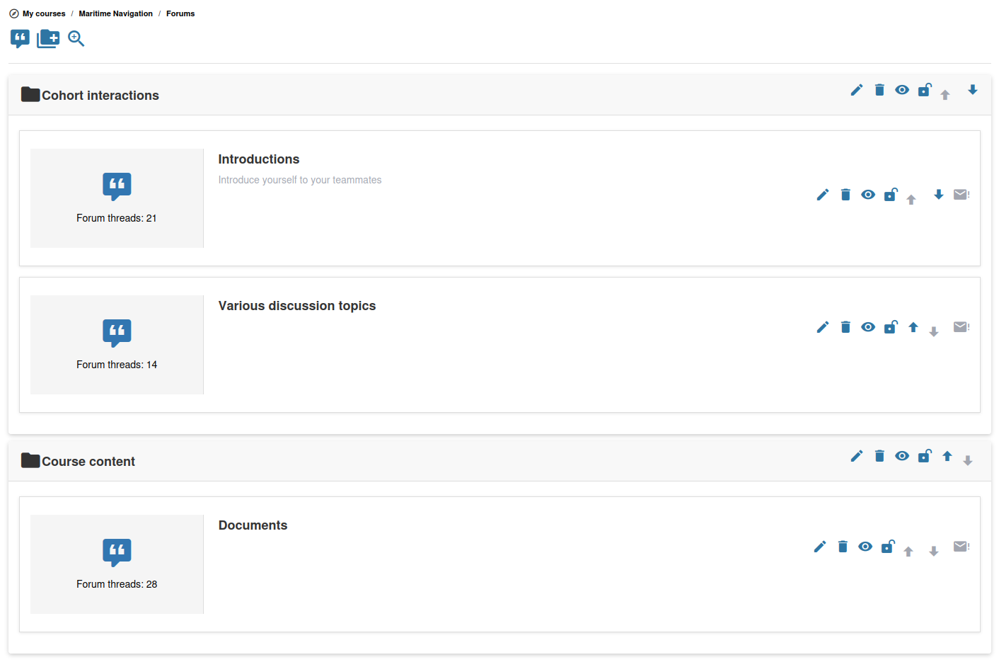

# Forums

The forum tool allows you to host structured discussions within your course. Learners can post messages, reply to each other, and engage in threaded conversations.

## Forum Structure

Forums in Chamilo are organized in three levels:

1. **Forum categories** — Top-level groupings (e.g., "General Discussions", "Module 1 Questions")
2. **Forums** — Individual discussion boards within a category
3. **Topics (threads)** — Individual discussion topics within a forum, each with a chain of replies

## Creating a Forum Category

1. Open the **Forums**  tool from your course homepage
2. Click **Add a forum category**
3. Enter a **Category name** and optional description
4. Save

## Creating a Forum

You can only add a forum once at least one category exists.

1. Within a category, click **Add a forum**
2. Fill in the basic details:
   * **Title** — The name of this discussion board
   * **Description** — An optional description of the forum's purpose
   * **Create in category** — The category this forum belongs to
3. Open **Advanced settings** to configure:
   * **Publication date** / **Closing date** — Optional time window during which the forum is open
   * **Moderated forum** — Require new posts to be approved by a teacher before they become visible
   * **Can learners edit their own posts?** — Allow or prevent learners from editing posts after submitting
   * **Allow users to start new threads** — When set to No, learners can only reply to existing threads
   * **Default view type** — Choose how posts are displayed: **Flat**, **Threaded**, or **Nested**
   * **For Group** — Attach this forum to a course group
   * **Public access / Private access** — For group forums, decide whether any course member can read it or only group members
4. Save

If the course visibility is set to "Open to the world", the form also shows an **Allow anonymous posts?** option. This option is hidden in courses with restricted visibility.

## Managing Topics

Learners (and you) can create new topics within a forum. As a teacher, you can:

* **Pin a topic (sticky message)** — Mark a thread as sticky when you create or edit it so it always appears at the top
* **Lock a topic** — Prevent further replies
* **Edit or delete posts** — Moderate the discussion
* **Move a topic** — Transfer a topic to a different forum

On very long threads, your platform may only show the first posts of each thread to everyone except platform administrators — you included — when the administrator sets **Maximum posts shown in a forum thread** (`thread_max_posts_for_non_admins`, see [Forums Settings](../../admin-guide/platform-settings/forum-settings.md)). Ask an administrator if you need to read the later posts of such a thread.

## Forum Scoring

When creating a new thread as a teacher, you can enable **Grade this thread** under Advanced settings. You then set a maximum score, a column header for the gradebook, and a weight in the report. You can also enable **Thread scored by peers**, which requires each learner to qualify at least two other learners before their own score counts.

## Participation Requirements and Category Information

Administrators can optionally enable three forum-wide behaviors under **Administration > Configuration settings > Forums**:

* **Show thread replies only after participating** (`show_thread_replies_after_participation`) — A learner sees the thread's opening message, but not other people's replies until they have contributed a post. Teachers, administrators, session coaches and group tutors are not subject to this restriction. A learner's post waiting for moderation still counts as participation, although normal moderation rules still apply.
* **Show the forum category description in threads** (`show_category_description_in_thread`) — The category title and an excerpt of its description appear above the discussion. **Read more** expands long descriptions.
* **Posts required to complete a forum thread** (`thread_participation_progress_posts`) — When greater than `0`, a progress bar shows a learner's post count against the configured target. Posts awaiting moderation count. Setting it to `0` hides the bar.

The progress target is an informational indicator, **not** the threshold for unlocking replies: if participation-gated replies are enabled, posting once is sufficient to lift that restriction. These settings are disabled by default. See [Forums Settings](../../admin-guide/platform-settings/forum-settings.md).

These three settings apply to every course of the platform, unless the administrator also enables **Forum participation settings can be changed by course** (`forum_participation_can_be_modified_in_course`). Each course then chooses its own values in the **Forum Settings** section of its [course settings](../creating-your-course/course-settings.md#forum-settings) — for example to hide replies until learners post in some courses only, while the platform settings stay disabled. A course that keeps **Use the platform setting** follows the platform value.

## Forum discussions inside a learning path

When learners open a forum discussion **from a Learning Path step**, its replies are displayed **newest first**. The opening post remains part of the discussion, while ordinary forum navigation outside the learning path retains its normal ordering. The forum page hides redundant **Back to threads** and **Back to learning path** actions in this embedded context; learners should use the learning path player's navigation to move to another step.

If learners open the same discussion from the regular **Forums** tool, they use the normal forum navigation and chronological post order. This contextual behavior was corrected in [PR #9163](https://github.com/chamilo/chamilo-lms/pull/9163).

## Notifications

Each forum and thread has a **Notify me** toggle that you and your learners can use to subscribe to email notifications about new posts. Notifications are a per-user subscription and are not configured when creating the forum.
