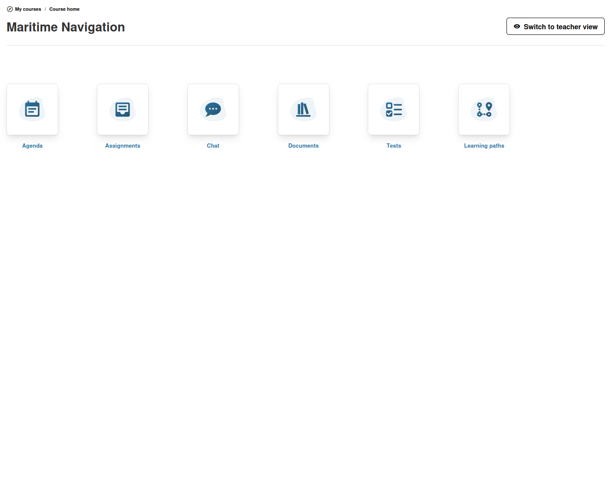

# Course Homepage

The course homepage is the first page your learners see when they enter a course. This page describes how to customize it to create an engaging entry point.

## Course Introduction

The course introduction is a rich-text area on the homepage. By default it sits above the tool grid. Use it to:

* Welcome your learners
* Describe the course objectives
* Provide instructions for getting started
* Embed images, videos, or links

To edit the introduction:

1. Click the **Edit introduction**  button
2. Use the rich-text editor to write your content
3. Save your changes

If no introduction has been created yet, you will see a button to **Create an introduction**.

### Choosing where the introduction appears

You can place the introduction above, below, to the left or to the right of the tools.

* On the course homepage, use the **Introduction position** selector on the introduction block. Learners only see the result; they do not see the selector.
* You can also change this in [Course Settings](course-settings.md), under **Course homepage**.

The default is **Above the tools**, which keeps the previous layout.

On smaller screens, **Left of the tools** and **Right of the tools** stack the introduction above the tools so the page stays readable.

If the course sequence column is shown on the right of the homepage, a **Right of the tools** introduction is displayed above the tools instead, so the two columns do not overlap. The setting itself is kept: if the sequence column is hidden later, the introduction moves to the right. **Left of the tools** can appear beside the tools with the sequence column still on the far right.

## Tool Grid

The course tools are displayed in a grid layout, next to or below the introduction depending on the position you chose. Each tool appears as a card with:

* An icon representing the tool
* The tool name

The tools available in your course may include:

| Tool | Icon | Purpose |
|------|------|---------|
| Agenda |  | Schedule events and deadlines |
| Announcements |  | Send messages to enrolled learners |
| Assignments |  | Collect and grade student work |
| Documents |  | Upload and organize files and content |
| Tests |  | Create quizzes and tests |
| Forum |  | Host discussions |
| Glossary |  | Define key terms |
| Assessments |  | Manage grades and certificates |
| Learning paths |  | Build structured learning sequences |
| Links |  | Share useful URLs |
| Users |  | View and manage enrolled users |
| Surveys |  | Create and distribute surveys |

> Some tools may not appear if your administrator has disabled them at the platform level or if you have hidden them.

A notable change from Chamilo 1.* is that we don't split the tools in 3 different sections anymore. This gives full control to the teachers on what tools to show in what order.

Also, the **Tracking** and **Maintenance** tools have been moved to the top of the page under the stats and cog icons to remove tools that are never shown to the learners from the list.

## Organizing Tools

### Reordering

1. Click the **Sort** button at the top of the tool grid
2. Drag and drop tools to rearrange their order
3. The new order is saved automatically

### Hiding and Showing

* Click the **visibility icon** on any tool to toggle it between visible and hidden for learners
* Use **Show all** or **Hide all** for bulk changes
* Hidden tools remain accessible to you as the teacher — they are only hidden from learners

## Auto-Launch Features

You may configure certain tools to launch automatically when a learner enters the course. If enabled, a notification appears at the top of the course homepage indicating which auto-launch is active:

* Document auto-launch — Opens a specific document automatically
* Exercise auto-launch — Launches a test immediately
* Learning path auto-launch — Starts a learning path upon course entry
* Forum auto-launch — Opens the forum directly
