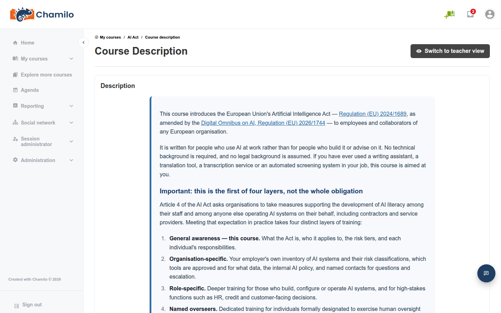
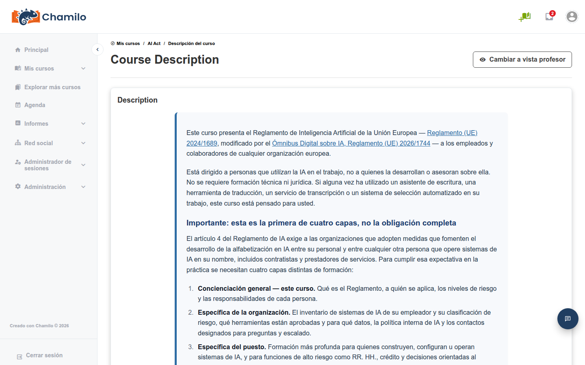
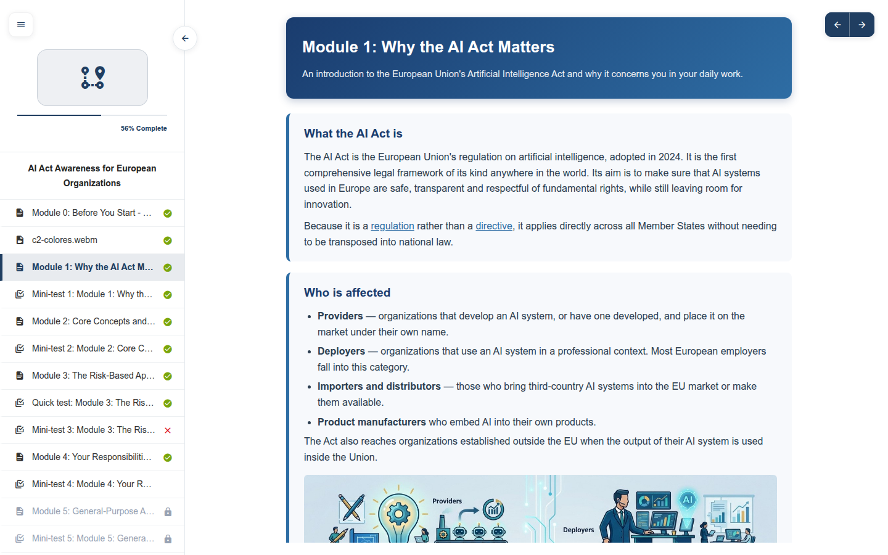

# Demo Courses

Starting with Chamilo 3.0.0, every new installation comes with two ready-made courses. They are both examples of what you can build with Chamilo **and** genuinely useful courses that you can offer to your colleagues and learners as they are.

| Course | Code | Who it is for |
|--------|------|---------------|
| **AI Act** | `AIACT` | Any organization concerned by the European AI Act, whose staff needs to become AI-literate and understand their obligations. The learning path is *AI Act Awareness for European Organizations*. |
| **Using Chamilo** | `USINGCHAMILO` | Any organization starting to use Chamilo: teachers, learners and administrators who want a guided tour of the platform. The learning path is *Getting Started with Chamilo 3.0*. |

You will find them in the course catalogue and in your **My courses** list if you have been subscribed to them.

## Multilingual by Design

Both courses are available in **26 languages**, mostly the languages of the countries affected by the AI Act. Learners do not have to choose anything: each person automatically sees the course in the language of their own profile. This works through the [multi-language content](../adding-content/multi-language-content.md) feature, so the same course (and the same learning path) holds all language versions at once.

The same page for a learner whose profile language is Spanish:


Because the language versions are part of the content, the course keeps working in the language of the learner even if the course itself was created in another language. If your own language is not among the 26, learners will see the course in the course's default language.


## What the Courses Contain

Both courses are built around a single [learning path](../adding-content/learning-paths.md) that guides learners step by step, with documents, images and mini-tests. The course homepage is kept minimal for learners: only the **Course description** and **Learning paths** tools are visible.

As a teacher, you can open them to see how an actual course is structured: how a learning path is organized, how content is written once for many languages, how tests are used to check understanding, and how the course homepage can be kept minimal.

## Using Them in Your Organization

* **Offer them as they are.** Ask your administrator to make sure the course is visible and subscribe your learners to it (see [Subscribing Users](../assessing-learners/subscribing-users.md)). The *AI Act* course can serve as your organization's AI-literacy training, and the *Using Chamilo* course as the onboarding course for new teachers and learners.
* **Copy and adapt them.** Use the course maintenance tools to create a copy, then edit the copy to add your own policies, branding or examples. Keeping the original untouched lets you compare later.
* **Learn from them.** Look at how they are built before you start your own first course.

## Hiding or Deleting Them

You do not have to keep these courses. Your administrator can hide them from the catalogue, change their visibility, or delete them completely, without affecting the rest of the platform. See [Demo Courses](../../admin-guide/courses/demo-courses.md) in the Administrator Guide.
