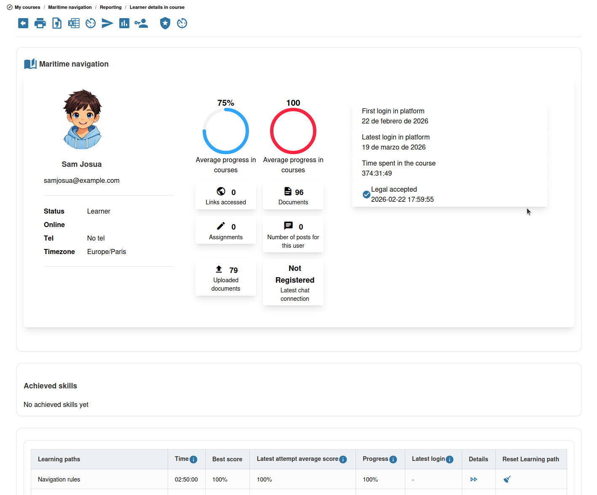

# Learner Tracking

Chamilo tracks learner activity throughout the platform, giving you detailed insights into how each learner is engaging with your course.

## Accessing Learner Tracking

Open the **Tracking**  tool from the course homepage, or click **Reporting** in the sidebar.

## What Is Tracked

For each learner, Chamilo records (in the main per-learner tracking view):

* **Login activity** — When the learner last logged in and their total login time
* **Time spent in the course** — Total time the learner has spent in your course
* **First and last access** — When the learner first entered and last visited the course
* **Course progress** — Aggregate progress percentage across the course
* **Exercise results** — Scores and attempts for each exercise
* **Learning path progress** — Completion percentage and time spent on each learning path
* **Assignment submissions** — Which assignments have been submitted and graded

Per-resource access details (which specific documents or pages a learner opened) and tool-level activity are available through the dedicated **Resources**, **Tools**, and **Events** views in the tracking section, rather than in the main learner row.

## Viewing Individual Learner Data

Click on a learner's name to see their detailed activity report. This shows:

* A summary of their overall engagement
* Progress through each learning path
* Exercise scores and attempt history
* Assignment submission status

## Learner Report Across All Courses

**Reporting** > **Learners**, then a learner's details, opens the learner report (`/reporting/learners/{id}`), which covers every course the learner follows. Below the learner's profile and acquired skills, it shows:

* **Classes** — The classes the learner belongs to, when there are any
* **Courses** — The courses the learner is subscribed to directly
* **One table per session** — The session's title and access dates, then the learner's courses in that session

Administrators, human resources managers, student bosses and session administrators see all the learner's subscriptions. Teachers, tutors and coaches only see the courses they teach or tutor, the sessions they coach as general coach, and the courses they coach in a session; a course teacher also sees that course in the learner's sessions.

Dates are shown in the user's time zone when users may choose one, otherwise in the platform's time zone.

Each course table lists the time spent, progress, score, absences (missed attendance sheets out of the total) and gradebook score for each course, followed by a **Total** row. The course title opens the course, and the details button opens the learner's report in that course. A course followed both directly and in a session appears in both tables, with the figures of each subscription.

Every table can be exported on its own to CSV or Excel. Session tables also offer a PDF export of the session's attendance and a **Certificate of achievement**. The export buttons at the top of the page export all the tables at once.

### Acquired Skills

The **Acquired skills** block shows the skills the learner has acquired. Clicking a skill opens its badge. How the skills are laid out depends on two settings of the **Skills** category in the platform settings:

* When **Skill levels names** (`skill.skill_levels_names`) is empty, the acquired skills are listed one after the other.
* Otherwise, the skills are placed in the skill tree: each acquired skill appears under its parent skills, up to the top of the tree. The parent skills the learner has not acquired are faded, and only the branches holding at least one acquired skill are drawn.
  * With **Show skills as a hierarchical table** (`skill.skills_hierarchical_view_in_user_tracking`) enabled, each top-level branch is a column, with its skills nested below it.
  * With it disabled, each top-level branch is a heading, followed by its skills side by side: the first level below the heading has larger badges, and the deeper levels show their badge without a title.

A skill shows its short code instead of its title when it has one. A skill not attached to any parent appears at the top of the tree.

### Messages About the Learner

When **Allow private messages between teachers about a learner** (`message.private_messages_about_user`) is enabled in the platform settings, a **Messages** block at the bottom of the report lists the follow-up messages written about the learner. Click a message to read it. **New message** writes a new one, with a subject and a text. When a message is sent, the learner's superiors receive a notification with a link to the report. You can delete only the messages you wrote; each deletion is recorded in the platform's event log.

The learner's report in one course, opened with the details button, also shows the learner's classes and the same **Messages** block.

## Tracking Views

You can view tracking data from different perspectives:

* **By learner** — Select a learner to see all their activity
* **By resource** — Select a document, exercise, or learning path to see how all learners interacted with it
* **By tool** — See aggregate usage for each course tool

## Tips

* **Identify struggling learners** — Look for learners with low engagement, multiple failed exercise attempts, or incomplete learning paths
* **Monitor progress regularly** — Check tracking data weekly to spot issues early
* **Use data for feedback** — Share relevant tracking data with learners to help them understand their own progress
