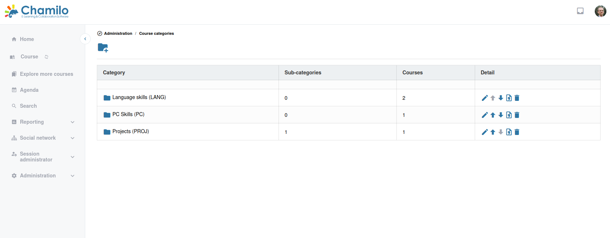

# Categorías de cursos

Las categorías de cursos ayudan a organizar el catálogo de cursos, facilitando que los estudiantes encuentren cursos relevantes.

## Crear una categoría

1. Desde el panel de administración, vaya a **Categorías de cursos**
2. Haga clic en **Añadir categoría**
3. Introduzca:
   * **Código de categoría** — Un identificador único breve
   * **Nombre de categoría** — El nombre visible (p. ej., «Tecnologías de la información», «Habilidades de gestión»)
   * **¿Permitir añadir cursos en esta categoría?** — Si permite que los cursos la establezcan como categoría, o si solo sirve como nivel intermedio en una jerarquía
   * **Categoría superior** — (Opcional) Coloque esta categoría bajo otra categoría para crear una jerarquía
   * **Descripción** — (Opcional)
   * **Imagen** — (Opcional) Representará esta categoría, aunque casi no se muestra en ningún lugar
4. Pulse *Añadir categoría*

Chamilo crea 3 categorías de forma predeterminada: *Competencias lingüísticas*, *Competencias informáticas* y *Proyectos*. Estas se pueden renombrar, eliminar o conservar, según sus necesidades.

## Jerarquía de categorías

Las categorías se pueden anidar para crear una estructura de árbol:

* Empresa
  * Gestión
  * Marketing
  * Finanzas
* Tecnología
  * Programación
  * Redes
  * Ciberseguridad

Los estudiantes que exploran el catálogo de cursos pueden navegar por esta jerarquía para encontrar cursos.

## Gestionar categorías

* **Editar** — Cambiar el nombre, el código o la categoría superior
* **Mover** — Cambiar la posición de una categoría en la lista
* **Eliminar** — Eliminar una categoría. Los cursos de una categoría eliminada se mueven a «sin categorizar».

## Consejos

* **Manténgalo simple** — Utilice categorías amplias que los estudiantes puedan comprender de un vistazo
* **Limite la profundidad** — Evite categorías profundamente anidadas. Dos o tres niveles suelen ser suficientes.
* **Asigne categorías durante la creación del curso** — Anime a los docentes a seleccionar una categoría al crear cursos, para que el catálogo se mantenga organizado