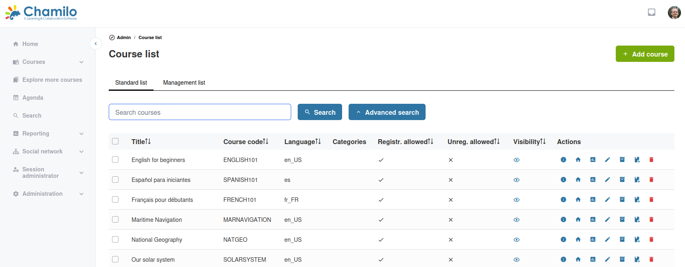

# Gestión de cursos

Como administrador, puede gestionar todos los cursos de la plataforma, independientemente de quién los haya creado.

## Lista de cursos

Desde el panel de administración, haga clic en **Lista de cursos** para ver todos los cursos. La lista muestra:

* Título y código del curso
* Idioma
* Categorías
* Estado de visibilidad

Utilice la herramienta **Búsqueda avanzada** para encontrar cursos específicos.

## Creación de un curso

Como administrador, puede crear cursos y asignarlos a cualquier profesor:

1. Haga clic en **Añadir curso** desde el panel de administración
2. Complete los datos del curso (título, código, categoría, idioma)
3. Asigne un profesor al curso
4. Guarde

Nota: En Chamilo 1.11.x, el código del curso se mostraba como parte de la URL del curso y era imposible modificarlo después de la creación del curso. Este comportamiento cambió a partir de la versión 2.x. El código del curso ya no es visible en la URL, y las versiones futuras podrían permitir a los profesores modificar el código del curso posteriormente, a medida que se vuelve menos esencial para la plataforma.

## Gestión de un curso existente

Busque un curso en la lista para acceder a las opciones de gestión en la columna *Acciones*:

* **Información** — Mostrar información sobre el curso 
* **Página de inicio del curso** — Le lleva directamente a la página de inicio del curso 
* **Informes** — Consultar datos de participación y rendimiento
* **Editar** — Cambiar el título del curso, la categoría, la visibilidad y otros ajustes
* **Crear una copia de seguridad** — Ir a la sección de mantenimiento del curso, donde puede crear copias y realizar otras acciones
* **Añadir al catálogo** — Añadir este curso al catálogo de cursos
* **Eliminar** — Eliminar de forma permanente el curso y todo su contenido

> Eliminar un curso elimina de forma permanente todo el contenido, los datos de los estudiantes, las calificaciones y la información de seguimiento. Considere exportar primero el curso como copia de seguridad.

## Integraciones del administrador

Los administradores también pueden sincronizar metadatos seleccionados del curso mediante `PATCH /api/courses/{id}`, o solicitar la eliminación del curso con `DELETE /api/courses/{id}`. Estas operaciones de la API requieren un administrador de la plataforma; un profesor no puede utilizarlas para eludir la interfaz de configuración del curso. La eliminación de cursos a través de la API puede comportarse de forma distinta en instalaciones multi-URL y no utiliza la eliminación opcional de documentos exclusivos de la pantalla de mantenimiento. Consulte [API de administración de cursos](../../developer-guide/api/course-administration.md) antes de automatizar operaciones destructivas.

## Operaciones masivas

Seleccione varios cursos en la lista para realizar acciones por lotes, como eliminarlos. Para exportar un curso, entre en el curso y utilice la herramienta **Mantenimiento**: no existe una acción de exportación masiva en la lista de cursos del administrador.

## Ajustes de visibilidad del curso

Los administradores pueden anular la visibilidad establecida por los profesores:

| Visibilidad | Efecto |
|-----------|--------|
| **Público** | Accesible para todos, incluidos los visitantes anónimos |
| **Abierto** | Accesible para todos los usuarios que han iniciado sesión |
| **Privado** | Solo los usuarios inscritos pueden acceder al curso |
| **Cerrado** | Nadie puede acceder al curso (excepto el profesor y los administradores) |
| **Oculto** | Nadie puede ver ni acceder al curso (excepto los administradores) |