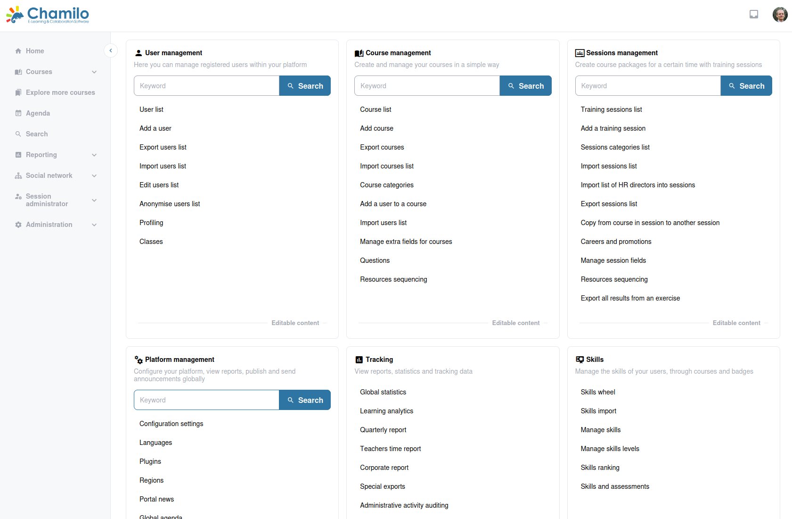

# Visión general de la interfaz de administración

El panel de administración es su centro de mando para gestionar la plataforma Chamilo. Acceda a él haciendo clic en **Administración**  en la barra lateral.

## Panel de administración

El panel de administración está organizado en bloques funcionales. Cada bloque agrupa herramientas de gestión relacionadas:

### Usuarios

* **Lista de usuarios** — Ver, buscar, editar y gestionar todos los usuarios de la plataforma
* **Añadir un usuario** — Crear cuentas de usuario individuales
* **Clases** — Gestionar clases de usuarios para la inscripción masiva en sesiones

Consulte el capítulo [Usuarios](../users/README.md) para más detalles.

### Cursos

* **Lista de cursos** — Ver y gestionar todos los cursos de la plataforma
* **Crear un curso** — Crear un curso nuevo
* **Categorías de cursos** — Organizar los cursos en categorías para el catálogo

Consulte el capítulo [Cursos](../courses/README.md) para más detalles.

### Sesiones

* **Lista de sesiones** — Ver y gestionar las sesiones de formación
* **Crear una sesión** — Configurar una nueva sesión con cursos e inscripción
* **Categorías de sesiones** — Organizar las sesiones en categorías
* **Carreras y promociones** — Gestionar itinerarios formativos y flujos de trabajo de promociones

Consulte el capítulo [Sesiones](../sessions/README.md) para más detalles.

### Plataforma

* **Parámetros de configuración**, **Idiomas**, **Noticias del portal**, **Agenda global**, **Páginas**, **Campos extra**, **Plantillas de correo**, **Categorías del formulario de contacto** y más — consulte el capítulo [Plataforma](../platform/README.md) para más detalles. El enlace «Parámetros de configuración» es el punto de entrada al capítulo independiente [Configuración de la plataforma](../platform-settings/README.md).

### Analítica

* **Estadísticas globales**, **Catálogo de informes**, **Analítica del aprendizaje**, **Informe trimestral**, **Informe de tiempo de los docentes**, **Informe corporativo**, **Exportaciones especiales**, **Incidencias** — Estadísticas e informes de la plataforma; consulte el capítulo [Analítica](../analytics/README.md) para más detalles

### Competencias

* **Rueda de competencias**, **Importación de competencias**, **Gestionar competencias**, **Gestionar niveles de competencias**, **Clasificación de competencias**, **Competencias y evaluaciones** — Insignias de competencia vinculadas a los resultados del cuaderno de calificaciones; consulte el capítulo [Competencias](../skills/README.md) para más detalles

### Sistema

* **Limpiar archivos temporales**, **Estado del sistema**, **Actualización del sistema**, **Colores**, **Información de archivos**, **Recursos por tipo**, **Lista de iconos** — Mantenimiento del servidor, autoactualización e identidad visual; consulte el capítulo [Sistema](../system/README.md) para más detalles

### Salas

* **Sedes**, **Salas**, **Buscador de disponibilidad de salas** — Sedes físicas y salas de formación reservables; consulte el capítulo [Salas](../rooms/README.md) para más detalles

### Seguridad

* **Auditoría de actividades**, **Intentos de inicio de sesión**, **IDS simple**, **Comprobador de fortaleza de contraseñas**, **Integridad de archivos** — Herramientas de supervisión y auditoría de seguridad; consulte el capítulo [Seguridad](../security/README.md) para más detalles

### Plugins

* Accesos directos a los plugins instalados que declaran una página de menú de administración, además de la gestión general de plugins — consulte el capítulo [Plugins](../plugins/README.md) para más detalles

### Comprobación de estado

* Comprobaciones en vivo de aprobado/fallo (configuración de correo, asignación de URL de administración, permisos de archivos) — consulte la página [Comprobación de estado](../health-check.md) para más detalles

### Otros bloques

* **Chamilo.org**, **Comprobación de versión**, **Soporte profesional**, **Noticias de Chamilo** — enlaces y paneles de estado que obtienen contenido del proyecto Chamilo; consulte [Otros bloques de administración](../other-admin-blocks/README.md) para más detalles

Cada sección se trata en detalle en el capítulo correspondiente de esta guía.

Los métodos de autenticación como OAuth2, LDAP, CAS y otros proveedores de autenticación externos no se configuran en el panel de administración, sino en `config/authentication.yaml`.