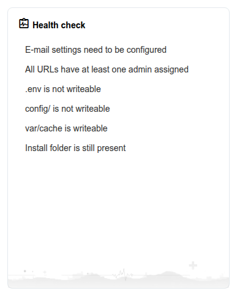

# Comprobación de estado

La comprobación de estado es un pequeño bloque del panel de administración que ejecuta una serie de verificaciones en tiempo real sobre la instalación y señala todo lo que requiere atención, sin necesidad de revisar los archivos de configuración para detectar configuraciones incorrectas habituales.

## Acceso a la comprobación de estado

Desde el panel de administración, el bloque **Comprobación de estado** aparece junto a los demás bloques del panel; no es necesario hacer clic, los resultados se muestran directamente.

## Las comprobaciones

* **Configuración de correo electrónico** — Comprueba que estén configurados una cadena de conexión del sistema de correo y un correo electrónico y un nombre de remitente. Si no lo están, enlaza con la configuración de correo para corregirlo.
* **Todas las URL tienen al menos un administrador asignado** — En una instalación multi-URL, comprueba que cada URL de acceso tenga al menos un administrador que pueda gestionarla. Si alguna no lo tiene, enlaza con la página de asignación de URL de acceso y usuarios.
* **`.env` no es escribible** — `.env` contiene secretos y no debe ser escribible por el servidor web después de la instalación. Se marca como error si lo es; enlaza con la Guía de seguridad.
* **`config/` no es escribible** — El mismo razonamiento que para `.env`: este directorio no debe ser escribible desde la web en condiciones normales de funcionamiento. Dado que esta carpeta ha sido históricamente un objetivo de ataques, elimínela con `rm -rf public/main/install`. Enlaza con la [Guía de seguridad](appendix/security-guide.md#remove-the-install-folder).
* **`var/cache` es escribible** — La comprobación opuesta: Symfony necesita escribir en su directorio de caché, por lo que esta se marca como error si *no* es escribible. Enlaza con la guía de ajuste del rendimiento y optimización.
* **La carpeta de instalación no está presente** — La carpeta `public/main/install` solo es necesaria durante la instalación y debe eliminarse después. Se marca como advertencia (no como error grave) si aún existe, ya que supone un riesgo de menor gravedad que las dos comprobaciones de permisos de escritura anteriores. Dado que esta carpeta ha sido históricamente un objetivo de ataques, elimínela con `rm -rf public/main/install`. Enlaza con la [Guía de seguridad](appendix/security-guide.md#remove-the-install-folder).

## Qué hacer al respecto

Cada comprobación enlaza directamente con el lugar donde se corregiría el problema subyacente, ya sea una página de configuración o la guía correspondiente. Revise esta lista justo después de la instalación y de forma periódica posteriormente (por ejemplo, tras una transferencia manual de archivos o un cambio de permisos), ya que una comprobación superada hoy no garantiza que siga siéndolo. Para una lista de comprobación más amplia de endurecimiento en producción, más allá de estas seis comprobaciones, consulte la [Guía de seguridad](appendix/security-guide.md).