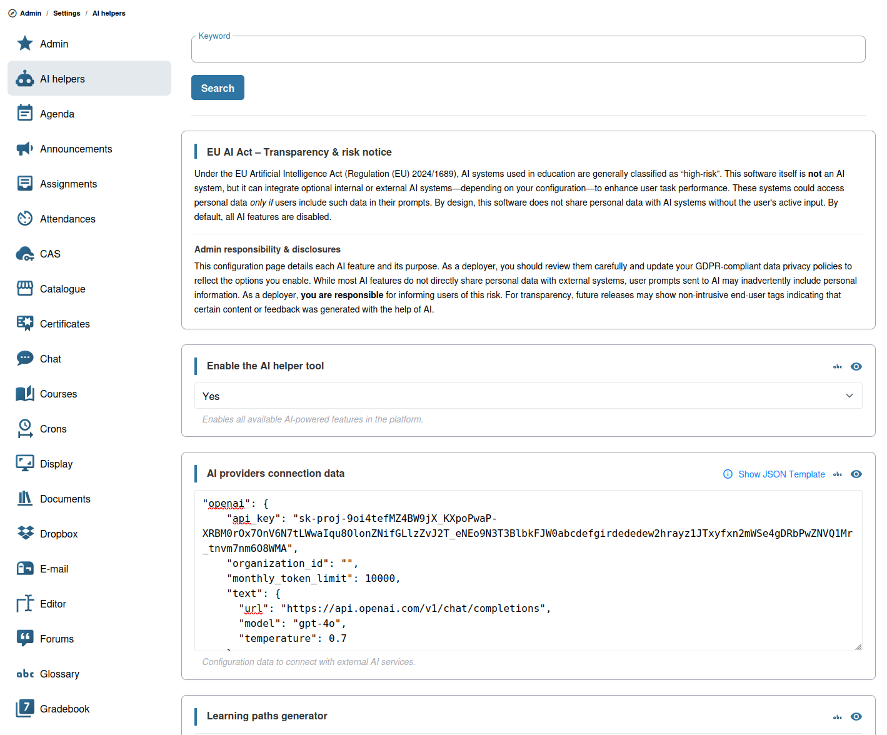

# Configuración de IA

Chamilo 3.0 incluye funciones basadas en IA que requieren configuración antes de estar disponibles para docentes y estudiantes.

## Proveedores de IA compatibles

Chamilo admite varios proveedores de IA:

| Proveedor | Capacidades |
|----------|-------------|
| **Claude (Anthropic)** | Generación de texto, análisis de documentos |
| **DeepSeek** | Generación de texto |
| **Google Gemini** | Generación de texto, imágenes y vídeo |
| **Grok** | Generación de texto, imágenes y vídeo |
| **Mistral** | Generación de texto |
| **OpenAI** | Generación de texto, imágenes y vídeo |

Cada proveedor puede configurarse para distintos tipos de tareas de IA:

* **Texto** — Se utiliza para la generación de ejercicios, la generación de itinerarios de aprendizaje, la calificación con IA y el tutor de IA
* **Imagen** — Se utiliza para la generación de imágenes con IA
* **Vídeo** — Se utiliza para la generación de vídeos con IA (cuando es compatible)
* **Documento** — Se utiliza para el análisis de documentos con IA

## Pasos de configuración

### 1. Obtener claves de API

Regístrese en una cuenta del proveedor de IA elegido y obtenga una clave de API:

* **Claude (Anthropic)**: [console.anthropic.com](https://console.anthropic.com/)
* **DeepSeek**: [platform.deepseek.com](https://platform.deepseek.com/)
* **Google Gemini**: Google AI Studio o Google Cloud
* **Grok**: [console.x.ai](https://console.x.ai/)
* **Mistral**: [console.mistral.ai](https://console.mistral.ai/)
* **OpenAI**: [platform.openai.com](https://platform.openai.com/)

### 2. Configurar los proveedores en Chamilo



En la configuración de la plataforma, vaya a la sección **Asistentes de IA**:

1. **Activar los asistentes de IA** — Active las funciones de IA de forma global
2. **Configurar los proveedores de IA** — Añada uno o varios proveedores con:
   * **Nombre del proveedor** (`claude`, `deepseek`, `gemini`, `grok`, `mistral`, `openai`). `anthropic` se acepta como alias de `claude`
   * **Clave de API** — Su clave de API del proveedor
   * **Modelo** — El modelo específico que se utilizará (p. ej., `gpt-4o`, `claude-sonnet-4-6`, `gemini-pro`, `mistral-large`)
   * **URL de la API** — La URL del punto de conexión (preconfigurada para los proveedores estándar)

Puede configurar varios proveedores. El primer proveedor de la configuración se convierte en el predeterminado.

### 3. Activar las funciones por curso

Las funciones de IA pueden activarse o desactivarse a nivel de curso. Los docentes pueden activar o desactivar:

* **Chatbot del tutor de IA** — El asistente de IA para los estudiantes
* **Calificador de tareas** — Recomendación de calificación generada por IA
* **Generador de ejercicios** — Preguntas de cuestionario generadas por IA
* **Generador de itinerarios de aprendizaje** — Secuencias de aprendizaje generadas por IA
* **Generador de imágenes/vídeos** — Imágenes y vídeos generados por IA en los documentos

Esto permite que distintos cursos utilicen configuraciones de IA diferentes según sus necesidades.

## Uso de cualquier modelo o punto de conexión compatible

**No está limitado a los proveedores indicados anteriormente.** Chamilo se comunica con cada proveedor a través de una *interfaz* de API estándar, y la URL del punto de conexión es configurable. Cualquier modelo o servicio compatible con una de estas interfaces puede utilizarse simplemente eligiendo el proveedor correspondiente y modificando la **URL de la API** (punto de conexión), la **clave de API** y el nombre del **modelo**.

| Si su modelo o servicio es compatible con... | Utilice este proveedor | Ruta típica del punto de conexión |
|---|---|---|
| La **API de OpenAI** (Chat Completions) | `openai` | `.../chat/completions` |
| La **API de mensajes de Anthropic (Claude)** | `claude` | `.../v1/messages` |
| La **API de Gemini** | `gemini` | específica del proveedor |
| Las API de **Mistral**, **DeepSeek** o **Grok** | `mistral`, `deepseek`, `grok` | específica del proveedor |

La interfaz compatible con OpenAI es, con diferencia, la más ampliamente implementada. La utilizan, entre otros, GLM (Z.ai / Zhipu), Qwen, Kimi, Together AI, Groq, OpenRouter, Perplexity y servidores autoalojados como Ollama, vLLM, LM Studio o LiteLLM. Todos ellos pueden conectarse a Chamilo a través del proveedor `openai`.

### Ejemplo: usar GLM (Z.ai) a través del proveedor OpenAI

Los modelos GLM de Z.ai exponen un endpoint compatible con OpenAI, por lo que no se necesita un proveedor GLM dedicado:

1. Obtenga una clave de API desde su cuenta de Z.ai.
2. En la configuración de **AI Helpers**, añada (o edite) el proveedor `openai`.
3. Establezca la **API URL** del servicio de texto en el endpoint de GLM, configure el **model** con un modelo GLM y pegue la clave de Z.ai como **API key**.

```json
{
  "openai": {
    "api_key": "YOUR_ZAI_API_KEY",
    "text": {
      "url": "https://api.z.ai/api/paas/v4/chat/completions",
      "model": "glm-4.6",
      "temperature": 0.7,
      "max_tokens": 1000
    }
  }
}
```

El mismo enfoque funciona para un modelo local servido por Ollama (`"url": "http://localhost:11434/v1/chat/completions"`, `"model": "llama3.1"`), o para cualquier otro servicio: consulte la documentación del proveedor para conocer su URL base compatible con OpenAI y los nombres exactos de los modelos.


El endpoint debe implementar el formato completo de solicitud/respuesta de la interfaz que elija, y el modelo debe admitir la capacidad que se esté utilizando (por ejemplo, la generación de imágenes solo funcionará si el endpoint también implementa la API de imágenes de OpenAI). Los nombres de los modelos, las URL de los endpoints y la disponibilidad los define el proveedor y pueden cambiar: consulte siempre su documentación. Si una función no funciona, pruebe primero con una configuración solo de texto.


El mismo principio se aplica al proveedor Claude: cualquier puerta de enlace o proxy compatible con Anthropic puede utilizarse cambiando la API URL.

## Tiempos de espera de generación de AI Toolbox

Para la generación de texto de **AI Toolbox**, la configuración `text.timeout` de un proveedor controla cuánto tiempo puede ejecutarse esa solicitud del proveedor. El proveedor de texto Grok utiliza un **valor predeterminado de 180 segundos** cuando no se configura un tiempo de espera numérico (véase [PR #9198](https://github.com/chamilo/chamilo-lms/pull/9198)). Esto no garantiza que la solicitud del navegador pueda ejecutarse durante 180 segundos: los proxies inversos, el servidor web u otra puerta de enlace pueden imponer un límite más corto.

Si el formulario de Toolbox muestra **HTTP 504**, compruebe el tiempo de espera de las solicitudes del proxy inverso o de la puerta de enlace, así como los registros de PHP y de la aplicación; aumentar solo `text.timeout` puede no resolverlo. Cuando el error nombra al proveedor de IA, revise el `text.timeout` de ese proveedor, las credenciales, la disponibilidad del modelo y los límites de las solicitudes. Evite aumentar los tiempos de espera sin tener en cuenta la capacidad del servidor y las solicitudes concurrentes.

## Consideraciones de coste

Las llamadas a las API de IA tienen costes asociados. Tenga en cuenta lo siguiente:

* **Establecer límites de uso** — Supervise y limite el uso de las API de IA para controlar los costes
* **Elegir los modelos con criterio** — Los modelos más pequeños y menos costosos pueden ser suficientes para muchas tareas educativas
* **Hacer un seguimiento del uso** — Chamilo registra las solicitudes de IA para ayudarle a supervisar el consumo

## Consejos

* **Empiece con un solo proveedor** — Configure y pruebe un proveedor antes de añadir más
* **Pruebe con un curso** — Active primero las funciones de IA en un curso de prueba para verificar que funcionan como se espera
* **Comuníquese con el profesorado** — Informe al profesorado de qué funciones de IA están disponibles y cómo utilizarlas
* **Supervise la calidad** — Revise periódicamente el contenido generado por IA para asegurarse de que cumple sus estándares educativos