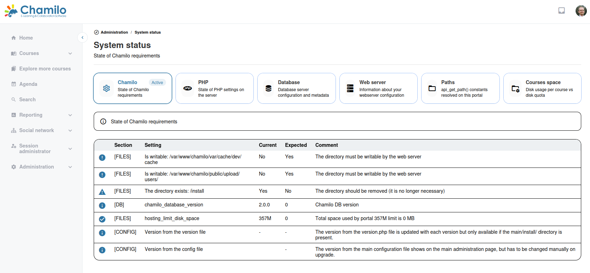

# Estado del sistema

La página de estado del sistema le ayuda a verificar que su servidor Chamilo esté correctamente configurado e identificar posibles problemas.

## Acceso al estado del sistema

Desde el panel de administración, haga clic en **Estado del sistema** (o **Información del sistema**).

## Qué muestra

### Configuración de PHP

* **Versión de PHP** — Chamilo 3.0 admite PHP 8.3, 8.4 y 8.5
* **Extensiones requeridas** — Comprueba que todas las extensiones de PHP necesarias estén instaladas
* **Ajustes de PHP** — Verifica ajustes importantes de PHP como el límite de memoria, los límites de carga y el tiempo de ejecución

### Estado de la base de datos

* **Conexión a la base de datos** — Confirma que la base de datos es accesible
* **Versión de la base de datos** — Muestra la versión del servidor de base de datos

### Permisos de archivos

* **Directorios con permiso de escritura** — Comprueba que Chamilo pueda escribir en los directorios requeridos (cache, uploads, logs)

### Información del servidor

* **Sistema operativo** — Detalles del sistema operativo del servidor
* **Servidor web** — Apache, Nginx u otro
* **Espacio en disco** — Almacenamiento disponible

## Comprobaciones recomendadas

Realice estas comprobaciones con regularidad:

* **Después de la instalación** — Verifique que se cumplan todos los requisitos
* **Después de las actualizaciones** — Asegúrese de que la versión de PHP y las extensiones sigan siendo compatibles
* **Cuando surjan problemas** — Consulte primero el estado del sistema al diagnosticar problemas