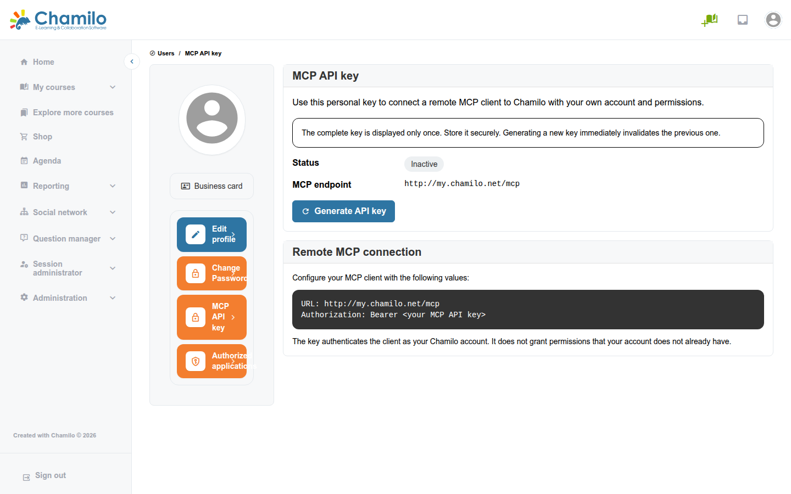

# MCP (Model Context Protocol)

Chamilo 3.0 expone un servidor MCP para que los asistentes y agentes de IA (Claude, conectores de ChatGPT o cualquier cliente compatible con MCP) puedan actuar dentro de la plataforma en nombre de un usuario autenticado, utilizando los propios permisos de ese usuario: no existe una cuenta de servicio independiente ni un acceso elevado.

## Qué aporta MCP a Chamilo

MCP (Model Context Protocol) es un estándar abierto que permite a los clientes de IA invocar un conjunto definido de «herramientas» expuestas por un servidor. El servidor MCP de Chamilo es accesible en un único punto de acceso, `/mcp`, y expone un conjunto seleccionado de herramientas de gestión de cursos orientadas al profesorado, en lugar de toda la superficie de la API.

## Capacidades disponibles

Cada llamada se ejecuta como el usuario conectado, de modo que una herramienta solo ve y modifica los cursos que ese usuario gestiona. El conjunto actual de herramientas:

| Herramienta | Qué hace |
|------|---------------|
| Current user | Devuelve la identidad y los roles del usuario autenticado |
| Teacher courses | Enumera los cursos que el usuario gestiona como docente |
| Course overview | Devuelve la información del curso base y los recuentos de recursos |
| Create course | Crea un curso nuevo aplicando las reglas de creación de cursos de la plataforma |
| Create course assignment | Crea una tarea en borrador o publicada, con una descripción y una puntuación máxima |
| Create course test | Crea un test de opción múltiple asistido por IA a partir de la descripción de un tema o de un documento existente |
| Get course test response status | Informa de qué estudiantes han respondido, están en curso o están pendientes en un test |
| Get user course test score | Devuelve las puntuaciones más reciente y mejor completadas de un estudiante en un test |
| Create training satisfaction survey | Crea una encuesta de satisfacción de siete preguntas |
| Create course learning path | Crea un itinerario de aprendizaje a partir de las páginas proporcionadas por el cliente MCP |
| Set learning path item prerequisite | Hace que un elemento de un itinerario de aprendizaje esté disponible solo cuando se haya completado un elemento anterior del mismo itinerario (con un rango de puntuación cuando ese elemento es un test), o elimina el prerrequisito; funciona para itinerarios de aprendizaje asociados a una sesión cuando se indica la sesión |
| Set course introduction | Sustituye, o borra, la sección de introducción mostrada en la página de inicio del curso, para el curso base o para una de sus sesiones (la introducción de la sesión prevalece entonces sobre la del curso base dentro de esa sesión) |
| Create course Toolbox application | Genera una aplicación SCORM 1.2 versionada en el AI Toolbox del curso y, opcionalmente, la publica |
| Update course Toolbox application | Genera una nueva versión asistida por IA de una aplicación Toolbox existente, conservando las versiones anteriores |
| List documents | Enumera los documentos de la herramienta Documentos de un curso |
| Read course document | Devuelve el contenido HTML, el título y los metadatos de un documento editable |
| Edit course document | Sustituye el contenido HTML completo de un documento editable existente |
| Create course document | Crea un documento HTML asistido por IA en la carpeta raíz de Documentos |
| Create course illustration | Genera una ilustración de IA para un tema y la guarda como documento |
| Illustrate document paragraph | Inserta una imagen o un vídeo existente antes o después de un párrafo de un documento |
| Find recent course forum activity | Busca publicaciones recientes y visibles del foro relacionadas con un tema |
| Review course quality | Analiza los itinerarios de aprendizaje, documentos, tests, tareas y encuestas de un curso, y devuelve recomendaciones de mejora |
| Generate Student Success feedback | Ejecuta el mismo análisis del Student Success AI Coach, filtrado por privacidad, disponible en los informes del curso para un estudiante de un curso gestionado |

Esta lista la selecciona el equipo principal de Chamilo y no es extensible por el usuario desde la plataforma: el profesorado no puede añadir sus propias herramientas.

## Activación de MCP

MCP está **desactivado de forma predeterminada**. Hasta que se active, el punto de acceso `/mcp` rechaza todas las credenciales y el botón **Clave de API de MCP** no aparece en la página **Red social** de los usuarios.

Vaya a **Administración > Parámetros de configuración > Seguridad** y configure:

* **Activar el servidor MCP** (`mcp_enabled`) en **Sí**.
* **Permitir MCP por roles** (`mcp_allowed_roles`) con los roles que pueden utilizar MCP. Se trata de un mapa JSON; de forma predeterminada solo se permiten administradores y docentes:

  ```json
  {"ADMIN":true,"COURSEMANAGER":true,"STUDENT":false,"HRM":false,"SESSIONADMIN":false,"STUDENT_BOSS":false,"INVITEE":false}
  ```

  Utilice `HRM` en las configuraciones nuevas. Una entrada `DRH` guardada anteriormente sigue siendo compatible cuando `HRM` no está presente; si ambas están presentes, prevalece `HRM`.

  Un usuario necesita al menos un rol habilitado para ver el botón **Clave de API de MCP** y para utilizar MCP. Un JSON no válido deniega MCP a todos los roles. La restricción también se aplica a las claves y a las conexiones OAuth creadas anteriormente, de modo que eliminar un rol interrumpe su acceso existente.

Consulte [Parámetros de seguridad](platform-settings/security-settings.md) para la descripción completa de ambos parámetros.

## Cómo se conectan los usuarios

### Clave de API MCP personal

Cada usuario genera su propia clave en **Red social** > **Clave de API MCP**:



* Al hacer clic en **Generar clave de API** se crea una clave y se muestra una sola vez: Chamilo solo almacena después una versión enmascarada, por lo que la clave completa debe copiarse y guardarse de forma segura de inmediato.
* Generar una nueva clave revoca de inmediato la anterior.
* La página muestra el estado de la clave (activa/inactiva), el endpoint MCP que debe configurarse en el cliente, y las fechas de creación y de último uso.
* El panel **Conexión MCP remota** indica con exactitud qué debe introducirse en el cliente MCP: la URL del endpoint y una cabecera `Authorization: Bearer <your MCP API key>`.

Como indica la propia página, la clave autentica al cliente como la cuenta de ese usuario: no concede ningún permiso que la cuenta no tenga ya.

### OAuth 2.1 (clientes remotos y conectores)

Para los clientes MCP que admiten el descubrimiento OAuth y el registro dinámico de clientes (en lugar de una clave pegada manualmente), Chamilo también actúa como servidor de autorización OAuth 2.1: el cliente descubre los endpoints de Chamilo, se registra y redirige al usuario a `/oauth/authorize` para aprobar el acceso. Las aplicaciones aprobadas aparecen en **Red social** > **Aplicaciones autorizadas**, donde el usuario puede revocar cualquiera que ya no utilice o no reconozca.

## Consideraciones de seguridad

* **Sin escalada de privilegios.** Cada llamada a una herramienta MCP y cada aplicación autorizada mediante OAuth se ejecuta con los propios permisos de Chamilo del usuario que se conecta: una clave de API personal o una aplicación autorizada nunca puede hacer más de lo que ese usuario ya podría hacer manualmente.
* **Solo Bearer, con limitación de tasa.** `/mcp` acepta únicamente una credencial Bearer: una clave de API MCP personal, un token de acceso OAuth o (en desarrollo) un JWT. Los intentos de autenticación están limitados por dirección IP para ralentizar la adivinación de credenciales.
* **Superficie pública reducida.** El único tráfico no autenticado que acepta `/mcp` es la preflight `OPTIONS`; cada llamada real requiere `ROLE_USER`. Los endpoints de descubrimiento OAuth, de registro dinámico de clientes y de tokens son públicos de forma intencionada, tal como exigen las especificaciones OAuth 2.1 / MCP: esto no concede acceso por sí mismo, solo permite que un cliente sepa cómo iniciar el flujo de autorización.
* **La protección contra DNS rebinding está desactivada deliberadamente para `/mcp`.** El paquete que implementa MCP restringe normalmente el endpoint a `localhost`, salvo que se configure una lista estática de nombres de host permitidos, lo que encaja mal con un portal Chamilo de múltiples URL accesible bajo muchos nombres de host. Chamilo desactiva esa comprobación porque aquí es redundante: cada solicitud a `/mcp` ya exige una credencial Bearer con independencia de su cabecera `Host`/`Origin`, y un ataque de DNS rebinding (que se basa en una autenticación ambiental, de tipo cookie, que acompaña a un Host falsificado) no puede falsificar un token Bearer que no posea ya.

## Configuración del servidor MCP

Además de los dos ajustes de la plataforma descritos en [Activación de MCP](#enabling-mcp), el propio servidor MCP se configura a nivel de archivo, en `config/packages/mcp.yaml`, lo que requiere acceso de shell al servidor:

| Clave | Finalidad |
|-----|---------|
| `app`, `version`, `description` | Identidad que Chamilo comunica a los clientes MCP que se conectan |
| `client_transports.stdio` / `client_transports.http` | Qué transportes están activos; Chamilo habilita ambos de forma predeterminada |
| `http.path` | El endpoint HTTP de MCP (`/mcp` de forma predeterminada) |
| `http.allowed_hosts` | Lista de hosts permitidos contra DNS rebinding: se establece en `false` en Chamilo (véase Consideraciones de seguridad más arriba) |
| `http.session.store`, `.directory`, `.ttl` | Dónde se persiste el estado de la sesión MCP y durante cuánto tiempo |

Para desactivar MCP para todos, vuelva a establecer **Habilitar servidor MCP** en **No**. Para eliminar el propio transporte HTTP, establezca `client_transports.http: false` (y `stdio: false` si el transporte CLI también debe desactivarse) y vacíe la caché:

```bash
php bin/console cache:clear --env=prod
php bin/console cache:warmup --env=prod
```

## Consejos

* Trate una clave de API MCP como una contraseña: quien la posea puede actuar como ese usuario a través de cualquier cliente MCP.
* Anime a los usuarios a revisar periódicamente **Aplicaciones autorizadas** y a revocar todo lo que no reconozcan.
* Consulte [Configuración de IA](integrations/ai-configuration.md) para los proveedores de IA que respaldan las herramientas de generación de contenido (creación de pruebas, creación de documentos, ilustraciones) enumeradas anteriormente.