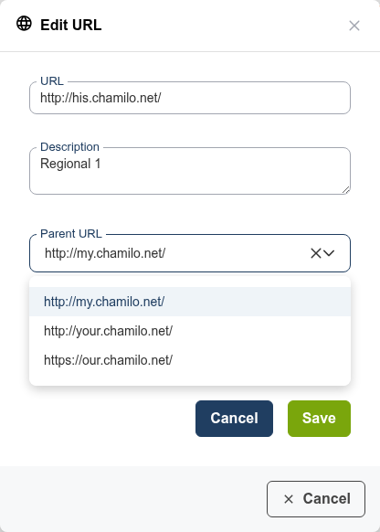
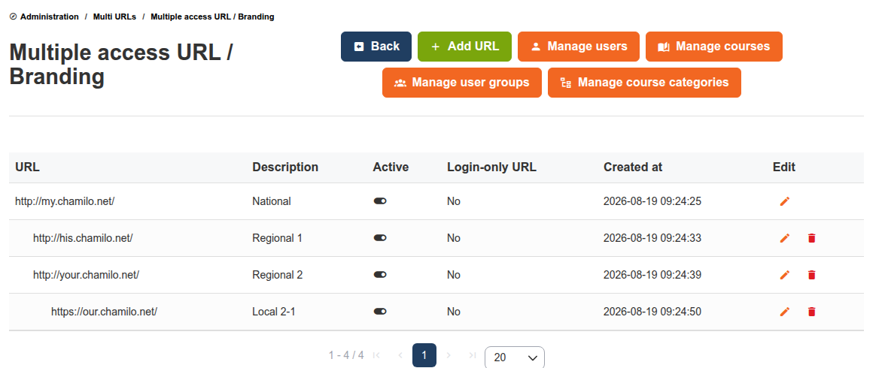

# URLs de acceso

Las URLs de acceso permiten que una única instalación de Chamilo sirva varios portales independientes.

Esta herramienta también está disponible desde el bloque [Plataforma](../platform/README.md) del panel de administración, como **Configurar múltiples URL de acceso**.

## Casos de uso

* **Despliegues multiinquilino** — Alojar portales de formación independientes para distintas organizaciones en un único servidor
* **Portales departamentales** — Ofrecer a cada departamento su propio portal con identidad visual (p. ej., `hr.training.company.com`, `it.training.company.com`)
* **Portales regionales** — Portales independientes para distintas regiones o idiomas

## Cómo funciona

Cada URL de acceso es un punto de entrada independiente a la misma instalación de Chamilo:

* Los usuarios pueden asignarse a una o varias URLs de acceso
* Los cursos y las sesiones pertenecen a URLs de acceso específicas
* La configuración de la plataforma puede personalizarse por URL de acceso
* La identidad visual y los temas pueden diferir según la URL
* Los usuarios de un portal no pueden ver a los usuarios ni los cursos de otro (salvo que se compartan de forma explícita)

## Configuración

### Activación de múltiples URL

Las múltiples URL deben activarse en la configuración de Chamilo (normalmente en los ajustes del entorno). Esto suele hacerse durante la configuración inicial.

### Creación de una URL de acceso

1. Desde el panel de administración, vaya a **URLs de acceso**
2. Haga clic en **Añadir URL**
3. Introduzca la URL (p. ej., `https://portal2.yoursite.com`) y una descripción
4. Opcionalmente, elija una **URL principal** para anidar esta URL bajo otra; consulte [Jerarquía de URL](#url-hierarchy) más abajo
5. Guarde

### Asignación de usuarios y cursos

* **Usuarios** — Asigne usuarios a URLs de acceso específicas. Un usuario puede pertenecer a varias URL.
* **Cursos** — Asigne cursos a URLs de acceso específicas
* **Sesiones** — Asigne sesiones a URLs de acceso específicas

### Configuración por URL

Cada URL de acceso puede tener lo suyo:

* **Tema de color** — Identidad visual distinta
* **Nombre y logotipo de la plataforma** — Identidad personalizada
* **Sustituciones de configuración** — Determinados ajustes de la plataforma pueden personalizarse por URL

## Jerarquía de URL

Las URLs de acceso pueden organizarse en un árbol principal/secundario en lugar de una lista plana. Al crear o editar una URL, un Administrador global sin restricciones (véase [Administradores de subárbol](#subtree-administrators) más abajo) puede elegir cualquier otra URL como su **URL principal**:

* El desplegable nunca ofrece la URL que se está editando, ni ninguno de sus propios descendientes, como posible principal: esto evita crear un ciclo. El backend vuelve a validarlo con independencia de lo que muestre la interfaz.
* Si se crea una URL sin elegir un principal, se asigna de forma predeterminada a la **URL solo de inicio de sesión** si existe una (véase [Configuración por URL](#per-url-settings) más arriba) o, en caso contrario, a la primera URL de acceso: el mismo comportamiento predeterminado que existía antes de esta función.
* La URL superior de un árbol —la que no tiene principal— es la **raíz** de ese árbol. Una única instalación de Chamilo puede alojar más de un árbol independiente.

Dondequiera que se listen las URLs de acceso —el panel de múltiples URL y la página de gestión de URLs de acceso—, el árbol se muestra mediante sangría, con un principal seguido inmediatamente de sus propios secundarios (hermanos ordenados alfabéticamente), en lugar de una columna «Principal» independiente:

## Administradores de subárbol

La jerarquía de URL también determina lo que puede gestionar un [Administrador global](../users/user-roles.md):

* Quien esté registrado en la URL **raíz** de un árbol es **sin restricciones**: gestiona todas las URLs de acceso, exactamente como antes de que existiera esta función.
* Quien esté registrado solo en una URL **no raíz** tiene **ámbito limitado**: las páginas de múltiples URL y de URLs de acceso solo muestran esa URL y sus descendientes, y el gráfico de inicios de sesión del panel de múltiples URL indica «Inicios de sesión (sus URL)» en lugar de «Inicios de sesión (todas las URL combinadas)».

Con independencia del ámbito, lo siguiente queda reservado a un Administrador global **sin restricciones**: un administrador con ámbito limitado no puede realizar estas acciones ni siquiera para las URL de su propio subárbol:

* Crear una nueva URL de acceso
* Editar la propia URL, la descripción o el principal de una URL de acceso
* Activar o desactivar una URL de acceso
* Eliminar una URL de acceso (la URL raíz de toda la instalación nunca puede eliminarse, por nadie)
* Registrarse a sí mismo en todas las URLs de acceso a la vez

Un administrador con ámbito limitado puede seguir gestionando todo lo *asignado a* las URL de su subárbol —usuarios, cursos, sesiones, identidad visual y configuración—, pero no las propias entradas de URL de acceso.

## Consejos

* **Decida con antelación** — Si opta por una configuración multi-URL, debe hacerlo al inicio de su proyecto Chamilo, ya que requiere dejar la primera URL relativamente vacía de contenido. Habilitar multi-URL posteriormente es más complejo (requiere cambios manuales en las bases de datos).
* **Planifique la estructura de URL** — Decida el esquema de URL antes de crear las URL de acceso, ya que cambiar las URL más adelante afecta a todos los enlaces y marcadores existentes
* **Configuración de DNS** — Cada URL de acceso debe resolverse al mismo servidor de Chamilo. Configure los registros DNS en consecuencia.
* **Administrador global** — Utilice el rol de administrador global para gestionar todas las URL de acceso. Para delegar la gestión de una sola rama, registre al administrador en una URL que no sea raíz — consulte [Administradores de subárbol](#subtree-administrators)