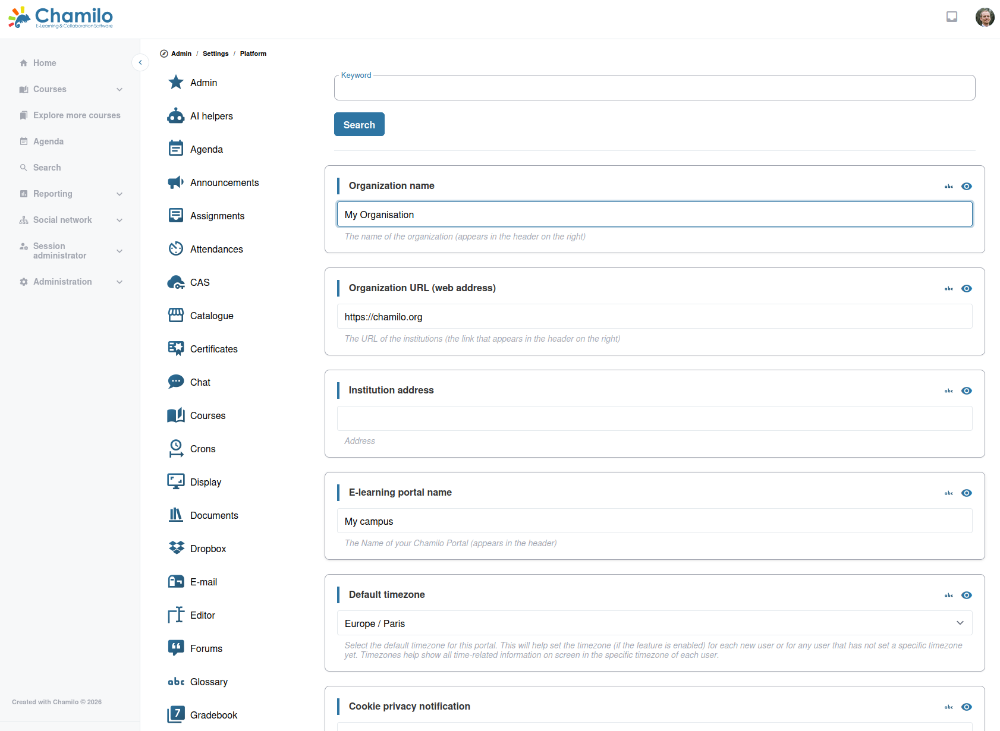

# Configuración de la plataforma

Chamilo dispone de un amplio sistema de configuración con ajustes organizados en categorías. El conjunto completo de categorías que se muestra a continuación refleja la página **Configuration settings** del panel de administración y el archivo subyacente `SettingsCurrentFixtures.php` del código fuente, que constituye la fuente de verdad para los nombres de las variables, los títulos y las descripciones.

Acceda a la configuración de la plataforma desde el panel de administración haciendo clic en **Configuration settings**.

## Todas las categorías

Hay **39 categorías de configuración** en total, enumeradas alfabéticamente a continuación. El número que aparece después de cada enlace es el recuento de ajustes de esa categoría.

### De ámbito de plataforma

* **[Identidad del administrador](admin-settings.md)** (12) — Identidad y datos de contacto del administrador de la plataforma.
* **[Plataforma](platform-settings.md)** (30) — Identidad a nivel de plataforma, zona horaria, política de registro, usuarios en línea, indicadores de rendimiento.
* **[Visualización](display-settings.md)** (24) — Diseño de la página de inicio, gravatar, menús, comportamiento de la imagen de marca.
* **[Editor](editor-settings.md)** (26) — Barras de herramientas del editor de texto enriquecido (TinyMCE), complementos, asistentes de IA.
* **[Idiomas](language-settings.md)** (12) — Idiomas disponibles, idioma predeterminado, idiomas de reserva.
* **[Correo](mail-settings.md)** (22) — Diseño del correo saliente, identidad del remitente, firma.
* **[Flujos de trabajo](workflows-settings.md)** (23) — Interruptores de flujos de trabajo transversales (creación de cursos, validación de inscripciones…).

### Autenticación, seguridad y privacidad

* **[Seguridad](security-settings.md)** (31) — Protección del inicio de sesión, política de contraseñas, cabeceras, 2FA, IDS.
* **[Registro](registration-settings.md)** (20) — Política de autorregistro y redirecciones posteriores al registro.
* **[Privacidad](privacy-settings.md)** (6) — Consentimiento, exportación de datos, solicitudes de eliminación de cuenta.
* **[CAS](cas-settings.md)** (7) — Configuración heredada de CAS trasladada desde la versión 1.x.

### Ciclo de vida de cursos y sesiones

* **[Curso](course-settings.md)** (45) — Valores predeterminados y políticas que se aplican a los cursos en toda la plataforma.
* **[Sesiones](session-settings.md)** (68) — Ciclo de vida de las sesiones, ventanas de acceso de los tutores, visibilidad.
* **[Catálogo de cursos](catalog-settings.md)** (13) — Comportamiento del catálogo público de cursos.
* **[Perfil](profile-settings.md)** (29) — Qué campos aparecen en el perfil del usuario.

### Herramientas del curso

* **[Agenda](agenda-settings.md)** (11)
* **[Anuncios](announcement-settings.md)** (9)
* **[Tareas (Trabajos)](work-settings.md)** (12)
* **[Asistencia](attendance-settings.md)** (4)
* **[Chat](chat-settings.md)** (5)
* **[Documentos](document-settings.md)** (29)
* **[Dropbox](dropbox-settings.md)** (10)
* **[Ejercicios (Pruebas)](exercise-settings.md)** (63)
* **[Foros](forum-settings.md)** (9)
* **[Glosario](glossary-settings.md)** (3)
* **[Grupos](group-settings.md)** (3)
* **[Lecciones](lp-settings.md)** (51)
* **[Encuestas](survey-settings.md)** (12)

### Evaluación y reconocimiento

* **[Libro de calificaciones (Evaluaciones)](gradebook-settings.md)** (34) — Visualización de puntuaciones, decimales, umbrales de certificados.
* **[Certificados](certificate-settings.md)** (9) — Valores predeterminados aplicados cuando un estudiante obtiene un certificado.
* **[Competencias](skill-settings.md)** (13) — Árbol de competencias, reglas de concesión, integración con el perfil.
* **[Seguimiento](tracking-settings.md)** (14) — Qué se registra y qué informes se exponen.

### Comunicación y comunidad

* **[Mensajería](message-settings.md)** (7)
* **[Red social](social-settings.md)** (7)

### IA

* **[Asistentes de IA](ai-helpers-settings.md)** (13) — Proveedores por tipo de tarea (texto, imagen, vídeo, tutor, calificación).

### Operaciones e integración

* **[Tareas cron](crons-settings.md)** (3)
* **[Búsqueda](search-settings.md)** (3) — Configuración de la búsqueda de texto completo con Xapian.
* **[Tickets](ticket-settings.md)** (8) — Sistema de mesa de ayuda.
* **[Servicios web](webservice-settings.md)** (7) — Puntos de acceso heredados SOAP/REST.

## Cómo funcionan los ajustes

* Los ajustes se almacenan en la base de datos (tabla `settings`) y se gestionan a través de la interfaz web
* Algunos ajustes están **bloqueados por URL** en configuraciones multi-URL (su valor se aplica a toda la plataforma y no puede anularse por URL; véanse las columnas `access_url_locked` y `access_url_changeable` de la tabla `settings`); otros (la mayoría) pueden anularse por URL de acceso
* Los cambios surten efecto de inmediato (no es necesario reiniciar el servidor), aunque su sesión de usuario podría conservar algunos de ellos en memoria. Si los cambios no se reflejan de inmediato, cierre la sesión e inicie sesión de nuevo para vaciar su sesión.
* Algunos ajustes tienen dependencias: cambiar uno puede afectar al comportamiento de otros
* Los nombres de variable que se muestran en cada página (p. ej., `2fa_enable`) coinciden con la fila de la tabla `settings` de la base de datos (columna `variable`) y con las claves utilizadas en las anulaciones (`config/settings_overrides.yaml`), cuando corresponda.

Para obtener más información, consulte [Configurations](https://github.com/chamilo/chamilo-lms/wiki/Configurations) en nuestra wiki.

## Validación en línea para ajustes JSON

Algunos ajustes requieren un valor JSON. En estos campos de texto específicos de JSON, Chamilo comprueba la sintaxis aproximadamente **tres segundos** después de que deje de escribir. Si el valor no es válido, aparece un mensaje de **Sintaxis JSON no válida** debajo del campo, y el formulario no se puede enviar hasta que se corrija la sintaxis.

El mismo comportamiento está disponible al editar un ajuste JSON a través de los resultados de búsqueda de ajustes. Los campos de texto ordinarios y los ajustes deshabilitados no se tratan como JSON. Esta comprobación en el navegador ayuda a detectar errores de escritura; la validación en el servidor sigue vigente. Consulte [PR #9411](https://github.com/chamilo/chamilo-lms/pull/9411).

## Consejos

* **Documente sus ajustes** — Mantenga un registro de los ajustes que no son los predeterminados y del motivo por el que los modificó
* **Cambie una cosa a la vez** — Al solucionar problemas, modifique un ajuste cada vez para poder identificar el efecto
* **Pruebe en un entorno de preproducción** — Para cambios significativos de ajustes, pruebe primero en un servidor de preproducción