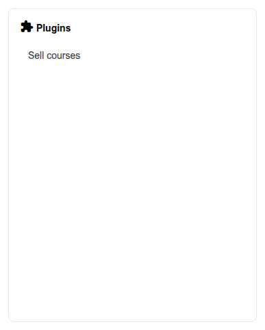

# Plugins

Los plugins amplían la funcionalidad de Chamilo sin modificar el código del núcleo. Chamilo 3.0 incluye más de 50 plugins que pueden activarse según sea necesario.

## El bloque Plugins

El panel de administración también dispone de su propio bloque **Plugins**, independiente de la gestión general de plugins de este capítulo. No enumera todos los plugins instalados, sino únicamente aquellos cuya configuración declara que deben aparecer en la región del menú de administración, ofreciendo a cada uno de ellos un acceso directo a su propia página de administración directamente en el panel.

Si un plugin que ha activado no aparece aquí, es lo esperado: significa que ese plugin concreto no se ha declarado para la región del menú de administración, no que haya algo averiado. Consulte [Gestión de plugins](managing-plugins.md) para ver la lista completa de plugins instalados, independientemente de si aparecen en el panel.

## En este capítulo

* **[Gestión de plugins](managing-plugins.md)** — Instalar, activar, configurar y desactivar plugins
* **[Pagos y servicios recurrentes de BuyCourses](buycourses.md)** — Configurar pasarelas de pago, renovaciones e historial de pagos de servicios