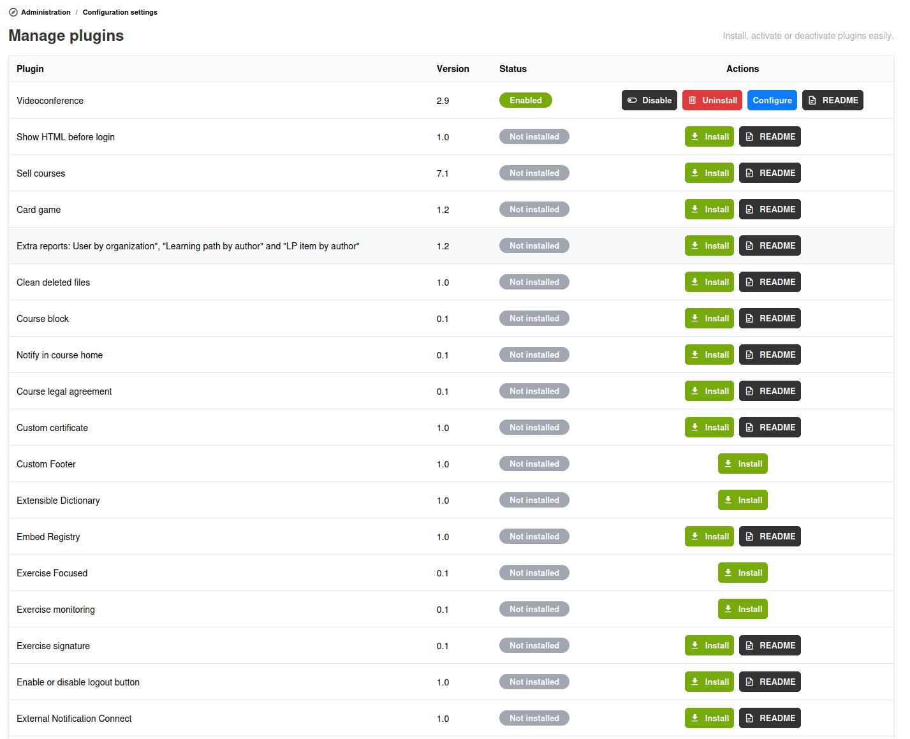

# Gestión de plugins

## Acceso al gestor de plugins

Desde el panel de administración, haga clic en **Administrar plugins** para ver la lista de plugins disponibles.

## Estados de los plugins

Cada plugin tiene uno de estos dos estados:

* **Activo** — El plugin está habilitado y sus funciones están disponibles en la plataforma
* **Inactivo** — El plugin está instalado, pero deshabilitado

## Activación de un plugin

1. Localice el plugin en la lista
2. Haga clic en **Instalar** y, a continuación, en **Activar**, o actívelo con el interruptor
3. Configure los ajustes del plugin (si procede, busque el botón **Configurar**)
4. Guarde
5. Si se recomienda en el README, actívelo en una **región** específica

Algunos plugins añaden herramientas a los cursos, nuevas páginas a la plataforma o funcionalidades adicionales a las características existentes.

## Configuración de un plugin

Muchos plugins disponen de opciones de configuración. Tras activar un plugin:

1. Haga clic en el botón **Configurar** situado junto al plugin
2. Complete la configuración requerida (claves de API, URL, opciones, etc.)
3. Guarde

## Desactivación de un plugin

1. Localice el plugin en la lista
2. Haga clic en **Desactivar** o desactívelo con el interruptor
3. Las funciones del plugin se retiran de inmediato de la plataforma, pero el plugin sigue instalado y conserva su configuración hasta que lo **Desinstale**

Desactivar un plugin no elimina sus datos. Si lo activa más adelante, los datos seguirán disponibles.

## Consejos

* **Active solo lo que necesite** — Cada plugin activo añade cierta carga. Mantenga desactivados los plugins que no utilice.
* **Pruebe antes de pasar a producción** — Active los plugins nuevos primero en un entorno de pruebas
* **Compruebe la compatibilidad** — Tras actualizar Chamilo, verifique que todos los plugins activos siguen funcionando correctamente