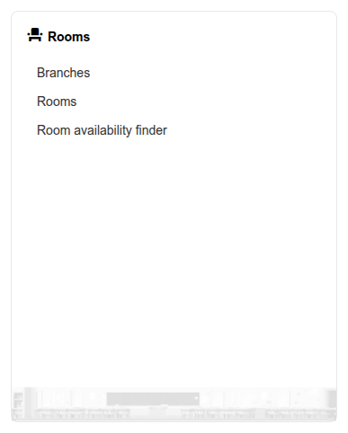

# Salas

El bloque **Salas** del tablero de administración gestiona las ubicaciones físicas que Chamilo puede registrar para la formación presencial o semipresencial: sedes (sitios), las salas que contienen y una herramienta para averiguar qué salas están libres en un momento determinado.

Este capítulo trata la gestión de sedes y salas desde el lado del administrador. Para el lado del docente — asignar una sala a una sesión de curso — consulte [Sedes y salas](../../teacher-guide/branches-and-rooms.md) en la Guía del docente.

## Acceso al bloque Salas

Desde el panel de administración, el bloque **Salas** aparece junto a los demás bloques del tablero. Haga clic en cualquiera de sus enlaces para abrir la herramienta correspondiente.

## Contenido del bloque

* **[Gestión de salas](managing-rooms.md)** — Crear y organizar sedes (sitios) y las salas de cada una
* **[Buscador de disponibilidad de salas](room-availability-finder.md)** — Comprobar qué salas están libres para una fecha y un intervalo horario determinados

## Nota sobre multi-URL

En una instalación multi-URL (multiinquilino), las sedes y las salas están asociadas a una única URL de acceso cada una: nunca se comparten entre portales.