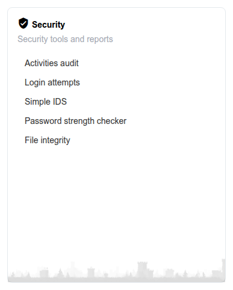

# Seguridad

El bloque **Seguridad** del panel de administración agrupa las herramientas integradas de supervisión y auditoría de seguridad de la plataforma. Es independiente de [Configuración de seguridad](../platform-settings/security-settings.md), que configura la *política* de seguridad (reglas de contraseñas, CAPTCHA, cabeceras de seguridad HTTP, etc.); este bloque proporciona los *informes y las herramientas* que supervisan la plataforma en busca de actividad sospechosa y cambios no deseados.

El bloque se introdujo en Chamilo 2.0 con cuatro herramientas y se amplió en Chamilo 3.0 con una quinta, **Integridad de archivos**.

## Acceso al bloque Seguridad

Desde el panel de administración, el bloque **Seguridad** aparece junto a los demás bloques del panel (Usuarios, Cursos, Gestión de la plataforma, Sistema, etc.). Haga clic en cualquiera de sus enlaces para abrir la herramienta correspondiente.

## Contenido del bloque

* **[Auditoría de actividades](activities-audit.md)** — Consulte los eventos administrativos y de la plataforma importantes (cambios de usuarios, cursos, sesiones y otros) según el tipo de evento
* **[Intentos de inicio de sesión](login-attempts.md)** — Revise los intentos de inicio de sesión fallidos y correctos, con gráficos y un registro consultable
* **[IDS simple](simple-ids.md)** — Consulte las solicitudes señaladas por el sistema de detección de intrusiones integrado y ligero de Chamilo
* **[Comprobador de fortaleza de contraseñas](password-strength-checker.md)** — Analice los usuarios activos para detectar contraseñas que coincidan con una lista de contraseñas de uso habitual
* **[Integridad de archivos](file-integrity.md)** *(nuevo en Chamilo 3.0)* — Detecte adiciones, modificaciones, eliminaciones o cambios de permisos inesperados en los archivos instalados

## Flujo de trabajo adicional de informes confidenciales

[Informes confidenciales](confidential-reporting.md) es una función opcional de informes e investigación controlada por permisos. Es independiente de las cinco herramientas de supervisión para administradores enumeradas anteriormente.

## Quién puede acceder

Las cinco herramientas requieren acceso de **Administrador del portal**. Las acciones de análisis, pausa y restablecimiento de la línea base de Integridad de archivos requieren además acceso de **Administrador global**, y pausar las alertas o establecer una nueva línea base exige volver a introducir la propia contraseña; consulte [Integridad de archivos](file-integrity.md#actions) para obtener más detalles.