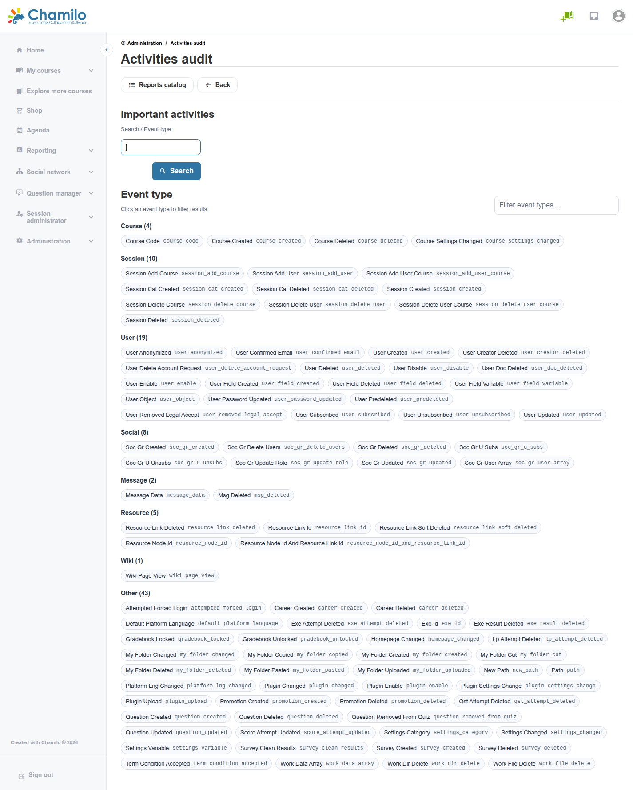

# Auditoría de actividades

El informe de auditoría de actividades permite consultar las actividades administrativas y de la plataforma más importantes, filtradas por tipo de evento. Se trata del mismo informe subyacente al que antes se accedía desde **Seguimiento > Auditoría de actividad administrativa**; ahora también está enlazado directamente desde el bloque Seguridad, ya que es principalmente una herramienta de seguridad y rendición de cuentas.

## Acceso a la auditoría de actividades

Desde el panel de administración, haga clic en **Seguridad > Auditoría de actividades**.

## Qué muestra

Los eventos se agrupan en categorías:

* **Curso** — Creación y eliminación de cursos, y cambios de configuración
* **Sesión** — Creación y eliminación de sesiones y categorías de sesión, y cambios de inscripción
* **Usuario** — Creación y eliminación de cuentas, actualizaciones de contraseña, cambios de campos y más
* **Social** — Creación y eliminación de grupos sociales, y cambios de pertenencia
* **Mensaje** — Cambios y eliminaciones de datos de mensajes
* **Recurso** — Creación y eliminación de recursos y de enlaces de recursos
* **Wiki** — Visualizaciones de páginas wiki
* **Otros** — Todo lo demás, incluida la actividad de plugins, el bloqueo de la libreta de calificaciones, las eliminaciones de intentos de ejercicios, los intentos de inicio de sesión forzado y los cambios de configuración a nivel de plataforma

Haga clic en una etiqueta de tipo de evento (por ejemplo, **Intento de inicio de sesión forzado**) para filtrar el informe y mostrar una tabla de entradas coincidentes. También puede buscar directamente por palabra clave mediante el campo **Buscar** situado encima de la lista de tipos de evento.

## Casos de uso

* Investigar quién eliminó un curso, una sesión o una cuenta de usuario, y cuándo
* Confirmar si un cambio administrativo concreto (una actualización de configuración, la instalación de un plugin) fue realizado por el administrador esperado
* Dar seguimiento a los eventos **Intento de inicio de sesión forzado** junto con el informe [Intentos de inicio de sesión](login-attempts.md)