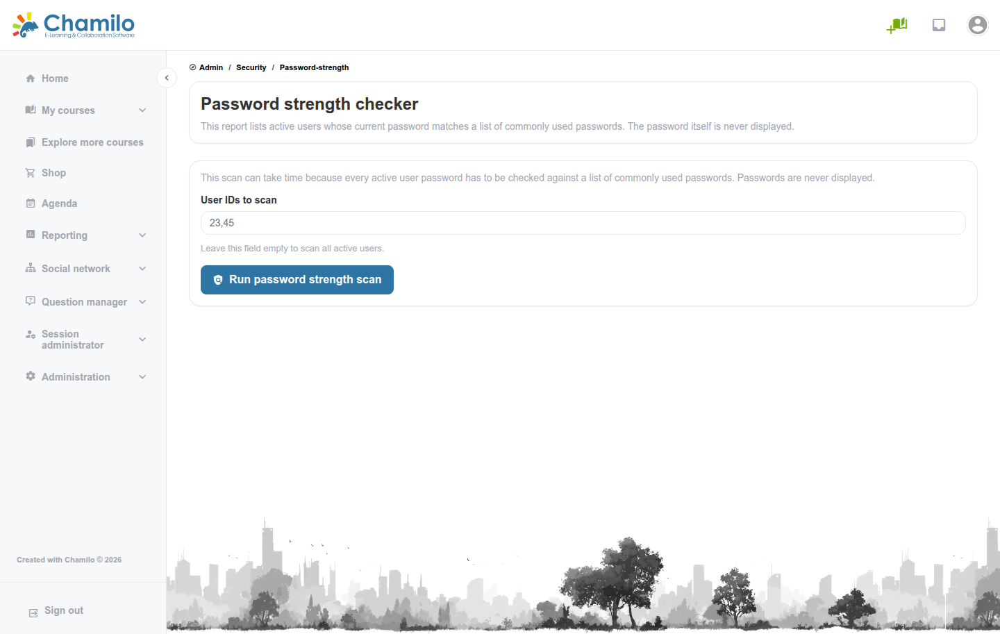
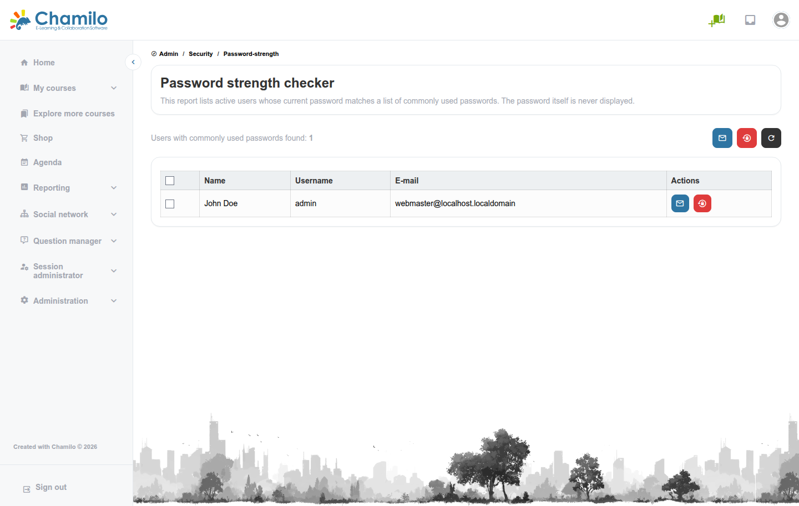

# Comprobador de fortaleza de contraseñas

El comprobador de fortaleza de contraseñas compara los hashes de contraseña almacenados de los usuarios activos con una lista breve de contraseñas de uso habitual (`123456`, `password`, `qwerty123` y similares). Nunca muestra ni transmite las contraseñas en sí, sino únicamente si la contraseña actual de un usuario coincide con alguna de las candidatas conocidas como débiles.

## Acceso al comprobador de fortaleza de contraseñas

Desde el panel de administración, haga clic en **Seguridad > Comprobador de fortaleza de contraseñas**.

## Ejecución de un análisis

* Deje **ID de usuario que analizar** vacío para analizar a todos los usuarios activos, o introduzca una lista de ID de usuario separados por comas para comprobar un subconjunto
* Haga clic en **Ejecutar análisis de fortaleza de contraseñas**

El análisis se ejecuta de forma asíncrona en segundo plano para no bloquear la página, y muestra el progreso en tiempo real (usuarios verificados hasta el momento, del total, y cuántas contraseñas débiles se han encontrado). Como cada contraseña candidata debe comprobarse con el hash de cada usuario seleccionado, analizar a todos los usuarios en una plataforma grande puede llevar un tiempo; la lista de candidatas se mantiene intencionadamente breve para limitar este coste.

## Actuación sobre los resultados

Una vez finalizado el análisis, los usuarios marcados se enumeran con dos acciones disponibles, ya sea por usuario o como acción masiva para todos los usuarios seleccionados:

* **Solicitar cambio de contraseña** (icono de sobre) — Envía al usuario un correo electrónico pidiéndole que cambie su contraseña
* **Forzar restablecimiento de contraseña** (icono de restablecimiento) — Invalida de inmediato la contraseña actual del usuario y le envía una nueva por correo electrónico

Ambas acciones vuelven a verificar a los usuarios seleccionados con la lista de contraseñas débiles antes de actuar, de modo que una solicitud obsoleta o manipulada no pueda utilizarse para restablecer una cuenta que ya no tiene una contraseña débil.

## Desactivación de cuentas con contraseñas débiles

Una vez que el análisis identifica las cuentas con contraseñas débiles, los administradores autorizados pueden desactivar una cuenta elegible de forma individual o seleccionar varias cuentas y usar **Desactivar cuentas seleccionadas**. Confirme la acción antes de continuar. La herramienta también conserva las acciones de remediación existentes de restablecimiento de contraseña.

El comprobador restringe los análisis y la remediación a la URL de acceso aplicable. No permite que los administradores desactiven sus propias cuentas ni otras cuentas administrativas mediante este flujo de trabajo. Una cuenta desactivada necesitará un proceso de reactivación autorizado adecuado antes de que la persona pueda volver a iniciar sesión. Véase [PR de desactivación por contraseña débil n.º 9373](https://github.com/chamilo/chamilo-lms/pull/9373).

## Ilustración del castillo de contraseñas

La página de seguridad incluye una demostración localizada del **castillo de contraseñas**; la pantalla de cambio de contraseña también utiliza la guía visual. Ilustra características progresivas de la fortaleza de la contraseña, pero es una **ilustración**, no un sustituto de la validación real de la política de contraseñas. La contraseña de demostración no se envía ni se almacena en el visualizador. Siga aplicando la política de contraseñas configurada en lugar de basarse únicamente en la imagen. Véase [PR del castillo de contraseñas n.º 9447](https://github.com/chamilo/chamilo-lms/pull/9447).

## Uso recomendado

* Ejecute este análisis periódicamente, especialmente después de una importación masiva de usuarios (las cuentas importadas a veces se entregan con contraseñas predeterminadas sencillas)
* Combínelo con los ajustes **Requisitos mínimos de sintaxis de contraseña** y **Intervalo de rotación de contraseñas** de [Ajustes de seguridad](../platform-settings/security-settings.md) para impedir que se establezcan contraseñas débiles desde el principio, en lugar de detectarlas únicamente a posteriori