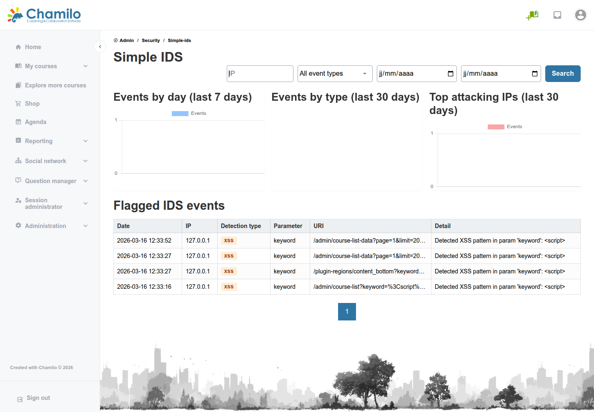

# Simple IDS

Chamilo incluye un sistema de detección de intrusiones (IDS) ligero e integrado en la aplicación. En cada solicitud, analiza los parámetros de consulta de la URL, la ruta de la solicitud y un par de encabezados (`User-Agent`, `Referer`) en busca de firmas de ataque habituales —por ejemplo, cargas útiles XSS o patrones de path traversal— y registra cualquier elemento sospechoso. La página Simple IDS permite revisar lo que ha marcado.

Los **cuerpos** de las solicitudes no se analizan de forma intencionada, para evitar falsos positivos procedentes del contenido del editor de texto enriquecido (el texto de los cursos contiene de forma legítima marcado similar a HTML/JavaScript).

## Acceso a Simple IDS

Desde el panel de administración, haga clic en **Seguridad > Simple IDS**.

## Qué muestra

* **Eventos por día (últimos 7 días)**, **Eventos por tipo (últimos 30 días)** y **Principales IP atacantes (últimos 30 días)** — Gráficos de resumen
* **Tabla de eventos IDS marcados** — Cada entrada muestra la fecha, la IP de origen, el tipo de detección (por ejemplo, `XSS`), el parámetro afectado, el URI de la solicitud y una breve descripción de lo detectado

Utilice los filtros de **IP**, tipo de evento e intervalo de fechas situados encima de los gráficos para acotar los resultados.

## Cómo funciona

* Cada solicitud se analiza a la entrada; las coincidencias se añaden a `var/logs/ids/ids_events.log`
* A la salida, el mismo suscriptor añade a la respuesta los encabezados de seguridad recomendados por OWASP
* Si el bloqueo está activado, una solicitud que coincida con una firma se detiene de inmediato con una respuesta HTTP 400 en lugar de llegar al código de la aplicación

## Configuración

Simple IDS se controla mediante variables de entorno, definidas en `config/packages/chamilo_ids.yaml`:

| Variable | Finalidad |
|----------|---------|
| `IDS_ENABLED` | Activa o desactiva el análisis y el registro de las solicitudes |
| `IDS_BLOCK` | Cuando está activada, una solicitud detectada se rechaza (HTTP 400) en lugar de limitarse a registrarla |
| `IDS_SECURITY_HEADERS` | Controla si se añaden los encabezados de respuesta recomendados por OWASP |

Se trata de un detector ligero y de mejor esfuerzo, pensado para captar intentos evidentes de sondeo y explotación; no sustituye a un cortafuegos de aplicaciones web (WAF) dedicado en despliegues de alto riesgo.