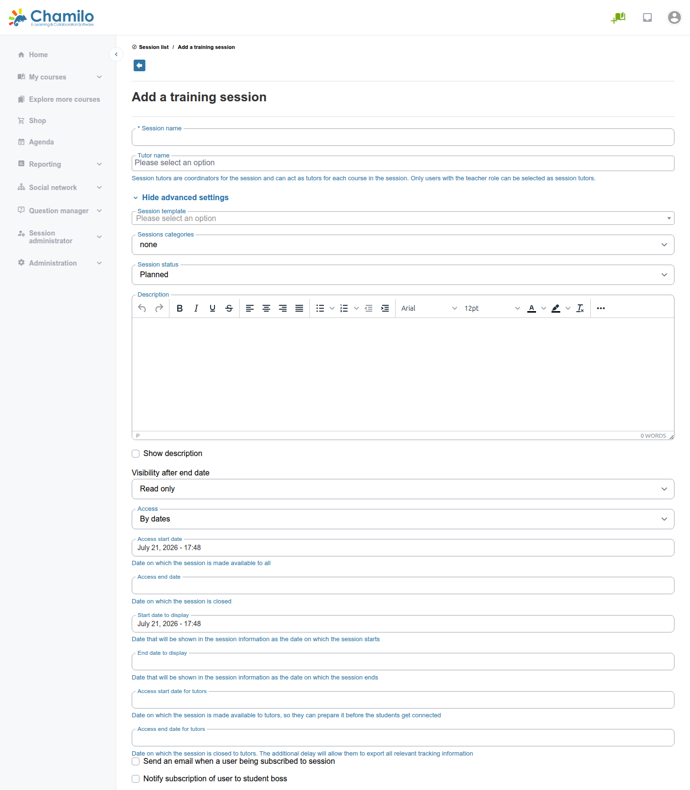
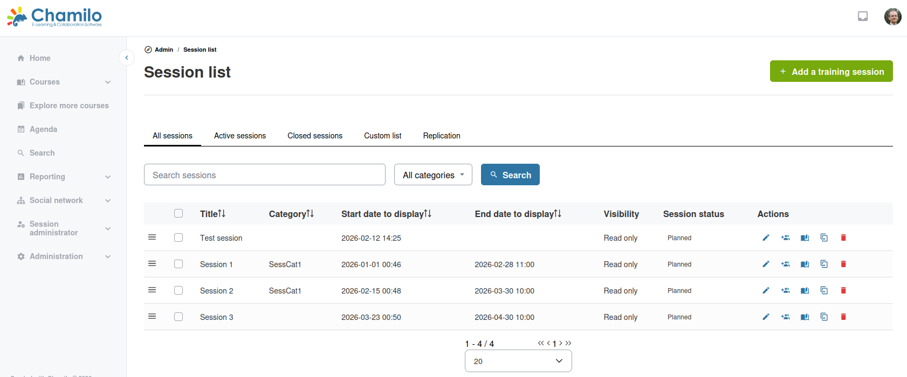
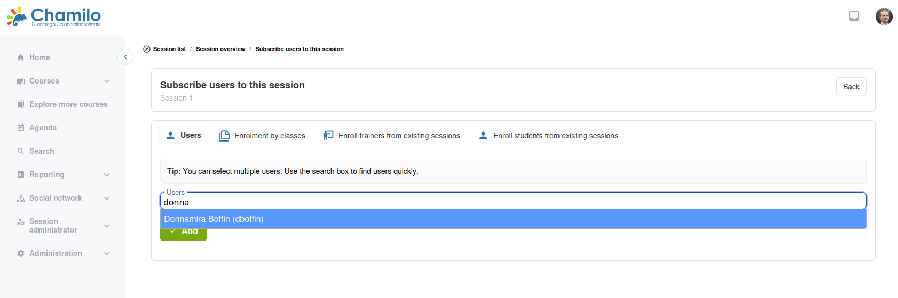

# Gestión de sesiones

## Creación de una sesión

1. Desde el panel de administración, haga clic en **Crear una sesión**
2. Complete los datos de la sesión:
   * **Nombre de la sesión** — Un nombre descriptivo (p. ej., «Incorporación primavera 2026»)
   * **Fechas de inicio y fin** — Cuándo se desarrolla la sesión (opcional: las sesiones pueden no tener fecha de cierre). Hay 3 conjuntos de fechas: fechas para mostrar, fechas para limitar el acceso de los estudiantes y fechas para limitar el acceso de los tutores
   * **Tutor de la sesión** — La persona que supervisa toda la sesión
   * **Categoría** — Asigne la sesión a una categoría para organizarla
   * **Visibilidad** — Controle el acceso y el comportamiento en los listados
3. **Añadir cursos** — Seleccione uno o varios cursos para incluirlos en la sesión
4. **Inscribir estudiantes** — Añada usuarios individuales o clases de usuarios
5. **Asignar tutores de curso** — Para cada curso, asigne un docente (tutor de curso)
6. Guarde

## Fechas de la sesión

Las sesiones admiten una configuración flexible de fechas:

| Fecha | Finalidad |
|------|---------|
| **Inicio/fin de visualización** | Cuándo aparece la sesión en los listados de los estudiantes |
| **Inicio/fin de acceso** | Cuándo los estudiantes pueden acceder realmente al contenido de la sesión |
| **Inicio/fin de acceso del tutor** | Cuándo los tutores pueden acceder a la sesión (a menudo comienza antes y termina después del acceso de los estudiantes) |

Esto le permite preparar la sesión antes de que lleguen los estudiantes y mantener abierto el acceso de los tutores después de que finalice la sesión para la calificación y la elaboración de informes.

## Lista de sesiones

La lista de sesiones muestra todas las sesiones con:

* Nombre de la sesión
* Fechas de inicio y fin
* Estado (activa, próxima, pasada)

Utilice la búsqueda y los filtros para encontrar sesiones por nombre, fecha, categoría o estado.

## Edición de una sesión

Haga clic en una sesión para editarla:

* Cambiar las fechas, el nombre o la categoría
* Añadir o eliminar cursos
* Cambiar los tutores de curso
* Añadir o eliminar estudiantes
* Ver los datos de seguimiento de la sesión

## Inscripción de usuarios

Puede inscribir usuarios en una sesión mediante:

* **Inscripción individual** — Busque y añada usuarios individuales
* **Inscripción por clase** — Añada una clase completa (grupo de usuarios predefinidos) de una sola vez
* **Importación CSV** — Cargue un archivo con las asignaciones de usuario y sesión

## Acceso a las sesiones

Los estudiantes acceden a sus sesiones a través de **Mis sesiones** en la barra lateral. Las sesiones se organizan en:

* **Sesiones actuales** — Actualmente activas
* **Sesiones pasadas** — Finalizadas
* **Sesiones próximas** — Aún no iniciadas

## Inscripción mediante API

Los sistemas externos pueden utilizar la [API de inscripción de estudiantes en sesiones](../../developer-guide/api/session-students.md) para listar los identificadores de los estudiantes, añadir estudiantes seleccionados o eliminar estudiantes seleccionados. Estas rutas requieren permisos de administrador de la plataforma y conservan las demás inscripciones cuando se envía una nueva lista de identificadores.

## Consejos

* **Planifique las fechas con cuidado** — Asegúrese de que las fechas de acceso de los tutores se extiendan más allá de las fechas de los estudiantes, de modo que los tutores puedan preparar la sesión y hacer el seguimiento
* **Utilice clases para inscripciones recurrentes** — Si inscribe con frecuencia a los mismos grupos, cree clases y asígnelas a las sesiones
* **Mantenga las sesiones organizadas** — Utilice categorías y convenciones de nomenclatura claras para facilitar la gestión