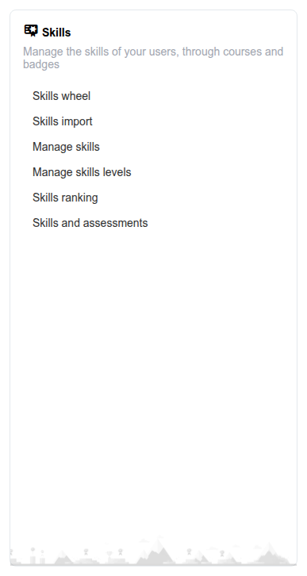

# Competencias

El bloque **Competencias** del panel de administración agrupa las herramientas para definir, organizar y hacer seguimiento de las insignias de competencia («competencias») en toda la plataforma. Una competencia puede otorgarse automáticamente cuando un estudiante alcanza un umbral del libro de calificaciones, completa cursos específicos o de forma manual por un docente, y puede incluir un icono tipo insignia y un nivel (por ejemplo, Bronce/Plata/Oro).

El bloque completo solo aparece si el ajuste **Activar la herramienta de competencias** (`skill.allow_skills_tool`, en Ajustes de configuración > Competencias) está activado; está habilitado de forma predeterminada.

## Acceso al bloque Competencias

Desde el panel de administración, el bloque **Competencias** aparece junto a los demás bloques del panel. Haga clic en cualquiera de sus enlaces para abrir la herramienta correspondiente.

## Contenido del bloque

* **[Gestión de competencias](managing-skills.md)** — Cree competencias, impórtelas de forma masiva y asigne cada una a una escala de niveles
* **[Rueda de competencias](skills-wheel.md)** — Un mapa visual ampliable de todo el árbol de competencias
* **[Clasificación de competencias](skills-ranking.md)** — Una tabla de clasificación de usuarios según las competencias adquiridas
* **[Competencias y evaluaciones](skills-assessments.md)** — Vincule las categorías del libro de calificaciones con las competencias que otorgan

## Ajustes relacionados

Otros ajustes en Ajustes de configuración > Competencias determinan quién puede hacer qué con este bloque:

* **Permitir la gestión de competencias a RR. HH.** (`allow_hr_skills_management`) — Permite a los usuarios con el rol de responsable de recursos humanos gestionar competencias junto con los administradores
* **Permitir competencias privadas** (`allow_private_skills`)
* **Los docentes pueden asignar competencias** (`skills_teachers_can_assign_skills`)
* **Ocultar niveles de competencia** (`hide_skill_levels`)
* **Mostrar el nombre completo de la competencia en la rueda de competencias** (`show_full_skill_name_on_skill_wheel`)