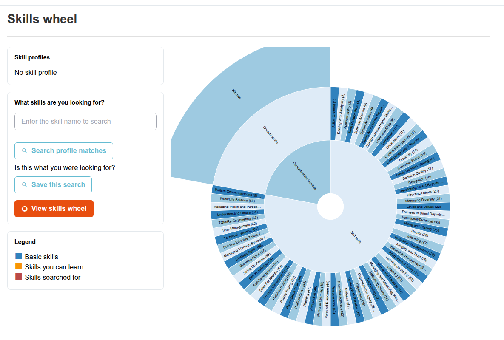
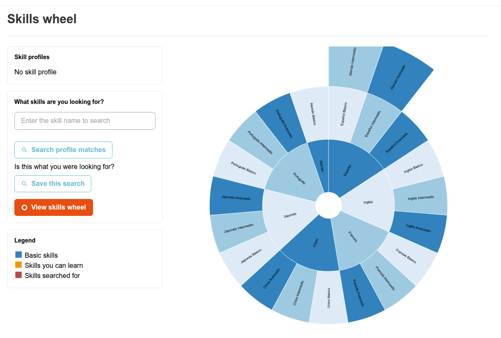
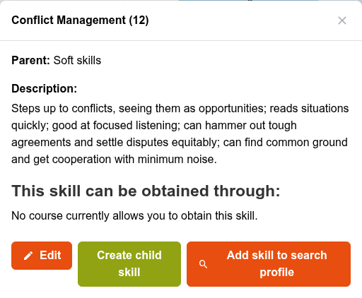

# Rueda de competencias

La Rueda de competencias es un diagrama ampliable con forma de rueda de todo el árbol de competencias: una alternativa visual a la consulta de la lista plana en [Gestión de competencias](managing-skills.md).

## Acceso a la Rueda de competencias

Desde el panel de administración, haga clic en **Competencias > Rueda de competencias**.

## Qué muestra

Cada segmento de la rueda es una competencia, que se puede expandir para mostrar sus competencias hijas. Un segmento indica si la competencia tiene un libro de calificaciones vinculado (véase [Competencias y evaluaciones](skills-assessments.md)) y, al consultar a un usuario concreto, si ese usuario ya la ha alcanzado.

Haga clic en un segmento para ampliarlo y mostrar sus competencias hijas; haga clic en el círculo central para volver a alejar la vista. El explorador moderno también muestra la jerarquía actual como migas de pan, de modo que puede retroceder por sus ramas.

### Exploración y búsqueda de competencias (3.1)

La rueda actualizada utiliza un **explorador de estilo 3D** adaptable, con un efecto de profundidad al desplazar el puntero por el diagrama. Se trata de una visualización de la jerarquía de competencias, no de un conjunto distinto de competencias.

* Abra **¿Qué competencias está buscando?** para buscar por nombre de competencia. Puede seleccionar varias competencias y, a continuación, usar **Ver rueda de competencias** para localizar una competencia seleccionada en la jerarquía.
* Pulse `/` o **Ctrl+K** (en macOS, **Cmd+K**) cuando no esté escribiendo en un campo de formulario para abrir el diálogo de búsqueda.
* Use el **Modo de enfoque** para obtener una vista ampliada de la rueda; **Esc** sale del Modo de enfoque. El control **Ayuda** explica la navegación y la leyenda.
* Seleccione una competencia para abrir su inspector contextual, con el código de la competencia, la descripción, la jerarquía de padres y los cursos o evaluaciones mediante los cuales se puede adquirir, cuando estén disponibles.

El inspector de detalles de la competencia ofrece **Editar**, **Crear competencia hija** y **Añadir competencia al perfil de búsqueda** a los administradores y responsables de recursos humanos autorizados. Tras crear o editar una competencia desde la rueda, la interfaz vuelve al contexto de la rueda en lugar de llevarle a una lista no relacionada.

Haga clic con el botón derecho en un segmento para abrir sus detalles: descripción, competencia padre y los cursos (si los hay) que la otorgan. Desde este diálogo, los administradores también pueden editar la competencia, crear una competencia hija bajo ella o añadirla a la búsqueda de perfiles descrita a continuación.

Los usuarios administradores y con el rol Responsable de recursos humanos también disponen aquí de una búsqueda de perfiles: las competencias se pueden agrupar en «perfiles» (conjuntos de competencias esperadas para un rol o una descripción de puesto determinados), y esta página permite buscar usuarios cuyas competencias adquiridas coincidan con un perfil dado, lo que resulta útil para identificar quién está preparado para un rol o dónde se encuentran las carencias en un equipo.

### Uso de los perfiles de competencias

El control **Perfiles de competencias** está disponible para administradores y responsables de recursos humanos. Ábralo para encontrar perfiles guardados y buscar usuarios cuyas competencias coincidan con ellos. También puede seleccionar varias competencias en el diálogo de búsqueda y elegir **Buscar coincidencias de perfil** o **Guardar esta búsqueda**. Estas acciones de gestión de perfiles están restringidas por rol; no todas las personas que consultan la rueda las ven.

Esta mejora de la interfaz se implementó en [PR #9201](https://github.com/chamilo/chamilo-lms/pull/9201).